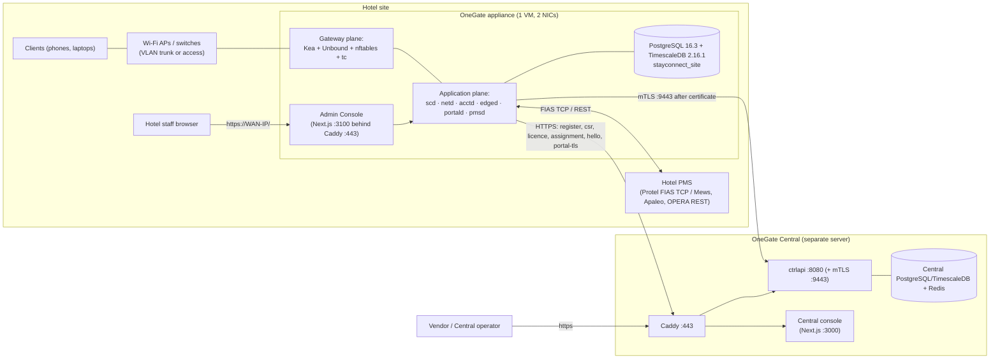
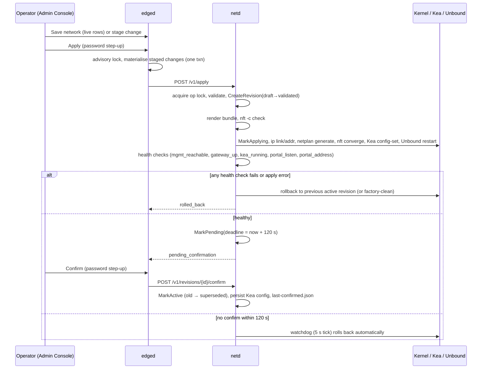
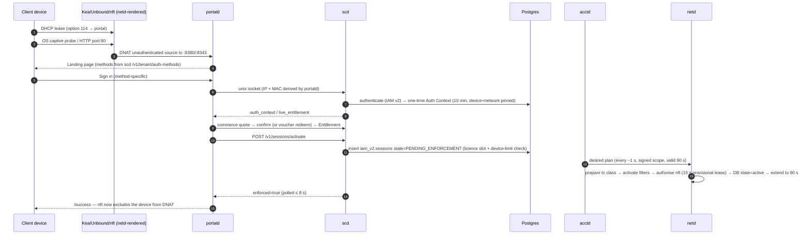
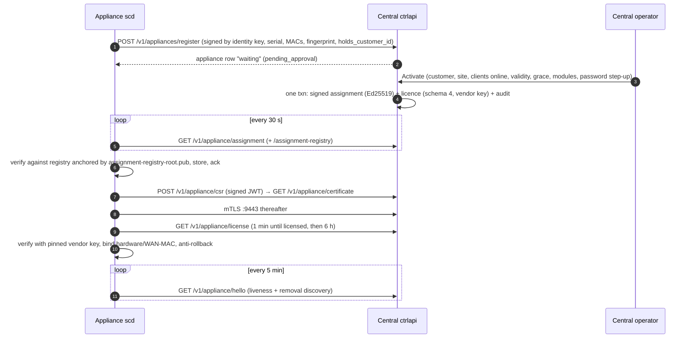
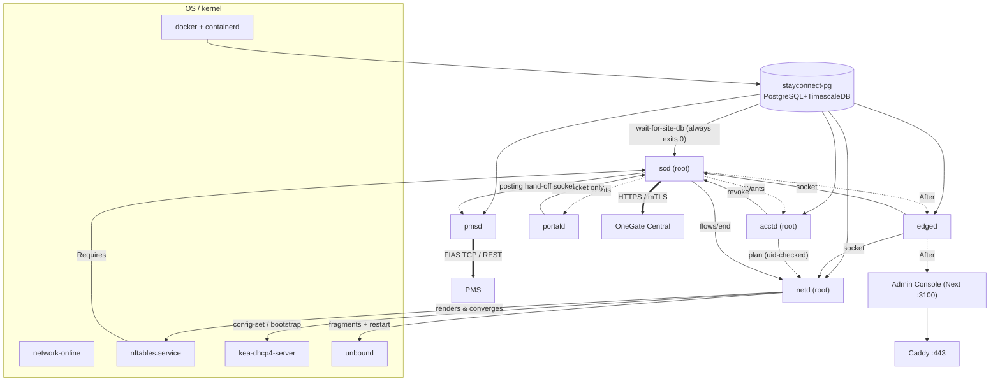

# OneGate Complete Technical Architecture & System Handbook

| | |
|---|---|
| **Status** | Authoritative current-state reference (not a historical snapshot) |
| **Reviewed against** | `master` at `7e4686ae56a229ef05460e02675d1d17924f8c9c` (2026-10-26); install path (sections 7.5, 16, 22–24) updated by the fresh-VM installer mission, 2026-10-27; certificate enrollment (section 9.3, finding F1) corrected 2026-10-27; installer acceptance on the test pair (R1–R3, manual A3.7) 2026-10-27 |
| **Fresh-VM validation** | A new Central and a new appliance on VMware ESXi / Ubuntu 22.04.5, isolated from PRE-LIVE and the production Central, 2026-10-27 — labelled **[VM]** (installation manual Appendix 3) |
| **Live environments inspected (read-only)** | PRE-LIVE appliance `172.21.60.25` and OneGate Central `172.21.96.196`, 2026-10-26 |
| **Companion documents** | [Fresh VM Installation & Configuration Manual](../runbooks/ONEGATE_FRESH_VM_INSTALLATION_MANUAL.md) · [Machine-readable inventory](../inventory/onegate-components.json) |
| **Supersedes** | [SYSTEM_OVERVIEW.md](../SYSTEM_OVERVIEW.md) (historical snapshot of 2026-07-10) as the whole-system reference |

> **How to read this handbook.** Every non-obvious fact carries a *verification label* (section 0.2). Where the repository, a
> document and a live host disagree, the disagreement is stated, not smoothed over. Anything that could not be established
> without exercising a real environment is listed in [section 22](#22-genuinely-unverified-facts) rather than guessed.
> Product words follow [PRODUCT_TERMINOLOGY.md](../PRODUCT_TERMINOLOGY.md): **Admin Console** (the on-appliance
> administration application, formerly "Hotel Admin"), **Client** (the end user), **Client network**, **Client Portal**.
> Internal identifiers (`guest_networks`, `hotel-admin`, `stayconnect-*` unit names, `iam_v2`) are unchanged by the rename.

## Contents

0. [Scope, conventions and verification labels](#0-scope-conventions-and-verification-labels)
1. [What OneGate is](#1-what-onegate-is)
2. [Top-level architecture](#2-top-level-architecture)
3. [Technology inventory and versions](#3-technology-inventory-and-versions)
4. [Repository map](#4-repository-map)
5. [Appliance runtime components](#5-appliance-runtime-components)
6. [Appliance on-disk layout, sockets and ports](#6-appliance-on-disk-layout-sockets-and-ports)
7. [Data layer: PostgreSQL, TimescaleDB, Redis, schemas, migrations](#7-data-layer)
8. [Docker, Compose and systemd](#8-docker-compose-and-systemd)
9. [Caddy, TLS and PKI](#9-caddy-tls-and-pki)
10. [Linux networking: netplan, nftables, Kea, Unbound, shaping](#10-linux-networking)
11. [Client journey: sign-in, entitlement, sessions, accounting](#11-client-journey)
12. [PMS integrations](#12-pms-integrations)
13. [Commerce, payments and finance](#13-commerce-payments-and-finance)
14. [OneGate Central: control plane, registration, assignment, licensing](#14-onegate-central)
15. [Module and capability model](#15-module-and-capability-model)
16. [Backups, disaster recovery and upgrades](#16-backups-disaster-recovery-and-upgrades)
17. [Security, RBAC and audit](#17-security-rbac-and-audit)
18. [Monitoring, logging and health](#18-monitoring-logging-and-health)
19. [CI/CD and governance](#19-cicd-and-governance)
20. [Dependency map, start-up relationships and failure-impact matrix](#20-dependency-map-start-up-and-failure-impact)
21. [Component status register (deployed / optional / disabled / historical / not implemented)](#21-component-status-register)
22. [Genuinely unverified facts](#22-genuinely-unverified-facts)
23. [Obsolete or contradictory documentation](#23-obsolete-or-contradictory-documentation)
24. [Missing install automation and open decisions](#24-missing-install-automation-and-open-decisions)
25. [Evidence references](#25-evidence-references)

---

## 0. Scope, conventions and verification labels

### 0.1 Scope

This handbook describes the OneGate product as it exists on `master`: the **hotel appliance** (a single Linux VM or
machine installed at each site) and **OneGate Central** (a separate server that provides identity, activation and
licensing only). It covers languages, daemons, sockets, data stores, networking, sign-in and entitlement flow, PMS,
commerce, security, backup/DR, CI/CD and the dependencies between all of them.

Out of scope: product marketing, per-screen UI guides (see [user-guide/](../user-guide/)), and historical phase plans
(see [section 23](#23-obsolete-or-contradictory-documentation)).

### 0.2 Verification labels

| Label | Meaning |
|---|---|
| **[CODE]** | Verified by reading the source / scripts / unit files in the repository at the reviewed SHA. |
| **[LIVE]** | Verified by read-only inspection of the actual PRE-LIVE appliance or Central on 2026-10-26 (names, modes, versions, listeners; no secret value was read or recorded). |
| **[DISPOSABLE]** | Verified on a disposable test database or container built from the repository (e.g. schema object counts). |
| **[VM]** | Executed on the fresh, isolated test VM pair (new Central + new appliance, VMware ESXi, Ubuntu 22.04.5) on 2026-10-27; evidence in the installation manual's Appendix 3. |
| **[SELFTEST]** | Covered by a self-test in `scripts/ci/` or a script's own `--self-test`. |
| **[DOC]** | Stated by a repository document, **not** exercised in this mission. The document is named. |
| **[PO]** | Unsupported, or requires a separate Product Owner decision/authorisation before it can be done or relied on. |
| **[UNVERIFIED]** | Could not be established from the repository or a safe read-only inspection. Listed again in section 22. |

A statement with several labels, for example **[CODE][LIVE]**, was confirmed in both places.

### 0.3 Conventions

* Paths are repository-relative unless they begin with `/` (a path on a deployed host).
* "The appliance" is the per-site machine. "Central" is OneGate Central. They are **never** combined on one host.
* Product-owner standing decisions that shape the architecture (CLAUDE.md §0D/§0E): Central serves an appliance for
  identity, activation and licensing only; the hotel's operations (Clients, sessions, PMS, accounting, reports) live
  on the appliance and **no Client data goes to Central**.
* Go-Live is not authorised. PRE-LIVE remains PRE-LIVE.

---

## 1. What OneGate is

OneGate is a captive-portal / network-access gateway for hotels and similar venues. A site installs one appliance. Each
appliance:

* serves **Client networks** (VLANs/bridges) with DHCP (Kea), DNS (Unbound), NAT, an nftables captive-portal gate and
  per-session traffic shaping;
* presents a **Client Portal** where a Client signs in (voucher, staff-created account, email account, SMS/WhatsApp
  code, social login, open selection, or — when a PMS is connected — room number and name);
* grants time/data-limited access packages (free, prepaid voucher, card payment, room charge to the PMS);
* mirrors a PMS (Protel FIAS in production; Mews, Apaleo and OPERA Cloud are REST connectors verified at contract
  level only) and can post room charges back;
* is administered locally through the **Admin Console** (Next.js) on its management address;
* is **local-first**: it keeps operating if Central or the PMS is unreachable, authorising from its last-good mirrored
  roster and its persisted signed licence.

**OneGate Central** is a separate server that holds the vendor's signing keys and the appliance fleet registry. It
registers appliances, lets an operator **Activate** one for a customer and site, issues the signed **assignment** and
**licence**, issues the appliance's mutual-TLS client certificate, and manages the Client Portal hostname/certificate
lifecycle. It never dials an appliance and receives no Client data.

---

## 2. Top-level architecture

### 2.1 System context

### 2.2 Planes

| Plane | Components | Trust level |
|---|---|---|
| **Gateway (kernel / OS)** | nftables table `inet stayconnect`, bridges/VLANs, `tc` HTB+IFB shaping, conntrack, Kea DHCPv4, Unbound DNS, netplan/systemd-networkd | Rendered and applied only by `netd` (root). |
| **Guest-facing** | `portald` (Client Portal, :8380/:8343) | Unprivileged, own user, **no database access**, talks only to `scd` over a unix socket. |
| **Authority** | `scd` (root) | Owns Client authentication, entitlement-to-session, licence state, Central link, sealing keys, backups, portal TLS keys. |
| **Enforcement** | `acctd` (root) → `netd` (root) | `acctd` produces the desired shaping/authorisation plan from durable state; `netd` is the sole writer of the Phase-3 authorisation set and tc classes. |
| **Operator** | `edged` (Admin Console API, user `stayconnect`), Admin Console (Next.js, user `stayconnect-hotel-admin`), Caddy | Staff authentication, RBAC, audit. |
| **PMS** | `pmsd` (user `stayconnect-pmsd`) | Most sandboxed unit; DB-only plus PMS sockets. |
| **Data** | Docker container `stayconnect-pg` (TimescaleDB image) + least-privilege `svc_*` roles | Loopback only. |

### 2.3 Key architectural properties

1. **Edge-first / local-first** — every guest-affecting decision is made on the appliance from persisted state. [CODE][DOC: OFFLINE_OPERATION.md]
2. **Least privilege by construction** — eight `svc_*` LOGIN database roles with no superuser/bypass, SECURITY DEFINER "controlled writer" functions for sessions/accounting, and a start-up `writerguard.Verify` that refuses to run with a broken boundary. [CODE]
3. **Fail-closed enforcement** — kernel authorisation entries are short leases (≤ 90 s) renewed by reconciliation; a dead producer or netd means access lapses, not persists. [CODE]
4. **Signed trust chain** — vendor licence key, assignment signing key + registry root, Central TLS CA and an appliance CA (offline Root + online Intermediate) are four separate trust objects. [CODE]
5. **No tenant/site in configuration** — identity comes from a verified signed assignment, never from an environment file in a production build. [CODE]
6. **Everything the appliance says to Central is HTTPS to `ctrlapi`** — seven endpoint families, all licensing/identity (CLAUDE.md §0E). No telemetry, bus, command channel or update agent exists on the appliance. [CODE]

---

## 3. Technology inventory and versions

### 3.1 Languages and toolchains

| Technology | Version (source) | Where used | Label |
|---|---|---|---|
| Go | `go 1.25.0` in `data-plane/go.mod` and `control-plane/go.mod`; `go 1.25` in `license/go.mod`; **builds use `golang:1.25.12`** container (`scripts/build-appliance-binaries.sh`, `deploy/scripts/central-build.sh`) | All daemons (appliance and Central), licence library | [CODE] |
| Node.js | CI/build `20` (`node:20.18.0-bookworm-slim` in `central-build.sh`); recorded minimum runtime `18.17.0`; **installed on both live hosts: v20.20.2** (NodeSource) | Admin Console and Central console (Next standalone `node server.js`) | [CODE][LIVE] |
| TypeScript | 5.5.3 | Both consoles | [CODE] |
| Python 3 | 3.12 in CI; 3.10.6 on live hosts (Ubuntu 22.04) | `tools/*.py`, cert and key helper scripts, `scram_verifier.py` | [CODE][LIVE] |
| Bash | — | Install/deploy/test scripts | [CODE] |
| SQL (psql migrations) | PostgreSQL 16 dialect | `data-plane/migrations`, `control-plane/migrations` | [CODE] |

### 3.2 Go dependencies (direct)

| Module | Version | Purpose (from import sites) |
|---|---|---|
| `github.com/go-chi/chi/v5` | v5.1.0 | HTTP router (all daemons) |
| `github.com/jackc/pgx/v5` | v5.7.1 | PostgreSQL driver |
| `github.com/prometheus/client_golang` | v1.23.2 | Metrics |
| `filippo.io/age` | v1.2.1 | Backup encryption (appliance) |
| `github.com/pkg/sftp` | v1.13.9 | SFTP destination for erasure-ledger secondary copy / backups |
| `golang.org/x/crypto` | v0.49.0 (appliance) / v0.52.0 (Central) | argon2id, ACME, ssh |
| `golang.org/x/net` | v0.51.0 / v0.54.0 | html, publicsuffix |
| `github.com/redis/go-redis/v9` | v9.7.0 | **Central only** (operator sessions, rate limits) |
| `license` (in-repo, via `replace ../license`) | — | Licence document, signature verification, module catalogue |

No NATS dependency remains (removed 2026-09-27). [CODE]

### 3.3 Front-end

| | Admin Console (`hotel-admin/`) | Central console (`cloud-admin/`) |
|---|---|---|
| Next.js | **15.5.27** | **14.2.5** |
| React / React DOM | 18.3.1 | 18.3.1 |
| Tailwind CSS | 3.4.10 | 3.4.10 |
| Output | `output: "standalone"` | `output: "standalone"` |
| Test | vitest ^3.2.7, Playwright (Chrome + WebKit) | vitest ^3.2.7 |
| Served at | `127.0.0.1:3100` behind Caddy | `127.0.0.1:3000` behind Caddy |

The two consoles are on **different Next.js majors** — deliberate (Admin Console moved to 15.5 for security advisories; see `docs/PHASE4_DEPENDENCY_TRIAGE.md`). [CODE]
The **Client Portal** is not a Next app: it is server-rendered Go `html/template` with inline CSS/JS and no external asset, font or framework, because a Client has no Internet before authentication. [CODE]

### 3.4 Platform software on the live appliance (PRE-LIVE, 2026-10-26)

| Package / component | Live version | Label |
|---|---|---|
| OS | Ubuntu 22.04.5 LTS, kernel 5.15.0-191-generic | [LIVE] |
| Docker Engine / Compose plugin | 29.7.2 / v5.5.0 | [LIVE] |
| containerd.io | 2.3.3 | [LIVE] |
| PostgreSQL (container) | 16.3 (musl build) | [LIVE] |
| TimescaleDB | 2.16.1 (image `timescale/timescaledb:2.16.1-pg16`) | [LIVE][CODE] |
| Redis (container) | `redis:7-alpine` — present, **no consumer in appliance code** | [LIVE][CODE] |
| Caddy | 2.11.4 | [LIVE] |
| Kea DHCPv4 | 2.0.2 (Ubuntu 22.04 archive: `2.0.2-1ubuntu0.1`) | [LIVE] |
| Unbound | 1.13.1 (`1.13.1-1ubuntu5.17`) | [LIVE] |
| nftables | 1.0.2 | [LIVE] |
| Node.js | 20.20.2 | [LIVE] |
| time sync | systemd-timesyncd, clock synchronised, zone UTC | [LIVE] |

Central (172.21.96.196) runs the same OS and image pins with the differences: Docker 29.1.3 (Ubuntu package), Compose 2.40.3, `ufw` active (22/443/9443), no Kea/Unbound/nftables rules of its own, and containers `sc-central-pg` / `sc-central-redis`. [LIVE]

---

## 4. Repository map

| Directory | Contents | Class |
|---|---|---|
| `control-plane/` | Go module "Central": `cmd/{ctrlapi,acceptance,pkitest,regtest}`, `internal/*`, **56** migrations (`0001`–`0056`) | Product |
| `data-plane/` | Go module "appliance": `cmd/{acctd,edged,keybootstrap,netd,phase3-foundation,pmsd,portald,scd,scd-enroll-test,sitemigrate,svc-run}`, **78** internal packages, **158** migrations (`0001`–`0158`) plus `baseline/` and `iam_base/` | Product |
| `license/` | Shared Go module: licence document, verification, modules | Product |
| `hotel-admin/` | Admin Console (Next.js) incl. `e2e/` Playwright and `capability-contract.json` | Product |
| `cloud-admin/` | Central console (Next.js) | Product |
| `design-system/` | `tokens.css` single source of design tokens, copied into both consoles by `tools/sync-design-tokens.mjs` | Product asset |
| `deploy/` | systemd units, Caddyfiles, compose files, env examples, Kea/nftables/netplan/Unbound skeletons, polkit, sysctl, tmpfiles, journald, `gatep/` (DB roles/grants), `pki/` (slots only), `scripts/` (install/deploy/central-*) | Product |
| `scripts/` | `build-appliance-binaries.sh`, `binary-rollback.sh`, `edge-migrate.sh`, `gatep-*.sh`, integration and live e2e harnesses | Tooling / test |
| `tools/` | Governance validators, `full-check.py`, `preflight.sh`, change-manifest tooling | Tooling |
| `.github/workflows/` | 5 workflows (one required check; four dispatch-only gates) | Tooling |
| `governance/` | `project-state.json`, decision register, branch protection model, `transitions/` (T0001–T0258) | Governance records |
| `docs/` | Documentation (mix of current and historical) | Documentation |
| `iam_v2_scratch/` | SQL fixtures used by CI gates | Test fixture |
| `bin/`, `evidence/`, `exports/`, `.cleanroom*` | Local or generated artifacts, git-ignored | Ignored |

`README.md` still lists a `policyd` daemon; no `cmd/policyd` exists. [CODE]

---

## 5. Appliance runtime components

Each subsection answers: what and why, technology, source/config, internals, neighbours, behaviour if it stops, and failure
detection/recovery. Common to all Go daemons: logs are structured JSON (`slog`) to the journal; start-up goes through
`startupbackoff.Guard(name)` (adaptive crash-loop back-off); every unit sets `StartLimitIntervalSec=0` so systemd never
gives up restarting. No daemon uses Redis. **[CODE]**

### 5.1 scd — session controller and guest authority

| | |
|---|---|
| **Purpose** | The authority of the guest plane: Client authentication (voucher, staff account, email account, SMS/WhatsApp OTP, social, open selection, remembered device, PMS room, post-stay PIN), entitlement→session activation, commerce (quote/confirm/redeem), licence state, Central agents (registration, assignment, licence, certificate, hello, portal TLS), module resolver, device management, GDPR erasure ledger, backups/restore, sealing of secrets. |
| **Technology / source** | Go, chi, pgx. `data-plane/cmd/scd/` (~150 files, `main.go` 1173 lines). Version constant `0.0.3-dev`. |
| **Run as / unit** | `root` (needs `nft`); `deploy/systemd/stayconnect-scd.service`: `After=network-online docker nftables`, `Requires=nftables.service`, `Wants=… portald acctd`; `ExecStartPre=check-phase6-guest-dependency.sh` then `wait-for-site-db.sh`; `Restart=always RestartSec=2`; `ProtectSystem=full`, `NoNewPrivileges`; `ReadWritePaths` limited to `/etc/stayconnect/{identity,license,assignment,certs}`, `backup-retention.conf`, the backup-cleanup timer drop-in dir, optional `portal-tls`, and (drop-in) `/etc/caddy/hotel-admin`. |
| **Listens** | Unix socket `/run/stayconnect/scd.sock`, mode 0660, `root:stayconnect-scd`. Optional TCP metrics `SCD_METRICS_ADDR` (live: `127.0.0.1:9101`). |
| **Route classes** | `peerGate` (SO_PEERCRED) classifies every route: *guest* prefixes (`/v1/health`, `/metrics`, `/v1/commerce/`, `/v1/sessions/{activate,authorize*,resume-*,status,revoke}`, `/v1/auth/{otp,social,account}/`, `/v1/tenant/`, `/v1/phase3/{access,auth}/`, `/v1/phase5/`, `/v1/phase6/`, `/v1/devices/`, `/v1/portal/tls-state`) are reachable by any process in the socket group; **everything else is admin and default-deny**: peer uid must be 0 or edged's uid *and* the peer executable must be the installed edged binary. A test walks the router and fails on any unclassified route. [CODE `admin_surface.go`, `peer_identity_linux.go`] |
| **Outbound** | PostgreSQL (`SCD_DB_URL`, role `svc_scd`; separate DSNs for `svc_payment`, `svc_payment_outcome`, `svc_posting`); `nft`/`tc` via exec; netd unix socket (flow end/conntrack); Central HTTPS `SCD_CTRLAPI_BASE` and mTLS `SCD_MTLS_BASE`; SMTP/SMS/WhatsApp/social/card providers; PMS providers (in-process legacy loader and posting worker). |
| **Persists** | Database; files `/etc/stayconnect/{identity,license,assignment,certs,secrets,portal-tls}`, `vendor-license.pub`, `assignment-registry-root.pub`, `removed-from-central.json` (marker), `/opt/stayconnect/backups/db`. Holds the appliance identity private key, all sealing keys, portal TLS private keys. |
| **Background loops** | assignment agent (30 s poll), registrar (token-less self-registration, 30 s doubling to 5 min), licence refresh (1 min until licensed, then 6 h), hello probe (5 min), appliance-certificate rotation check (6 h, renew in last 14 d), offline-reconcile retries, portal TLS agent, walled-garden reconcile (1 min), self-service send/sweep, card reconcile, posting loop, PMS reload safety (10 min), throttle clean-up (5 min), sign-in-attempt purge (1 h), data-retention, erasure-ledger, backup loop, log-retention (hourly `journalctl --vacuum-time`). |
| **CLI** | `scd --print-build-profile`, `backup-now`, `backup-restore`, `marker-advance`, `backup-crypt`. |
| **Fail-closed states** | no identity → "awaiting registration" (Admin Console still served); registered but no verified assignment → tenant-scoped subsystems (PMS, social) skipped; `removed-from-central.json` present → **no new Clients admitted**, Central not contacted; cross-tenant purge failure → `tenantBlocked` (no Client authorised); enabled dark-auth feature with missing/invalid key, incoherent phase flags or failed `writerguard.Verify` → exit 1/2. |
| **If it stops** | New sign-ins, activations, revokes, voucher/licence/backup/MFA-code admin actions fail (Portal shows "Service unavailable. Please try again."). Already-active Clients keep forwarding for ≤ 90 s lease cycles because `acctd`/`netd` work from the DB; `Wants=` on peers is ordering only (no `Requires`/`PartOf`), so stopping scd stops nothing else. systemd restarts it in 2 s. Operator MFA verification is scd-backed, so a 2FA login can fail while scd is down. **[CODE]** |
| **Detection / recovery** | edged health supervisor probes `/v1/health` on the socket; `journalctl -u stayconnect-scd`; restart is `systemctl stop / reset-failed / start --no-block` (a plain `restart` of a *refused* start never returns because `StartLimitIntervalSec=0`). |

### 5.2 netd — privileged network daemon (the only network writer)

| | |
|---|---|
| **Purpose** | Applies Client networks (bridges, VLANs, addresses), renders and converges nftables, Kea, Unbound and netplan; manages the portal address and option 114; applies WAN/LAN system settings; owns the Phase-3 authorisation set and tc shaping classes; ends flows (conntrack). Every change: validate → apply → health checks → **120 s confirm window** → automatic rollback. |
| **Source** | `data-plane/cmd/netd/` + pure renderers in `data-plane/internal/netcfg`, `sysnet`, `nftconverge`, `shape`, `shapeplan`. |
| **Run as / unit** | `root`, `NoNewPrivileges=no`, no sandbox ("the one privileged surface"). `After=network-online docker kea-dhcp4-server`; `ExecStartPre=wait-for-site-db.sh`; `Environment=NETD_ADMIN_CALLERS=stayconnect,root`, `NETD_FLOW_CALLERS=root`, `NETD_EDGED_CALLER=stayconnect`; `EnvironmentFile=-/etc/stayconnect/netd.env` (WAN/mgmt/LAN interface names, `NETD_MGMT_ADDR=auto`, `NETD_PHASE3_PRODUCER_UID`). |
| **Listens** | Unix socket `/run/stayconnect/netd.sock`, 0660 `root:stayconnect`. Never TCP. |
| **Caller authentication** | SO_PEERCRED uid per route: *admin* class = edged and root; *flows* class = root (scd); Phase-3 shaping intake only from `NETD_PHASE3_PRODUCER_UID` (acctd). Unset/unresolvable lists admit **nobody**. The body-supplied audit actor is believed only from edged's uid. |
| **Loops** | `watchdogLoop` 5 s (rolls back an overdue unconfirmed revision), `nftStructureLoop` 10 s (re-asserts the in-force ruleset), `portalRuntimeLoop` 15 s (portal address / option 114 / resolver fragment follow scd's HTTPS state), `blockedRecoveryLoop` (20 s → 10 min), `sysnetWatchdog` 5 s, `scopeWatch` 30 s. |
| **Boot** | `SyncInterfaces` → `ReclaimInterruptedOnBoot` (an `applying` revision is rolled back) → `ReconcileActiveOnBoot` (re-asserts the confirmed revision from its *frozen intent*, never the live rows) → `ReconcileStalePendingOnBoot` → listen last. DB down at boot no longer aborts: netd starts from `last-confirmed.json`, refuses changes until the DB answers, and Phase-3 shaping stays dark. |
| **If it stops** | Edged returns 502 `netd_unreachable` for network pages; kernel state (bridges, nft, Kea) persists; the confirm watchdog and nft re-assertion stop; **no new Client sessions can be promoted** (they stay `PENDING_ENFORCEMENT`); existing authorised addresses lapse when their nft element timeout (≤ 90 s) expires — fail-closed. Unit restarts in 2 s and boot-reconciles. |
| **Detail** | Full network pipeline in [section 10](#10-linux-networking). |

### 5.3 acctd — accounting and enforcement producer

| | |
|---|---|
| **Purpose** | Each tick (`ACCTD_TICK_SECONDS`, default 1, clamped 1–10): ingest tc byte counters; enforce plan session limits (idle, max duration); enforce entitlement expiry (time, data, online-time budget); purge accounting detail; sweep aggregate online time; **submit the full desired shaping/authorisation plan to netd**. The legacy `loop()` is a no-op stub. |
| **Run as** | `root` (tc counters), `ProtectSystem=full`. DB role `svc_acctd`. Heartbeat file `/run/stayconnect/health/acctd` read by edged. |
| **Identity** | Tenant/site/appliance from the verified signed assignment; with none, logs "accounting paused" and exits 0 (restarted by systemd). Re-execs on assignment change. |
| **Phase-3 arm** | Nil unless `STAYCONNECT_PHASE3_MASTER` is on; while nil, no plan is submitted and no accounting runs — **see the enforcement-plane finding in [section 24](#24-missing-install-automation-and-open-decisions)**. |
| **If it stops** | No plan renewals → netd's leases lapse within ~90 s (fail-closed); no byte accounting; no quota/expiry enforcement. |

### 5.4 portald — Client Portal

| | |
|---|---|
| **Purpose** | The only Client-facing web server: landing/sign-in pages, package selection, payment return, status/logout, captive-portal probe endpoints (iOS, Android, Windows), RFC 8908 `/captive-portal/api` (TLS only). |
| **Technology** | Go, chi, `html/template`; HTML/CSS embedded as Go string constants; 12+ languages as Go source; per-response CSP with nonce; gzip. |
| **Run as / unit** | `stayconnect-portald` (own user/group), `SupplementaryGroups=stayconnect-scd`, `AmbientCapabilities=CAP_NET_BIND_SERVICE`, `ProtectSystem=strict`, `InaccessiblePaths` for backups, `PrivateTmp`. Env `/etc/stayconnect/portald.env` (only `PORTALD_SCD_SOCKET`). |
| **Listens** | HTTP `:8380`, HTTPS `:8343` (SNI certificates from `/etc/stayconnect/portal-tls`; listener starts before certs exist). Clients reach 80/443 of the *portal address* through nft DNAT to these ports. |
| **Outbound** | **Only** the scd unix socket (5 s client timeout; 12 s for activation). **No database, no netd, no PMS.** It polls scd's portal TLS state every 15 s and falls back to HTTP after two failed polls. |
| **State** | In-memory only: commerce session (`sc_commerce`, 10 min), pending OTP, sign-in damper (30/min per IP), design cache. |
| **If it stops** | New Clients cannot reach the sign-in page (DNAT target has no listener); authorised Clients unaffected. During a network apply `portal_listen` health fails and the apply rolls back. |
| **Trust** | Real client IP is the TCP peer address only (no RealIP middleware); MAC is read from the kernel neighbour table with an active ARP nudge. |

### 5.5 edged — Admin Console API

| | |
|---|---|
| **Purpose** | Operator-facing HTTP API: site-database CRUD, proxies privileged actions to scd and netd, health supervisor, RBAC, audit. Sub-commands `serve` (default), `seed-admin`, `reset-mfa`. |
| **Run as** | `stayconnect`, `SupplementaryGroups=stayconnect-scd`, `ProtectSystem=strict`, `ReadOnlyPaths=/etc/stayconnect`, `ReadWritePaths=/var/log/stayconnect /run/stayconnect/health /opt/stayconnect/portal-assets`. No unit `Requires` on scd (a scd restart must not take edged down). |
| **Listens** | `127.0.0.1:8090` (`EDGED_ADDR`; wildcard/empty host is refused). |
| **Sessions** | Cookie `sc_edge_session` (HttpOnly, SameSite=Lax, Secure by default), **in-memory store** — an edged restart signs everyone out. |
| **Keys and flags** | Holds no sealing keys (scd owns them). Flag-gated route groups exist for commerce, PMS, post-stay, transfers, device self-service, financial review. |
| **If it stops** | Admin Console shows errors/login failure; the Client plane is unaffected. |

### 5.6 pmsd — PMS connector

See [section 12](#12-pms-integrations). One supervised worker per PMS interface under a DB advisory lock; DB-only plus PMS sockets; strongest hardening of all units. **On PRE-LIVE it is `enabled` and `active (running)`.** [LIVE]

### 5.7 Admin Console (Next.js)

`hotel-admin/`, Next 15.5.27 standalone, `ExecStart=/usr/bin/node server.js`, `PORT=3100`, `HOSTNAME=127.0.0.1`, user `stayconnect-hotel-admin` (no supplementary groups: cannot open the scd socket), `MemoryMax=768M`. Rewrites `/api/:path*` to edged (`EDGE_UPSTREAM`, default `http://127.0.0.1:8090`), proxy timeout 190 s (> edged's 180 s network apply). `middleware.ts` redirects to `/login` without a session cookie. **No build happens on the appliance**; releases are installed atomically as `/opt/stayconnect/releases/hotel-admin/<stamp>` behind the symlink `/opt/stayconnect/hotel-admin`. If it stops: Caddy returns 502 for the console; edged still runs on loopback. [CODE][LIVE]

### 5.8 Caddy (appliance)

Unit `stayconnect-caddy.service` (user `caddy`, `Type=notify`, `ExecStartPre=svc-run caddy`, admin API on owner-only unix socket `/run/caddy/admin.sock`, `local_certs`). Site blocks: `portal.stayconnect.local` → `127.0.0.1:8380` **only for loopback sources** (Clients reach portald directly, not via Caddy); `api./admin.stayconnect.local` → explicit 404; `import /etc/caddy/hotel-admin/vhost.caddy` (generated by the certificate manager) → `hotel.stayconnect.local, <management IP>` → `127.0.0.1:3100`. Caddy does **not** proxy edged directly: the path is browser → Caddy:443 → Next:3100 → `/api` rewrite → edged:8090. [CODE][LIVE]

### 5.9 Supporting binaries and tools

| Binary | Role | Deployed as a service? |
|---|---|---|
| `keybootstrap` | Deploy-time, idempotent creation of the appliance-local key files and the OTP generation-1 key row; run **once by the provisioner** with a privileged DSN; runtime daemons are load-only | No (tool) — installed at `/opt/stayconnect/bin/keybootstrap` |
| `svc-run` | `ExecStartPre` back-off wrapper; for non-Go services (Caddy, Admin Console, Kea) `exec`s the real command in place | No (wrapper) |
| `sitemigrate` | Historical one-shot copy of a tenant/site from the old Central DB to a site DB; Central no longer holds Client data | No (legacy tool) |
| `phase3-foundation` | Manual operator tool to inspect/install/rollback the Phase-3 nft foundation; netd now keeps this durable in-process | No (manual/historical) |
| `scd-enroll-test` | Test helper for a smoke script | No (test) |

### 5.10 Appliance service dependency table

| Unit | After | Wants | Requires | Restart | User |
|---|---|---|---|---|---|
| `stayconnect-scd` | network-online, docker, nftables | network-online, docker, portald, acctd | nftables | always / 2 s | root |
| `stayconnect-netd` | network-online, docker, kea-dhcp4-server | network-online, docker | — | always / 2 s | root |
| `stayconnect-edged` | network-online, docker, scd | same | — (deliberately none) | always / 2 s | stayconnect |
| `stayconnect-portald` | network-online, scd | network-online, scd | — | always / 2 s | stayconnect-portald |
| `stayconnect-acctd` | network-online, docker, scd | same | — | always / 2 s | root |
| `stayconnect-pmsd` | network-online, docker | same | — | on-failure / 10 s | stayconnect-pmsd |
| `stayconnect-hotel-admin` | network-online, edged | network-online, edged | — | always / 3 s | stayconnect-hotel-admin |
| `stayconnect-caddy` | network-online | network-online | — | always / 2 s | caddy |

Timers: `stayconnect-backup-cleanup.timer` (daily 03:30 + ≤15 min jitter) and `stayconnect-hotel-admin-cert-renew.timer` (boot+5 min, then 00/06/12/18 h + ≤1 h jitter). [CODE][LIVE]

---

## 6. Appliance on-disk layout, sockets and ports

### 6.1 Listeners (PRE-LIVE, `ss -ltnup`, 2026-10-26) **[LIVE]**

| Bind | Process | Purpose | Exposure |
|---|---|---|---|
| `0.0.0.0:22` | sshd | SSH | WAN/management NIC (not address-pinned) |
| `*:443`, `*:80`, `udp *:443` | caddy | Admin Console (HTTPS) | nft pins 443 to the management IP (`NETD_MGMT_ADDR=auto`) |
| `127.0.0.1:3100` | next-server | Admin Console | loopback |
| `127.0.0.1:8090` | edged | Admin Console API | loopback |
| `*:8380`, `*:8343` | portald | Client Portal HTTP / HTTPS | Client networks via DNAT; input chain drops non-gateway access |
| `127.0.0.1:9101` | scd | Prometheus metrics | loopback |
| `127.0.0.1:5432` | docker-proxy → `stayconnect-pg` | PostgreSQL | loopback |
| `127.0.0.1:6379` | docker-proxy → `stayconnect-redis` | Redis (no consumer) | loopback |
| `<gateway>:53` tcp/udp, `127.0.0.1:53`, `127.0.0.1:8953` | unbound | DNS / control | per-network gateway IPs |
| `<gateway>:67` udp | kea-dhcp4 | DHCPv4 | per-network bridges |
| `127.0.0.53:53` | systemd-resolved | host resolver | loopback |

Unix sockets: `/run/stayconnect/scd.sock` (`root:stayconnect-scd` 0660), `/run/stayconnect/netd.sock` (`root:stayconnect` 0660), `/run/kea/kea4-ctrl-socket`, `/run/caddy/admin.sock`, `/run/stayconnect/health/` (sticky 1777 directory for heartbeats and back-off trackers). **[LIVE]**

### 6.2 Layout **[CODE][LIVE]**

| Path | Contents | Owner / mode |
|---|---|---|
| `/opt/stayconnect/bin/` | `scd edged netd portald acctd pmsd keybootstrap sitemigrate svc-run` + helper scripts (`wait-for-site-db.sh`, `check-*.sh`, `stayconnect-backup-cleanup`, `lib-*.sh`) | root, 0755 |
| `/opt/stayconnect/deploy/` | Copy of the repository `deploy/` tree used by the provisioner | root |
| `/opt/stayconnect/data-plane/migrations/` | Baseline + numbered migrations used by the provisioner / `edge-migrate.sh` | root |
| `/opt/stayconnect/releases/hotel-admin/<stamp>/` + symlink `/opt/stayconnect/hotel-admin` (+ `.previous`) | Admin Console bundles | root / `stayconnect` |
| `/opt/stayconnect/portal-assets/` | Hotel-uploaded portal images (written by edged, served by portald) | `stayconnect`, 0755 |
| `/opt/stayconnect/backups/db/` | Encrypted backups (`db-*.sql.gz.age`, `etc-*.tgz.age`, meta, `.verified`) | `root:stayconnect` 0750 |
| `/opt/stayconnect/DEPLOYED_BINARIES.sha256` | Hand-maintained manifest: sha256, `vcs.revision`, tags, modified flag per service | root |
| `/etc/stayconnect/*.env` | `scd edged acctd netd portald pmsd` environment files (DSNs, flags) | `root:stayconnect` 0640 (scd.env 0600 live) |
| `/etc/stayconnect/.dsn` | Generated `svc_*` DSNs | root 0600 |
| `/etc/stayconnect/identity/` | `ed25519.key`, `identity.json`, activation request | root; key 0600 |
| `/etc/stayconnect/certs/` | `client.crt`, `ca.crt`, `mtls-client.key` | root; key 0600 |
| `/etc/stayconnect/assignment/` + `assignment-registry-root.pub` | Signed assignment, registry, trust anchor | root |
| `/etc/stayconnect/license/` + `vendor-license.pub` | `current.json`, `state.json`, vendor public key | root; docs 0600 |
| `/etc/stayconnect/secrets/` | `throttle.key`, `voucher_dek.key`, `otp_hmac_1.key`, `signin_attempts_dek.key`, `payment_dek.key`, `anonymous_access.key`, `notify_dek.key`, `social_dek.key`, `operator_totp_dek.key`, `pg-superuser.env` | root; dir 0700, files 0600 |
| `/etc/stayconnect/portal-tls/` | `<host>.key` (0640 `root:stayconnect-portald`), `<host>.crt` | `root:stayconnect-portald` 0750 |
| `/etc/stayconnect/generated/network/revision-NNNNNN/` | Frozen network bundles (`stayconnect.nft`, netplan, Kea JSON, unbound, `portal-ip`), `last-confirmed.json` | root 0750 |
| `/etc/stayconnect/financial-restore-generation.json` | Financial-restore generation marker (deliberately **not** backed up) | root 0644 |
| `/etc/stayconnect/backup-retention.conf` | Retention counts and backup schedule | root 0644 |
| `/etc/caddy/{Caddyfile,hotel-admin/}` | Caddy config; generated vhost, key, chain, `status.json` | caddy |
| `/etc/netplan/50-stayconnect-guest.yaml` | netd-rendered Client-network netplan (0600) | root |
| `/etc/kea/kea-dhcp4.conf` | Last *confirmed* Kea config written by netd | root |
| `/etc/unbound/unbound.conf.d/stayconnect-{guest,portal}.conf` | netd-rendered fragments | root |
| `/var/lib/stayconnect/` | `acctd-phase3-plan.json`, `netd-phase3-{plan,classes,activation-journal}.json`, `ledger/`, `log-retention.last-cut` | root, dir 0750 |
| `/var/log/stayconnect/` | edged/portald logs, backup-cleanup log, OTP mail stub log | `stayconnect` 0775 |
| `/var/lib/kea/kea-leases4.csv`, `/var/log/kea/` | Kea memfile leases and log | `_kea` |

Service accounts: `stayconnect` (uid 998), `stayconnect-portald`, `stayconnect-pmsd`, `stayconnect-hotel-admin`, group `stayconnect-scd` (empty group; membership only by unit `SupplementaryGroups`). **[LIVE]**

---

## 7. Data layer

### 7.1 Engines and containers

| Item | Appliance | Central |
|---|---|---|
| Compose file / project | `deploy/compose/infra.yml` / `stayconnect-infra` | `deploy/compose/central-infra.yml` / `stayconnect-central` |
| PostgreSQL container | `stayconnect-pg` | `sc-central-pg` |
| Image (pinned, **must be identical on both ends of any move** — dumps restore only into the same extension version) | `timescale/timescaledb:2.16.1-pg16` (PostgreSQL 16.3) | same |
| Superuser / initial DB | `stayconnect` / `stayconnect` (the real site DB is **`stayconnect_site`**, created by the provisioner) | `stayconnect` / `stayconnect` |
| Bind | `127.0.0.1:5432` only | `127.0.0.1:5432` only |
| Volume | `stayconnect-infra_pgdata` | `stayconnect-central_pgdata` |
| Password source | provisioner writes `/etc/stayconnect/secrets/pg-superuser.env` (0600); compose falls back to a dev default only when unset | files `${CENTRAL_SECRETS_DIR}/{db_password,redis_password}`, never environment |
| Logging hygiene | `log_min_error_statement=panic`, `log_error_verbosity=terse` (no Client data in DB logs); Docker log 10 MB × 3 | similar |
| Redis container | `stayconnect-redis` (`redis:7-alpine`, `--save 60 1`) — **defined and started, but no appliance code uses Redis** (no import in any `data-plane` non-test file; migration 0007 says "no Redis dependency") | `sc-central-redis` — **used by `ctrlapi`** for opaque operator sessions (`sc:sess:*`), rate limits and re-auth; `--appendonly no --save ""` (no persistence by design); **not backed up** |

[CODE][LIVE] (live: both appliance containers up; Central containers `healthy`). `docs/DEPLOYMENT_CLOUD.md` says Central Redis has "password, AOF" — the compose file disables persistence; the code is right.

### 7.2 Appliance databases observed live **[LIVE]**

`postgres`, `stayconnect` (initdb default, empty cloud-era name), **`stayconnect_site`** (374 MB, the real database), plus leftovers from earlier work (`scmig_0065`, and a set-aside copy `stayconnect_site_before_…` produced by a backup restore). A fresh install creates only `postgres`, `stayconnect` and `stayconnect_site`.
Extensions in `stayconnect_site`: `plpgsql 1.0`, `uuid-ossp 1.1`, `pgcrypto 1.3`, `timescaledb 2.16.1`.

### 7.3 Schemas and object counts

Counts below were measured on a **disposable PostgreSQL 16.3 container built from the repository migrations** [DISPOSABLE] and the table counts were **confirmed identical on the live appliance** [LIVE].

| Schema | Tables | Views | Functions | Notes |
|---|---|---|---|---|
| `public` | **49** | 0 | 178 (including TimescaleDB's) | Operators, vouchers, network configuration/DHCP/interfaces, `audit_log`, `accounting_records`, `schema_migrations`, settings, tenant/site/appliance mirror. Tables owned by the superuser `stayconnect`. |
| `iam_v2` | **169** | 12 | 371 (368 owned by `iam_v2_owner`; **234 `SECURITY DEFINER`**) | The identity/access domain: guest-network anchor, PMS interface core, plans/packages, identities/credentials, stays, auth contexts/commerce, entitlements/devices/sessions, postings/payments/settlements, resolution. Owned by `iam_v2_owner`. |

Totals: **218 tables, 12 views**; **231** user triggers (207 on `iam_v2` tables), **49** of which are `*_append_only` / immutability guards. **Two hypertables**, both in `public`: `accounting_records` (1-day chunks) and `audit_log` (7-day chunks). No Timescale compression or retention policy exists in any SQL; retention is done by application settings (migration 0127).

### 7.4 Roles and least privilege (Gate-P)

| Role | Kind | Purpose / privilege shape |
|---|---|---|
| `stayconnect` | superuser (break-glass) | Owns `public` tables; used by migrations/`keybootstrap`/backups only |
| `svc_scd` | LOGIN, limit 20 | Guest auth/session/commerce, backups: 25 `public` + 52 `iam_v2` tables DML |
| `svc_edged` | LOGIN, limit 20 | Admin Console API: 28 `public` + 101 `iam_v2` tables DML |
| `svc_acctd` | LOGIN, limit 10 | Reads 6 tables; writes only through controlled functions |
| `svc_netd` | LOGIN, limit 10 | 10 network-revision tables + read of `guest_networks`/pools |
| `svc_pmsd` | LOGIN, limit 10 | 20 PMS/stay tables; **no posting, payment, settlement or accounting privilege** |
| `svc_payment`, `svc_payment_outcome`, `svc_posting` | LOGIN, limit 5 | Members of `sc_payment_runtime`, `sc_payment_outcome`, `sc_posting_runtime` |
| `iam_v2_owner` / `iam_v2_migrator` / `iam_v2_rollback` | NOLOGIN | Object owner / may `SET ROLE` owner for migrations / owner membership + `SELECT,DELETE` on the ledger (the only role that can run a down-migration) |
| `sc_commerce_runtime`, `sc_financial_operator`, `sc_financial_readonly` | NOLOGIN | Group roles |

There is **no database role for `portald`** — it has no database access. All `svc_*` roles are `NOSUPERUSER NOCREATEDB NOCREATEROLE NOBYPASSRLS NOREPLICATION`. [CODE][DISPOSABLE]

**Gate-P mechanism** (`deploy/gatep/`, `scripts/gatep-*.sh`):

1. `gatep-roles.sql` creates the `svc_*` roles without passwords; `gatep-iam-roles.sql` creates the `iam_v2_*` roles and revokes `CREATE` on `public` from `PUBLIC`.
2. The baseline (or migrations) create the schema; `gatep-iam-ownership.sql` re-owns every `iam_v2` object to `iam_v2_owner` and asserts none remain elsewhere.
3. `gatep-grants.sql` runs in **one transaction**: fails closed if a runtime role owns any object or is a member of any role, revokes everything, re-grants the allow-list per service from 24 `svc-*-grants.sql` includes, and ends with a closing assertion (migration 0124: each role holds only what its code uses).
4. `gatep-set-passwords.sh` generates per-role passwords **on the appliance**, writes SCRAM-SHA-256 verifiers (`scram_verifier.py`, password on stdin), refuses unless `log_statement=none` and `log_min_duration_statement=-1`, and writes the 0600 DSN file `/etc/stayconnect/.dsn`.
5. `scripts/gatep-reconcile.sh` is the documented, hash-guarded way to re-apply grants after a new migration (the provisioner uses direct `psql -f gatep-grants.sql` instead — see section 23).
6. `writerguard.Verify(...)` runs at start-up in scd, acctd, netd, edged (when the Phase-3 surface is on) and pmsd and **refuses to start** if the controlled-writer boundary is broken (for example, connected as the table owner).

**Durability trap** (recorded in project memory, not re-verified): a grant that only a *migration* makes does not survive a factory-clean install, because `gatep-grants.sql` revokes everything and runs after the migrations. Roles `sc_*`, `svc_payment*`, `svc_posting`, `svc_pmsd`, `iam_v2_rollback` are created by the baseline/migrations, not Gate-P. [CODE][UNVERIFIED for the count of residual gaps]

### 7.5 Migrations

| | Appliance | Central |
|---|---|---|
| Location | `data-plane/migrations/` | `control-plane/migrations/` |
| Count | **158** `.up.sql` + 158 `.down.sql` (`0001`–`0158`), plus `iam_base/` (11 files, run between 0008 and 0009 on the upgrade path) and `baseline/0000_production_baseline.sql` | **56** up + 56 down (`0001`–`0056`) |
| Ledger | `public.schema_migrations(version text PK, applied_at)` — name without suffix | `schema_migrations` keyed by **full file name** with checksum columns |
| Runner | `scripts/edge-migrate.sh` — one migration at a time, positive-identity, fail-closed | `deploy/scripts/central-migrate.sh status\|up [--dry-run]\|verify\|adopt --through NNNN --yes` |
| Live head | **0158** (109 ledger rows; fresh baseline installs have **no ledger rows**) **[LIVE]** | **0056** (56 rows) **[LIVE]** |

**`edge-migrate.sh` safety gates** [CODE]: mandatory `--only <version>`, `--expect-db`, `--target-kind disposable|live-site`, `--ack-target` (`I_UNDERSTAND_DISPOSABLE_DATABASE` or `I_UNDERSTAND_LIVE_DARK_SITE_MIGRATION`; live requires database `stayconnect_site`), `--expect-sha256` of the migration file; canonical-directory check (no symlinks/duplicates); disposable targets must carry the harness marker table `public._scratch_marker`; structural ledger verification before the lock; bounded advisory lock; lock → re-read ledger → apply or `SKIP_AFTER_LOCK` → exactly one ledger row. On live sites a **mandatory verified pre-change backup** (`scd backup-now`) is taken first; failure refuses with exit 4. `--down` additionally needs `--ack-down`, the sha256 of the `.down.sql`, the version to be the ledger head, and a role with ledger `DELETE` (so the forward role cannot roll back). `public`-schema migrations are not applied by the runner (its executor has no `CREATE` on `public`) and are done by hand as superuser. An empty ledger is treated as a factory-clean baseline.

**The factory baseline** (`data-plane/migrations/baseline/0000_production_baseline.sql`) embodies every migration through **0158** and is proven object-for-object identical to the upgrade path's end state (`scripts/factory-clean-baseline-verify.sh`: PASS, 14 058 facts). A fresh appliance is built *from* it (`deploy/scripts/site-db-init.sh`: one transaction, blank schema only), records the coverage in `/etc/stayconnect/schema-baseline`, and carries an **empty ledger** by design; later migrations are applied on upgrade through `edge-migrate.sh` (`deploy/scripts/apply-pending-migrations.sh`). `appliance-build.sh` and the installer refuse a release whose baseline is older than its newest migration (`deploy/scripts/lib-baseline.sh`). History: the first edition found the baseline at 0149 and a provisioner that could not complete on a blank VM (defects K1/K2); both are fixed (section 24.1). [CODE][VM]

**Milestones by number range (appliance, from migration names)**: 0001–0008 edge init, networking, audit, guest accounts, throttle, OTP keys · 0009 commerce · 0010 stay resolution · 0011–0026 financial execution/payments/reversal/recovery · 0027–0029 post-stay & transfer · 0030–0047 device self-service, aggregate online time, expiry writer · 0048 command channel (dropped by 0093) · 0049 zero-legacy guest IAM · 0050–0060 PMS freshness / last-good roster · 0061–0090 spend, sign-in attempts, settings, ownership · 0091–0100 safe catalogue delete, licence modules, acquisition, card, room-charge · 0101–0118 client networks, sign-in method, refunds/disputes, device replacement · 0119–0126 audit remediation · 0127–0149 GDPR/backup/erasure ledger · 0150–0158 resync sign-in, staged network switch, portal profile, recovery, archive, multi-PMS routing (D74), candidate freshness, delete unused PMS connection, settings history.

### 7.6 Central database **[CODE][DOC]**

Database `stayconnect` (37 MB live) in `sc-central-pg`. Tables after the redesign (0046/0047): customers (`tenants`), `sites`, `appliances` (+ lifecycle `pending_approval|assigned|revoked|decommissioned`), assignments and the signing-key registry, certificates/PKI, retired identities, security alerts, offline-activation requests, `licenses` (one current per appliance, signed envelopes), portal hostname/certificate tables (0050), operators/roles/sign-in locks, `audit_log` (hypertable). Telemetry tables were dropped by 0045. Retention (0054, hourly `central_retention_apply()`): audit 24 months (6–120), personal history 24 (6–120), history 6 years (1–10), disabled accounts 24 months (1–120). Central runtime database roles are **[UNVERIFIED]** (Central connects as the superuser `stayconnect`).

### 7.7 Data ownership (docs/DATA_OWNERSHIP.md)

The cloud owns the licensing relationship; the **site owns its Clients' data**. Central holds customers, sites, appliances, assignments, licences, retired identities, Central operators and its own audit log. The appliance holds local operators, vouchers, all `iam_v2` identities/accounts, stays/PMS mirror, sessions, devices, accounting, provider secrets, payment transactions and the local audit log. Never synced either way: Client identities/MACs/IPs/emails/phones/names/room numbers, local operator hashes, PMS/Stripe/SendGrid/Twilio/OAuth credentials; the vendor private signing key is Central-only. A cross-customer appliance move purges the previous customer's local data (or is blocked if protected records remain). `DATA_OWNERSHIP.md` section 3 table names pre-date later migrations; verify table names against the catalogue before quoting.

---

## 8. Docker, Compose and systemd

* **Docker** is used for exactly two things on the appliance — the TimescaleDB container and the (unused) Redis container — and the same two on Central. No application daemon runs in a container. [CODE][LIVE]
* **Compose** files are version-pinned and are never auto-applied by a deploy: a changed `central-infra.yml` is *reported*, not applied. **Never `docker compose down -v`** (deletes the licence database). Container names (`stayconnect-pg`, `sc-central-pg`) are an interface used by scripts.
* **systemd** is the supervisor for everything else. Units: `deploy/systemd/stayconnect-*.service|.timer` (appliance: scd, netd, edged, portald, acctd, pmsd, hotel-admin, backup-cleanup, hotel-admin-cert-renew; Central: ctrlapi, cloud-admin, central-backup) and `deploy/caddy/stayconnect-caddy.{edge,central}.service`. `install-service-units.sh` installs only `stayconnect-*.service|.timer` files (so drop-in directories are **not** installed — section 24) and refuses to install if a unit's absolute `Exec*` path is missing.
* **Crash-loop protection** is layered: `Restart=always`, `StartLimitIntervalSec=0` (never give up), and in-process `startupbackoff.Guard` with trackers in `/run/stayconnect/health`. Consequence: **`systemctl restart` of a refused start never returns** — use `stop` / `reset-failed` / `start --no-block`.
* **`/run/stayconnect`** is created by `RuntimeDirectory=stayconnect` with `RuntimeDirectoryPreserve=yes` in both scd and netd so restarting one does not delete the other's socket; the shared `health/` directory is created by tmpfiles (`1777`).
* **Journald**: `MaxFileSec=1day` drop-in; scd vacuums per the site's system-log retention setting (default 14 days). Live journals: 3.9 GB (appliance), 88 MB (Central). [LIVE]

---

## 9. Caddy, TLS and PKI

### 9.1 TLS endpoints

| Endpoint | Terminator | Certificate | Notes |
|---|---|---|---|
| Admin Console `https://<WAN/management IP>/` and `hotel.stayconnect.local` | Caddy (appliance) | EC P-256 leaf, 730 d, SAN = `hotel.stayconnect.local` + management IP, signed by **Caddy's local CA**; renewed by `stayconnect-hotel-admin-cert-manager` (timer every 6 h; renews at ≤ 45 days, SAN/IP drift or missing; atomic swap with `.prev` rollback, `caddy validate` + reload, health check by name and IP) | Browsers must trust Caddy's local root or accept a warning; distribution of that root to staff PCs is **[UNVERIFIED]**. HSTS 1 y, `nosniff`, `X-Frame-Options: DENY`. |
| Client Portal `https://<label>.gw.onegate.work` | portald :8343 | Public ACME certificate obtained **through Central** (DNS-01 at Cloudflare, Let's Encrypt); ECDSA P-256 key and CSR generated **on the appliance** | Portal address is a private RFC 1918 /32 on dummy interface `ogportal0`; HSTS is deliberately never set; PRE-LIVE: a `t89b76xm.gw.onegate.work` certificate file is present **[LIVE]** |
| Central console + API `https://sc-central.echofusion.com` | Caddy (Central) | Issued by Central's own internal TLS CA (`central-mint-tls.sh`, 825 d) by default; ACME only if `--tls acme` | Appliances pin `central-ca.crt` into the OS trust store |
| Central appliance protocol `:9443` | `ctrlapi` directly (not behind Caddy) | Server certificate issued by the **appliance Intermediate CA**, rotated 30 days before expiry | `RequireAndVerifyClientCert` against the appliance CA |
| Appliance → Central, first calls | `:443` via Caddy | Signed JWT with the appliance identity key (≤ 60 s lifetime, replay-protected) | Used for register, CSR; mTLS thereafter |

Caddy specifics: appliance admin API is the owner-only unix socket `/run/caddy/admin.sock`; Central runs `admin off`, so a Caddyfile change needs `caddy validate` then `systemctl restart stayconnect-caddy` (no reload). The distro `caddy.service` is disabled (appliance) / masked (Central) so it cannot collide with the shipped unit. Caddy access logs strip request headers, query strings and MAC addresses. [CODE][LIVE]

### 9.2 The trust objects (four, deliberately separate)

| Object | Private key (never leaves) | Public artifact the appliance pins | Purpose |
|---|---|---|---|
| **Vendor licence key** (Ed25519) | Central `/etc/stayconnect/vendor-license.key` (0600; in every export bundle) | `/etc/stayconnect/vendor-license.pub` (32 raw bytes) | Signs licences and offline activation packages. Rotating invalidates the whole fleet's pin. |
| **Assignment signing key** (Ed25519, distinct from vendor key — `ctrlapi` refuses equality) | Central `assignment-signing.key` | none directly | Signs the tenant/site assignment |
| **Assignment registry root key** | Central `assignment-registry-root.key` | `/etc/stayconnect/assignment-registry-root.pub` | Signs the versioned registry listing active / verify-only / revoked assignment keys. **Without this anchor the appliance silently never adopts an assignment.** |
| **Central internal TLS CA** ("StayConnect Internal CA", valid to 2036-07-08) | Central `tls/ca.key` | OS trust store via `install-central-trust.sh` (`/usr/local/share/ca-certificates/stayconnect-central-ca.crt`) | Authenticates Central's `:443` certificate. A missing CA looks like an unreachable Central (silent retry). |
| **Appliance CA** — offline **Root** + online **Intermediate** | Root key moved to `pki-offline` then cold storage; Intermediate online at `/etc/stayconnect/pki/intermediate-ca.key` | Delivered with the appliance's certificate (`GET /v1/appliance/certificate` → `/etc/stayconnect/certs/ca.crt`) | Signs the appliance mTLS client certificates and Central's `:9443` server certificate. Never regenerate the Root (Product-Owner decision). |

Plus `operator-mfa.key` (seals Central TOTP secrets) and the portal-TLS `acme-account.key` / `dns-api.token` (Central only). The three public trust files live in `deploy/pki/` **slots that are git-ignored** (`.gitignore *`), so a fresh clone contains none of them; they are copied from Central's `/opt/stayconnect/central/appliance-trust/`. The slot name `central-ca.crt` on the appliance corresponds to `central-tls-ca.crt` on Central. [CODE][DOC deploy/pki/README.md]

### 9.3 Appliance identity and certificate lifecycle **[CODE]**

1. `scd` generates an **Ed25519 identity key** locally (`/etc/stayconnect/identity/ed25519.key` + `identity.json`) and a **separate mTLS key** (`certs/mtls-client.key`, never uploaded). Serial, WAN MAC, LAN MAC, hardware fingerprint and model are derived from DMI/NICs (`internal/hwid`); the OS hostname plays no part.
2. Registration is token-less and signed by the identity key; Central creates a `pending_approval` ("waiting") appliance.
3. `scd` submits a CSR (`POST /v1/appliance/csr` over `:443` with the signed JWT) as soon as Central reports `none`; a waiting appliance's request stays `pending` and is signed by *Activate* (an activated appliance's request is signed on arrival). Central issues the certificate from the Intermediate, and `scd` collects it atomically with `ca.crt`.
   * **A request belongs to the identity that filed it.** When a waiting appliance is reinstalled (same hardware, new identity and mTLS keys), Central voids the previous installation's pending requests in the same transaction that adopts the new identity (`csr_voided`, counted in the `appliance.identity_replaced` audit), and only a request filed at or after the current identity's `registered_at` is ever reported as `pending` or signed (`currentPendingCSR`, `control-plane/internal/api/certificates.go`). Signing one other request closes the rest as `rejected`. **[VM]**
   * **The appliance installs only a certificate for its own key.** A certificate whose public key is not `mtls-client.key` is refused before anything is written; `scd` then files one CSR for its own key (at most one per foreign certificate per 24 h, on-disk marker), which an activated appliance has signed on arrival — in the bootstrap and in the reconcile loop. **[CODE]** + unit tests.
4. `MaybeRotate` checks every 6 h and renews in the last 14 days with verify-before-switch and rollback; Central accepts the superseded certificate for 24 h.

---

## 10. Linux networking

### 10.1 NIC model

The appliance has **exactly two NICs**: the **WAN/management** NIC (default route, SSH, Admin Console, Central link; PRE-LIVE `ens160`) and the **LAN/client** NIC (carries Client networks as untagged bridge, or tagged VLAN sub-interfaces on a trunk; PRE-LIVE `ens192`). Management and WAN are the **same** interface by design (`NETD_MGMT_IFACE = NETD_WAN_IFACE`). [CODE][LIVE]

* The provisioner detects `WAN_IFACE` as the interface of the default route and `LAN_IFACE` as the first other NIC (alphabetical, skipping `lo`, `docker*`, `br-*`, `veth*`) and writes them to `netd.env`. netd's compiled defaults are `ens160`/`ens192`. Nothing blocks a three-NIC machine; "exactly two" is a design rule enforced by convention, not by code. [CODE]
* Interface roles (`network_interfaces.role`): `management`, `wan` (protected, cannot be reassigned), `guest_access`, `guest_trunk`, `ha_sync` (value exists; no consumer), `unused`. The newer **Access/Trunk port mode** (`POST /ports/{iface}/mode`) stages ENABLE/DISABLE changes and refuses protected ports. [CODE]
* **Live PRE-LIVE example** [LIVE]: `ens160 172.21.60.25/24` (default via `172.21.60.1`); `ens192` carries no address; `br-g-52fd7a28 10.20.0.1/20` (the prepared untagged Client network, ifb `ifb-g-52fd7a28`); VLAN sub-interface `ens192.90` enslaved to `br-g90-a811 10.90.0.1/24`; portal address `ogportal0 10.255.255.1/32`; Docker bridges for the two containers.
* Sysctl (`deploy/sysctl/99-stayconnect.conf`, installed by the provisioner): `ip_forward=1`, IPv6 forwarding 1, `send_redirects=0`, `nf_conntrack_max=262144`. [CODE][LIVE]

### 10.2 Who writes what

`netd` is the **only** component that changes the network. edged stages and proxies; scd only ends sessions. Rendering is **pure** (`data-plane/internal/netcfg`: `render_nft.go`, `render_kea.go`, `render_unbound.go`, `render_netplan.go`, `portal.go`, `validate.go`, `factory.go`); `netd` executes.

| Layer | How it is applied | Persistence |
|---|---|---|
| Bridges, VLANs, addresses | `ip link/addr` surgically (**not** `netplan apply`) — creates `ens192.<vid>` + `br-g<vid>…`; untagged networks enslave the parent NIC to `br-g-<fnv8>` | netplan file `/etc/netplan/50-stayconnect-guest.yaml` rendered and checked with `netplan generate` for reboot persistence |
| nftables | `nft -c` check, then scoped replace of **only** `table inet stayconnect` (never `flush ruleset`, to protect Docker's chains) via the fingerprint converger | `/etc/stayconnect/generated/network/revision-N/stayconnect.nft`; live fingerprint in marker set `sc_render_fp` |
| Kea | `config-set` over the control socket (config-test is **not** used — Kea caches its interface list); if a gateway is still not bound, Kea is restarted once and re-pushed | `/etc/kea/kea-dhcp4.conf` written by netd from the **confirmed** config only |
| Unbound | per-network fragment `stayconnect-guest.conf` + `stayconnect-portal.conf`, `unbound-checkconf`, then **restart** (reload does not bind new interfaces) | files in `/etc/unbound/unbound.conf.d/` |
| tc shaping | HTB per bridge egress (download) + IFB per bridge for ingress (upload, pre-SNAT); classid minor `0x1000 + (ip[2]&0x0f)<<8 \| ip[3]` | kernel state; Phase-3 plan/class/journal files in `/var/lib/stayconnect` |
| Conntrack | ctnetlink (fallback `conntrack` tool) flush per revoked address | none |

### 10.3 Apply → confirm → rollback lifecycle

Key facts [CODE]:

* Revision states: `draft, validated, applying, pending_confirmation, active, failed, rolled_back, superseded`; a unique index allows only **one** in-flight revision.
* The confirm window defaults to 120 s (`NETD_CONFIRM_SECONDS`) and **starts when the apply finishes**.
* **Every** failed health check during an apply triggers rollback (the "critical vs informational" split applies only to boot reconcile).
* **Manual rollback of an already-active revision is refused** (HTTP 409); it works only for `applying` or `pending_confirmation`. Going back from a confirmed state is a *new change*. (`previous_seq` is never written.)
* An incomplete rollback writes a durable marker and **blocks further applies** until a boot reconcile converges (`netd recover reassert-confirmed`).
* Boot reconcile and rollback use the revision's **frozen intent**, never the live rows; `last-confirmed.json` (sha256-digested) lets netd start with the DB down.
* **System WAN/LAN changes** follow the same shape (`/v1/system-network/*`): back up the netplan files to `/root/backups/sysnet/<stamp>/`, write, `netplan generate`, persistent pending marker, `netplan apply`, re-assert the nft management pin, verify (`wan_ip`, `gateway`, `internet`, `dns`, `lan_bridge`, `lan_member`, `management_reachable`; critical = WAN IP + gateway + management reachable), then confirm within the window or auto-rollback. A literal (non-`auto`) `NETD_MGMT_ADDR` makes a WAN IP change refuse with `management_pin_lockout`.
* Bridge safety: every bridge/VLAN netd creates is stamped with ifalias `onegate:<network id>`; deletion requires the recorded intent and the live alias to agree. `br-lan` (legacy) is never destroyed.

### 10.4 The nftables ruleset (live: `table inet stayconnect`)

Sets [LIVE]: `sc_render_fp` (render fingerprint marker), `auth_ipv4` (legacy, drained by netd), `phase3_auth_ipv4` (netd-owned authorisation set; element type `ifname . ipv4_addr` with timeout), `walled_garden_ip|tcp|udp` (reconciled by scd every minute), `dns_preauth_rl`, `guest_interfaces`, `guest_subnets`. Chains: `input` (policy drop), `forward` (policy drop), `prerouting_nat`, `postrouting_nat`. There is **no `output` chain**.

* `input`: management NIC — SSH 22 from any source, HTTPS 443 pinned to `ip daddr <management IP>` (`NETD_MGMT_ADDR=auto` follows the WAN address at each render), ICMP echo; Client interfaces — DHCP/DNS/portal port only **to that network's own gateway**, a final `iifname @guest_interfaces drop`. No 8080/3000 exposure exists.
* `forward`: IPv6 to/from Client interfaces dropped (counter `guest_ipv6_dropped`); optional client isolation; established/related accepted **first**; Client→management-CIDR dropped; inter-Client-subnet dropped; per-network internet-disabled drop; **accept for `iifname . ip saddr` in `phase3_auth_ipv4` toward the WAN**; walled-garden accepts; unauthenticated TCP 443 is silently dropped when no TLS portal exists (so Chrome/Edge run their own captive check).
  *Scope of "client isolation":* these rules act on traffic the appliance **routes** (Client → WAN, Client → management, Client network → other
  Client network). Two Clients on the **same** bridge exchange frames at layer 2 inside the bridge and never reach the routed `forward` path —
  measured on the validation appliance, where two namespace clients on one bridge could ping each other. Isolation between Clients of one
  segment is therefore enforced at the access layer (AP/switch client isolation) [VM].
* `prerouting_nat`: portal-address DNAT (443→8343, 80→8380, reachable only from Client interfaces); per-network captive DNAT of TCP 80 to `<gateway>:8380` for sources not in either auth set; masquerade out of the WAN where NAT is enabled.
* Authenticated identity is **(ingress bridge, IP)** so overlapping address ranges on different networks do not collide.
* Pre-auth DNS is rate-limited 20/s burst 40 per source.
* `nftStructureLoop` (10 s) re-asserts the in-force ruleset if `systemctl restart nftables`, an operator `nft -f` or a package upgrade removed the table; a flush wipes authorised elements, which `scd`/the Phase-3 reconcilers re-populate from durable state. The static `deploy/nftables/stayconnect.nft` is a **legacy skeleton** (WAN literally `ens160`, `flush ruleset`, 10.10.0.0/24) and must never be re-applied (section 23).

### 10.5 DHCP (Kea) and DNS (Unbound)

* Kea 2.0.2, DHCPv4 only, memfile leases `/var/lib/kea/kea-leases4.csv`, hook `libdhcp_lease_cmds.so`, control socket `/run/kea/kea4-ctrl-socket`. Subnet ids are `StableSubnetIDs` (FNV-1a of the network UUID). Only `dhcp_mode=local` networks become subnets; `external`, `relay` and `disabled` are skipped. **DHCP relay has no data path** — only validation exists (`relay_required`, `bad_relay_target`).
* **DHCP option 114 (RFC 8910)** is emitted **by code** (`{"code":114,"space":"dhcp4"}`), never by the name `v4-captive-portal`, because Kea 2.0 maps that name to code 160. Its value is `https://<canonical host>/captive-portal/api` while portal HTTPS is active, else `http://<gateway>:8380/`; netd re-pushes it every 15 s without creating a revision. DNAT interception is the fallback for detection.
* Kea is installed **stopped and disabled** by the provisioner (it binds Client bridges that do not exist yet). On the **first apply** netd writes `/etc/kea/kea-dhcp4.conf`, enables and starts Kea, waits for the control socket, and records a pre-bootstrap snapshot so a first-apply rollback can disable it again.
* Unbound 1.13.1: fragment listens on `127.0.0.1` + every gateway IP, `access-control` per subnet (`0.0.0.0/0 refuse`), rate limits, per-network `view` answering `portal.`/`captive.`/`gw.stayconnect.local`; the portal fragment answers the portal hostnames (and a *verified* custom domain) with the portal /32. AAAA gets NODATA.
* Client address ownership: before each lease renewal netd asks Kea whose address it is; a lease owned by another MAC withdraws authorisation and ends the session (`ADDRESS_NOT_OWNED`).

### 10.6 Where the factory network comes from

A fresh appliance offers a **prepared, not-active** Access network "Client Wi-Fi" (`netcfg/factory.go`: untagged, `10.20.0.0/20`, gateway `10.20.0.1`, pool `10.20.0.10`–`10.20.15.254`, domain `guest.local`, captive portal / NAT / internet / isolation on). It is a *definition*, not a database row; the operator activates it (staged ENABLE) or creates their own. `docs/EDGE_NETWORKING.md` still says the legacy `br-lan` is "imported as the first client network" — that contradicts `CLIENT_NETWORKING.md` and the code. [CODE][DOC]

---

## 11. Client journey

### 11.1 Boot-to-online (any method)

Common gates for every method [CODE]: licence gate; resolve the Client network from the source IP (`NO_GUEST_NETWORK` otherwise); the method must be offered on that network (`METHOD_NOT_OFFERED_ON_NETWORK`); IAM v2 is the **only** guest authority on a production build (the guest-authority lock refuses to start with `STAYCONNECT_IAMV2_MASTER` off). Authentication yields an **Auth Context** (one-time, TTL 10 min, pinned to device and network) — **never a session**. Refusal text is generic; raw scd error codes are never echoed to the Client.

### 11.2 Authentication methods

| Method | Entry route | Core rules |
|---|---|---|
| **Voucher** | `POST /auth/voucher` → scd `authorize` | Blind-index HMAC candidates per key generation; redeemable check; `commerce/redeem` spends the voucher and grants exactly the package printed on it. Works even when the licence is Restricted/Suspended. Durable throttle + 30/min per-IP damper. |
| **Staff-created account** (username/password) | `POST /auth/credentials` | argon2id; both account switches read before charge; dummy-hash verify for unknown/disabled accounts (no enumeration oracle); in-memory login limiter + durable throttle. Never licence-gated. |
| **Email account** (self-registered email + password) | `/auth/account/{register,signin,forgot,resend,grace}` | Client signed in at once; verification deadline (default 24 h) then suspended until verified; "Allow Internet for 1 More Hour" grace needs the password again; single-use HMAC links (verify up to deadline, reset 30 min); GET shows a page whose button POSTs (mail scanners cannot consume the token). Replaces the removed email-OTP method. |
| **SMS / WhatsApp OTP** | `/auth/otp/{request,resend,link,verify}` | Code is **bound to the issuing device MAC**; TTL 10 min, 5 attempts, 60 s cooldown, 5/destination/h, 20/IP/h; keyed-HMAC digest with key generations; requires a configured sender; staff-revealed codes become `*_ASSISTED` (may create a Client, never signs in to an existing one). |
| **Social login** (Google, Apple, Microsoft, Facebook) | `/auth/social/{start,callback}` | Offered only when portal HTTPS is active and the canonical host is in the provider's callback hosts; PKCE + OIDC nonce + 256-bit state row (10 min); requires a verified email; trusted-issuer (Google, Apple, Microsoft — not Facebook) verified email can attach a secondary factor to an existing Client; no merging of Clients. Production builds never register the Stub provider. |
| **Open selection** | `/auth/open` | Switch default off; needs `anonymous_access.key`; opaque anonymous subject (not the MAC); resume cookie `og_resume` (30 d) or one-time-shown recovery code (5 per 10 min per MAC). |
| **Remembered device** ("Welcome back") | `/v1/sessions/resume-peek`, `authorize-resume` | 256-bit device-bound credential stored only as a keyed HMAC; default 30 days (0 disables, ≤ 365); MAC re-checked every use — mismatch refuses and revokes; revoked by sign-out, expiry, operator disconnect or "Require fresh sign-in". |
| **Room (PMS)** | `POST /auth/pms/phase3` | See [section 12](#12-pms-integrations). Uniform 2.5 s failure budget; MAC-keyed protection. |
| **Post-stay PIN** | `/auth/post-stay-pin`, `/poststay/issue` | 8 characters from 28 symbols; bound to a stay-episode profile, not the room; zero-price packages only; ≤ 30 days. Dark unless Phase-5 flags are on. |

Cookies: `sc_commerce` (10 min), `og_account` (15 min), `og_resume` (30 d), `og_client`, `og_remember`; `Secure` when set over TLS.

### 11.3 Entitlement and session creation

* **Commerce** (mounted only with the Phase-2 portal flag): list eligible packages → `quote` (5 min) → `confirm` → entitlement. Acquisition methods per package revision: `NOT_REQUIRED` (Free), `PREPAID` (Voucher), `ONLINE_PAYMENT` (Card), `PMS_POSTING` (Room charge). End modes available now: `MANUAL_END`, `VALIDITY_WINDOW`, `FIXED_AT`; stay-dependent modes are capability-disabled for this path. One live entitlement per subject — a new grant supersedes the old; a sign-in that already has a live entitlement **joins** it rather than buying.
* **Activation** (`/v1/sessions/activate`, one transaction): licence gate; entitlement `ACTIVE` and in window; email-account suspension check; device must be the acquiring device or hold its own unconsumed auth context (consumed here); MAC/network identity match; reconnect shortcut (same device, same IP+bridge reuses the session; a new address ends the old with `ADDRESS_CHANGED`); **licensed-slot reservation** (advisory lock against the signed licence's `max_concurrent_online_guests`; `LICENSE_CAPACITY_REACHED`); device limit (`max_concurrent_devices`, policy `REJECT_NEW_DEVICE` or `DISCONNECT_OLDEST`, DB function authoritative, `MAX_DEVICES_REACHED`); insert session `PENDING_ENFORCEMENT`; poll up to 8 s for netd's promotion. `enforced:false` → "We could not bring your device online".

### 11.4 Enforcement (the fail-closed core)

1. `acctd` derives the plan from durable state (every `active`/`PENDING_ENFORCEMENT` session with an `ACTIVE`, in-window entitlement, plus recently ended ones for teardown) and POSTs a signed-scope envelope (valid **90 s**, durable plan generation counter) to netd — accepted only from `NETD_PHASE3_PRODUCER_UID`.
2. netd reconciles in order: **teardown** of ended sessions (deny first, then tc), remove stray nft elements and tc classes, drain the legacy `auth_ipv4` set, then shape what must be forwarded.
3. Per-session activation: lease clamp to `AccessEndsAt` → ask Kea who owns the address → allocate durable class generation → prepare tc classes (no filters) → register accounting origin → activate filters → verify classification → **authorise on a 15 s provisional lease** → verify → prove durably active via `iam_v2.activate_session_enforcement` → extend to **90 s**.
4. Constants: lease 90 s; renew below 60 s remaining; activation grace 30 s, after which the session fails closed with quarantine back-off 1 → 15 min. Removing a tc filter does not deny access; only the nft set does, so every failure denies the gate first.
5. Ending a session — triggers: entitlement window/data crossing/online-time budget (earliest instant wins and is recorded at its true time), plan idle timeout / max duration, Client logout (needs a per-device leave token), operator disconnect (`/v1/sessions/revoke`), address change, address ownership lost, device replaced/released, checkout boundary. Path: `iam_v2.end_session_enforcement` → nft deny → **conntrack flush** (the forward chain accepts established flows before the auth set) → tc class removal.
6. Accounting: acctd submits **absolute** tc counters with netd's class epoch to a controlled DB operation; it keeps no baseline, so a restart loses nothing; without epochs accounting is deferred.
7. The static docs' "scd reaper 30 s sweep" and "scd writes the nft set" are **historical** — expiry/idle are enforced by acctd; netd owns the authorisation set. [CODE]

> **Deployment prerequisite (important).** The enforcement plane is gated by environment flags: `STAYCONNECT_PHASE3_MASTER` in the netd and acctd environments plus `NETD_PHASE3_PRODUCER_UID` in `netd.env`, and the Phase-2 portal flags for commerce. Without them an appliance "authenticates guests, grants entitlements and sessions, and enforces nothing" (sessions stay `PENDING_ENFORCEMENT`). `provision-fresh-appliance.sh` writes them as part of the supported product profile (each key only when absent) and then runs `check-phase3-enforcement-plane.sh`; PMS and financial flags stay off. [CODE][VM]

### 11.5 Sign-in protection (rate limits)

| Layer | Scope | Values | Operator-editable? |
|---|---|---|---|
| portald damper | per connection IP, all sign-in routes | 30 per 60 s | No (protocol safety bound) |
| scd `loginLimiter` (memory; resets on restart) | account logins | 600/min global; 20/min per IP and per MAC; 10/min per user+IP/MAC | No |
| scd durable throttle (`public.auth_throttle_buckets`, HMACs only) | per method (voucher, account, otp, social, post_stay_pin) | endpoint 600/60 s; per IP 30; per device 30; per identity 10; block 15 min | No; needs `SCD_DURABLE_THROTTLE=true` (provisioner sets it); a store error denies |
| OTP engine | per destination/IP | 5 attempts, 60 s cooldown, 5/dest/h, 20/IP/h | No |
| Room sign-in protection | per device MAC | 5 failures / 60 s window / 60 s restriction (bounds 3–20 / 30–3600 / 30–3600) | **Yes** (audited, DB-enforced; scd has no table privilege) |
| Network room-sign-in pause | per Client network | 30 failures / 600 s / 900 s pause (bounds 10–1000 / 60–3600 / 60–3600) | **Yes** |
| Email-account abuse | per device | registrations/day default 3 (max 10), resend cooldown, grace | **Yes** |

Operator-console sign-in protection is separate (`public.operator_signin_protection`; section 17). The per-account lockout columns (`failed_attempts`, `locked_until`) are read in Go; their **writer is not found in Go** — **[UNVERIFIED]**. The editable DB-backed policy applies only to the PMS room path. [CODE]

### 11.6 Device management

All devices on a package share one entitlement (window, data, online time); **signing out does not free a place**. Places move by: Client replace (proven by an unexpired auth context issued to this device; the freed place is handed to this device in one transaction), Client release of an offline device, staff release (`staff_release_device_slot`), staff "Require fresh sign-in". The target must be offline (scd takes it off the network first). Client changes are limited by `client_device_changes_per_day` (default 3, bounds 1–10, cannot be disabled); every attempt is an append-only row in `iam_v2.device_slot_actions`. The portal shows numbered devices, never MACs. [CODE][DOC ONEGATE_DEVICE_MANAGEMENT.md]

### 11.7 Checkout, grace and post-stay

`pmsd` → stay engine → `checkout.ConvertAtCheckout` runs in the same transaction as the `GO` event: stay → `CHECKED_OUT`, pre-checkout entitlements terminated, and — if an active entitlement existed at the boundary — **exactly one Grace entitlement per lifecycle episode** (only devices authorised at the boundary grandfathered; others revoked with `CHECKOUT_BOUNDARY`). Built-in Emergency grace: 60 min, 5/2 Mbps, 500 MB, `REJECT_NEW_DEVICE`. No money moves; no session is issued by conversion. Post-stay PIN and cross-PMS transfer (staff-confirmed, atomic, never inferred) are Phase-5 features, dark unless flagged. [CODE]

---

## 12. PMS integrations

### 12.1 Ownership and channels

`pmsd` is the sole owner of PMS connections. **Every channel except one is a Postgres row**: pmsd writes the inbox `iam_v2.stay_events`, the `stays`/`stay_guests` mirror and the `pms_interface_runtime` health row; scd reads that mirror to authorise room sign-in; edged writes configuration and operator command rows (for example a full-resync command) that pmsd claims. The single non-DB channel is the **posting hand-off**: a root-owned scd posting worker sends a JSON line to a unix socket (`/run/stayconnect-pmsd/pmsd-posting.sock`, mode 0600, pmsd-owned) and waits for the PMS answer. pmsd never talks to scd, edged, portald or Central. [CODE]

| From | To | Mechanism |
|---|---|---|
| Client browser → portald | `POST /auth/pms/phase3` | HTTP |
| portald → scd | unix socket (`PORTALD_SCD_SOCKET`) | forwards derived IP/MAC + room + verification field |
| scd → Postgres | role `svc_scd` | reads mirror via scoped definer readers |
| scd → netd | indirect — scd polls the session row for netd's promotion to `active` | DB |
| pmsd → PMS (FIAS) | TCP, optional TLS with SHA-256 certificate pin; single serialised writer | `adapter_fias.go`, `fias_tls.go` |
| pmsd → PMS (REST) | HTTPS polling | `adapter_rest.go`, `internal/pmsrest` |
| scd posting worker → pmsd | unix socket | `internal/postinghandoff` |
| pmsd → Central | none (assignment read from disk only) | — |

**Legacy path.** `internal/pms` (in-process `ProtelFIAS`/`Mews`/`Apaleo`/`Stub` providers) and `internal/pmsloader` are "retired and kept for rollback", but scd still calls `pmsloader.Load` at boot for rows in `public.pms_providers`; only the `/v1/admin/pms/{name}/test|cache|health|reload` handlers use it. If an enabled legacy row exists on a live appliance, scd would open a **second** FIAS client to the same PMS (Protel accepts one link). Whether any such row is enabled on PRE-LIVE is **[UNVERIFIED]**. `internal/pmsguard` has no importer and is dead code. ADR-0001 ("legacy path authoritative, pmsd dark") is stale.

### 12.2 Connectors and their verification status

| Kind | Transport | Credential | Verification status (code catalogue) |
|---|---|---|---|
| `protel-fias` | TCP socket (optional TLS pin) | none | **VerifiedLive** — guest-in/change/out and full resync were exercised against a real Protel PMS (Gate 3A, 2026-07-16); room-charge: exactly one real USD 1.00 `PS` posting was ever made (T0204, 2026-09-30) [DOC governance] |
| `mews` | REST poll | client token + access token | **VerifiedContract only** — built from published API docs, tested with documentation-shaped replays; **never connected to a live property** |
| `apaleo` | REST poll (OAuth2 client credentials) | client id + secret | **VerifiedContract only** |
| `opera-cloud` | REST poll (OHIP) | client id + secret + app key | **VerifiedContract only**; cannot enumerate rooms, so reconciliation stays with check-outs |

Room charge is supported for `protel-fias` **only** (`pms_interface_financially_ready` returns `CONNECTOR_NOT_FINANCIAL` for others); no REST connector can post. The registry is the single source for pmsd, edged authoring and revision validation (`internal/pmsprovider`). Protel defaults: dial 5 s, read/write 15 s, keepalive 30 s (timeout 90 s), feed freshness 120 s, complete-sync bound 600 s; REST poll 60 s (Opera 120 s). The runbook `PMS-Interface-Commissioning.md` still claims only `protel-fias` exists and that the bounds are "derived" — stale. [CODE][DOC]

### 12.3 pmsd lifecycle

1. `main()` loads PMS flags (`STAYCONNECT_PHASE3_{MASTER,PMS_CONNECTOR,PMS_INGEST,PMS_AUTH,CHECKOUT_GRACE,ADMIN}`), builds a lazy pgx pool (`PMSD_DB_URL`).
2. `Run` loops: load the signed assignment (tenant/site only from there; `ErrNoAssignment` → exit 1, retry in 10 s), `writerguard.Verify(Phase3Requirements)`, build the stay applier, start the applier and worker supervisors; re-scope on assignment change.
3. **Dark behaviour**: with master/connector/ingest all off, pmsd logs and **exits 0** (no assignment, DB, secret or socket). A child flag with master off is a start-up error. Posting transmit exists only when `PHASE4_MASTER`, `_OUTBOX_WORKER` and `_PMS_TRANSMIT` all parse true.
4. **Supervisor** reconciles every 30 s: one worker per interface in `ACTIVE` or `DRAINING` (draining only while room charges are queued); replaced when `current_revision_id` changes; stops run before starts; two interfaces with the same `source_fingerprint` (kind + host:port) get **one** worker.
5. **Worker** (`ownAndServe`): advisory lock keyed from SHA-256(`stayconnect:pms-interface-owner:v1` ‖ tenant ‖ site ‖ interface) → re-read interface/revision/secret → `Revision.Validate` (fail closed on unpublished, non-read-only, bad durations or timezone, wrong credential mode) → allocate a pinned runtime generation → CONNECTING → decrypt secret (zeroed after dial) → dial → serve → DISCONNECTED with an error code. Reconnect is forever with jittered back-off from `iam_v2.pms_connection_settings` (default 0.5 s → 30 s, stable reset 60 s).
6. **Applier** loop per active interface (every 15 s reconcile; batch 64, 2 s idle) drains `stay_events` independently of the socket.

### 12.4 FIAS protocol handling **[CODE]**

* Framing STX…ETX, pipe-separated two-letter fields. Handshake: `LS`, `LD` (`IFPB`, version 1.13), then three `LR` subscriptions (`RIGI`, `RIGC`, `RIGO`) requesting `RN G# GN GF GA GD A0 A1`; then `DR` (database resync).
* **Outbound allow-list**: only `LS LD LR LA LE DR` plus a single guarded `PS` path; `PS`/`PA` from any other route is rejected.
* Strict parser: any malformed token, control byte or unknown record is a fault that ends the cycle with `PROTOCOL_FRAMING_ERROR`; a malformed domain record marks continuity `GAP_DETECTED`, sync `RESYNC_REQUIRED` and sends `DR`. A well-formed record lacking `RN` or `G#` is skipped and counted (faulting would livelock every resync).
* Event identity is a keyed HMAC over the whole parsed record; GI/GC/GO carry no verified timestamp, so the PMS event time is deliberately null.
* **Resync generations**: `DS…DE` windows stage events as `admission_kind='RESYNC'` under an allocated generation, invisible to the stay engine until `OnResyncComplete` publishes the generation atomically; a failed publish leaves the previous mirror live ("stale, never partial"). On every connect pmsd requires an initial resync before admitting live events.
* Stay engine (deterministic on event × current stay): GI creates/reinstates/moves/updates; GC updates; GO checks out and runs the checkout converter in the same transaction; unknown or terminal combinations become `MANUAL_REVIEW` (`GC_UNKNOWN_STAY`, `GO_UNKNOWN_STAY`, …). Names/rooms are normalised with `Unicode ToUpper(TrimSpace)` (no accent stripping or fuzzy matching); the reservation number is trim-only.
* Mirror tables (all `iam_v2`): `pms_interfaces`, `pms_interface_revisions` (immutable), `pms_interface_secret_generations` (AEAD), `pms_interface_runtime` (three independent axes: transport, continuity, sync; generation counters), `stays`, `stay_guests`, `stay_events` (inbox), `folios`, `stay_folios`, `stay_links`, `post_stay_profiles`, `pms_resync_coverage`, `pms_roster_reconciliation_runs`, `guest_network_pms_map`, `guest_network_pms_policy`, `pms_source_conflicts`, `pms_interface_pnumber_seq`, `stay_posting_blocks`, `pms_interface_financial_settings`. There is no table named `roster`; a "roster" is the set of `RESYNC` events at the published generation.

### 12.5 Roster reconciliation

After a published resync pmsd records coverage and runs `iam_v2.pms_roster_reconcile`, which queues one durable `GO` per stay to close — applied by the same engine and checkout converter. It matches by **reservation, never room number**; never closes a stay the PMS spoke about since the snapshot; never invents a checkout time; and **refuses** (recorded in `pms_roster_reconciliation_runs`) when the roster is incomplete or too small, the generation is unpublished or not the latest, the link is unhealthy, there is no coverage evidence, observations conflict, the close cap (500) is exceeded, or the scope mismatches. Defaults: trust minimum 50, inventory tolerance 2, lookback 10.

### 12.6 Room sign-in rules and freshness

* Preconditions: Phase-3 master + PMS-auth flags in scd, licence feature `FeatPMS`, site method switch on, network offers it. Per-network **routing policy** (`guest_network_pms_policy`, D74): `NONE` (no room sign-in), `DEDICATED` (exactly one mapped interface), `SHARED_STRICT` (2–3 interfaces); no policy row ⇒ undecided ⇒ nothing offered. The `ALL_ACTIVE_INTERFACES` routing mode was never implemented; whether the DB check on `guest_network_pms_map.routing_mode` still admits it is **[UNVERIFIED]**.
* Site mode (`tenants.auth_methods.pms.mode`): `room_any`, `room_lastname`, `room_firstname`, `room_reservation`, or `either` (last name **or** reservation). A field the mode does not accept is one `CREDENTIAL_MISMATCH` (not trimmed, so the mode cannot be probed). Match is exact against normalised values; multiple matches in a room ⇒ ambiguous (refused); only `IN_HOUSE` stays authorise (`issue_or_return_pms_context` requires `IN_HOUSE`, even though the probe also sees `POST_STAY_ACTIVE`).
* Resolver (`internal/pmsresolve`): parallel probes (5 s each); a failed/timed-out probe is `UNAVAILABLE`, never `NO_MATCH`; two verified candidates or any ambiguous one ⇒ ambiguous; exactly one verified ⇒ verified; there is **no fallback**, even for a single candidate. The decision is stored in `iam_v2.auth_resolutions` by `request_id` (only a stored verified result is replayed).
* The mirror pre-check is asked **before** any room lookup so a refusal reveals nothing about rooms; an erroring reader means "cannot authorise".
* **Freshness** (single source of truth `iam_v2.p3_feed_authorizes`, migration 0150): requires interface `ACTIVE`, revision pinned, continuity `CONTINUOUS`, no unapplied claimable events, and either (1) live feed — `CONNECTED`, `IN_SYNC`, heartbeat within `heartbeat_timeout_ms` (default 300 s), or (2) last good roster — a complete sync exists while the transport is *not* connected or sync *not* `IN_SYNC` (D39 local-first; D69 extends this to the resync window). A connected, in-sync but silent feed is refused. The evidence age ceiling is `max_auth_cache_age_seconds` (1–604800) if set, else `complete_sync_ms + heartbeat_timeout_ms`; the SQL fallback is 86400 s. Whether live revisions store a value is **[UNVERIFIED]**.
* **Room-charge freshness (D48)**: no longer depends on a recent live guest event; requires `CONNECTED` + heartbeat, `CONTINUOUS`, `IN_SYNC`, a part-published-generation absence and a complete resync within `mirror_max_age_seconds` (default 14400 s, bounds 3600–86400, audited). pmsd requests a resync at half that bound.

### 12.7 What happens when the PMS or pmsd is down

* **PMS link down / resyncing** — sign-in continues from the last published roster while its evidence is within the ceiling; refused if never synced, a continuity gap exists, the revision changed, or evidence is stale. *Eligibility is decided per stay; not every mirrored stay is eligible.* (CLAUDE.md §0D correction of record.)
* **pmsd stopped** — nothing keeps the mirror current; room sign-in continues from the mirror only while the stored runtime row reads not-connected/not-in-sync. If pmsd died while the row said `CONNECTED`/`IN_SYNC`, no mechanism was found that flips it, so branch (2) does not apply and sign-in is refused after the heartbeat ages out — **[UNVERIFIED]** whether another process writes `DISCONNECTED` on a crash.
* **Checkout while down** — closed by roster reconciliation after the next complete generation; until then a departed guest can still match the stale mirror.
* **Room charge** — fails closed (offers withheld; queued charges abort or stay queued).
* **DB down** — pmsd retries; scd resolve returns a uniform technical failure.
* A standing exception is on record: one open `GO_UNKNOWN_STAY` case on PRE-LIVE that must not be fabricated or suppressed (`docs/operations/STANDING_PMS_EXCEPTION_GO_UNKNOWN_STAY.md`).

### 12.8 Room-charge (posting) pipeline — Protel FIAS **[CODE]**

1. Gates: Phase-4 flags (`PHASE4_MASTER`, `_POSTING`, `_OUTBOX_WORKER`, `_PMS_TRANSMIT`, `_FINANCIAL_REVIEW`); deployment-ceiling capability `RoomChargeTransmit`; a `DarkGuard` refuses any `PS` while dark and consumes no `P#`.
2. Offer applicability: interface financially ready (Protel; approved onboarding with posting-target `RESERVATION`, base currency + exponent, attestation 20–2000 chars), live settlement mapping, stay `IN_HOUSE` with `posting_allowed`, no unresolved earlier charge, interface fresh, package currency = interface currency (no implicit FX).
3. Guest chooses `PMS_POSTING` → purchase `AWAITING_SETTLEMENT` (one per stay) → `p4_create_room_charge_posting` (insert triggers are the gate).
4. Posting worker (2 s tick, one posting per lane): claim, lock the stay, re-read the **current room** (G# is the pin, RN re-read), run the gate (lifecycle, target, freshness, revision, stay state, G#/RN equality, wire-safety, minor-unit amount, exact currency/exponent), allocate a durable per-interface `P#`, build `PS|RN|G#|TA|PTD|SOWIFI|CT|P#|WSSTAYCONNECT|`, **record the SHA-256 and commit before sending**.
5. Hand-off to pmsd over the unix socket; pmsd checks `p4_posting_command_authorised`, requires a steady link (no resync), refuses repeated `P#`, and sends through the single writer with a last-moment guard (reservation departed / room changed on the link ⇒ refuse). It waits for `PA` with the same `P#` (30 s). Any doubt after the first byte ⇒ `UNKNOWN`.
6. Settlement: `PA OK` ⇒ `ACKED`/`POSTED` ⇒ settlement `SETTLED` ⇒ paid grant; vendor non-OK ⇒ `REJECTED` ⇒ settlement failed; not transmitted ⇒ `NOT_SENT`, requeued; `UNKNOWN` ⇒ `HELD_RECOVERY`, **never retried automatically**; requeue needs an audited `CONFIRM_NOT_POSTED_RETRY` decision.
7. Posture on PRE-LIVE per governance (D47): Phase-4 flags on; `STAYCONNECT_PAYMENT_LIVE_ALLOWED` set nowhere; **one** real posting ever. `governance/project-state.json` still carries stale `pms_posting_authorized:false` fields. **Go-Live and further real postings need Product-Owner authorisation.** [DOC][PO]

---

## 13. Commerce, payments and finance

* **Acquisition methods** (per Internet Package revision): `NOT_REQUIRED` (Free), `PREPAID` (Voucher), `ONLINE_PAYMENT` (Card), `PMS_POSTING` (Room charge). `MANUAL_APPROVAL` remains in the contract and DB check but is dormant and never offered; there is no cash settlement concept — cash sales are Vouchers.
* **Voucher**: always backed by one package revision; redemption burns the voucher (`UNUSED → REDEEMED`, row count must be 1) in the same transaction that creates the entitlement; an issued voucher survives package republish and deactivation.
* **Card payment**: hosted checkout only — Stripe Checkout and Paymob (Intention + Unified Checkout) behind `payment.HostedCheckoutProvider`; card data never touches OneGate. Flow: immutable quote → purchase `AWAITING_SETTLEMENT` → payment intent (client reference `sc_…`) → provider page → **OneGate queries the provider** (outbound, authenticated) → `CAPTURED` → settlement `SETTLED` → entitlement. A browser redirect proves nothing. **There is no inbound webhook route** in scd/portald; a background reconciler queries every `PENDING` checkout until terminal, so a Client who paid and never returned is still granted. Ambiguous creation is resolved by querying the client reference, never by creating again; terminal `UNKNOWN` ⇒ settlement `MANUAL_REVIEW`.
* **Refunds**: OneGate **never initiates a refund**; provider-originated refunds/chargebacks reported by status queries are recorded as ledger rows and move the settlement to `PARTIALLY_REVERSED`/`REVERSED`.
* **Configuration is site-local**: `iam_v2.payment_provider_accounts` (definer writer, change log, `mode TEST|LIVE`) with secrets sealed AES-256-GCM under `payment_dek.key`, write-only in every API. **LIVE mode is refused by the deployment ceiling unless `STAYCONNECT_PAYMENT_LIVE_ALLOWED` is set — a separate Product-Owner authorisation. [PO]**
* Hosted-payment domains are added to the walled garden only for providers with an `ACTIVE` account while Card payment is deployed, licensed and enabled (plus a bounded, audited list of extra FQDNs).
* **Financial integrity**: 49 append-only/immutability triggers, financial records survive erasure by law, Phase-4 least-privilege roles (`svc_payment`, `svc_payment_outcome`, `svc_posting`), restore drills, **C35 fail-closed** and a financial-recovery mode entered after any restore (money movement held until reconciled).
* **Notification providers** (per site, secrets sealed under `notify_dek.key`): SMTP, SendGrid (email); Twilio (SMS); Meta WhatsApp, Twilio WhatsApp. Without a configured sender an OTP is **not issued**; the stub only writes to a local log file (`/var/log/stayconnect/otp-mail.log` seen live) in non-production use. Social providers: Google, Apple, Microsoft, Facebook (secrets sealed under `social_dek.key`, reloaded every 60 s).

---

## 14. OneGate Central

### 14.1 Components

| Component | Detail | Label |
|---|---|---|
| **ctrlapi** | Go binary `/opt/stayconnect/bin/ctrlapi serve`, root (writes `/etc/stayconnect`), sandboxed, `MemoryHigh 768M/Max 1G`. Operator API `/cloud/v1`, `/v1/auth`; appliance protocol `/v1/appliance*`; `/healthz`, `/readyz`, `/metrics` (loopback only). Listens `127.0.0.1:8080`; **public mTLS listener `:9443`** (client certificate required). Sub-commands: `seed-admin`, `gen-vendor-key`, `gen-assignment-key`, `gen-registry-key`, `assignment-key verify-only\|revoke`, `gen-mfa-key`, `reset-mfa`, `unlock-signin`, `check-mfa-key`, `serve`. | [CODE][LIVE] |
| **Central console** | `cloud-admin`, Next 14.2.5 standalone, `127.0.0.1:3000`, user `stayconnect`, 512 MB cap, `/opt/stayconnect/cloud-admin-current` symlink (+ `.previous`). Pages: login, account/security, overview, customers, appliances, licenses, system/{security-alerts, trust, audit, team, backup-health, portal-certificates}. | [CODE][LIVE] |
| **Caddy** | `stayconnect-caddy.service`; Caddyfile rendered from `Caddyfile.central`; `admin off`; routes `/v1/*`, `/cloud/*`, `/healthz`, `/readyz` → ctrlapi 8080, everything else → console 3000; `/metrics` **not** proxied; `:9443` **not** behind Caddy. | [CODE][LIVE] |
| **Database / Redis** | `sc-central-pg`, `sc-central-redis` (section 7). | [LIVE] |
| **Firewall** | `ufw` default-deny: 22 (+actual sshd port), 443, 9443. 5432, 6379, 8080, 3000 never public. | [CODE][LIVE] |
| **Backups** | `stayconnect-central-backup.timer` daily 02:15 (+10 min): `pg_dump -Fc`, `pg_restore -l` readability proof, `age`-encrypted to `/etc/stayconnect/backup-recipients.txt` (**plain dump + warning if that file is absent**), local only; plus a dump before every deploy; `stayconnect-backup-cleanup.timer` retention. | [CODE][LIVE] |

Environment: `/etc/stayconnect/ctrlapi.env` (0600) then `/etc/stayconnect/central-endpoint.env` (read last, wins). `ctrlapi` refuses to start in production if cookies are not Secure or it listens on all interfaces. Central operators: roles `platform_owner`, `platform_admin`, `platform_support` (read), `tenant_owner`, `tenant_admin`, `tenant_auditor`, `viewer`; password step-up for licence/activation writes; optional TOTP two-step sign-in (D68; issuer "OneGate Central"); login limiting 5/address and 300/min overall.

Central never dials an appliance. If Central stops: the console is unusable, appliances back off and retry, **sites are unaffected**; licences continue until `valid_until` (+ grace). Redis down signs operators out only. Host lost: recover with `central-install.sh --mode restore` from an export bundle.

### 14.2 Enrollment → activation → licensing (full trace) **[CODE]**

1. **Provision** writes `scd.env` with `SCD_CTRLAPI_BASE`, `SCD_MTLS_BASE`, `SCD_AUTO_REGISTER=true`; **no tenant or site is ever written**. The Central endpoint is a *name* (`sc-central.echofusion.com`, `:9443`) validated as https + FQDN (no IP); provisioning warns on `/etc/hosts` overrides and **hard-stops** if upstream resolvers disagree about the name (needs `dig`, not installed by the provisioner).
2. **Registration** (retry 30 s doubling to 5 min, ±20 % jitter; success re-execs scd). Refusals: known identity key from different hardware ⇒ 403 + clone alert; new key on a waiting appliance adopted only if the hardware fingerprint matches; retired identity ⇒ 403; a retired appliance re-registering ⇒ a **new** row.
3. **Activation** needs `platform_owner/admin` + password. It refuses `409 holds_other_customer_data` if the appliance holds a different customer's data. Tenant/site are never typed on the appliance and have no env fallback in production builds.
4. **Licence document** (schema 4): binds `appliance_id`, serial, hardware fingerprint, identity-key fingerprint, WAN MAC; monotonic `license_version`; `valid_from/until`; `grace_period_days`; `max_concurrent_online_guests`; `modules` (sole authority). The envelope is `{payload (exact signed bytes), signature, key_id}` — no canonicalisation. Stored in `/etc/stayconnect/license/{current.json,state.json,revoked.json}` with anti-rollback (version/issued-at/revoked ids) and a 48 h clock high-water. Binding re-evaluated every minute: **hardware mismatch = hard reject**; WAN-MAC-only mismatch = soft (operator does "Rebind WAN MAC" in Central). States: Active, GracePeriod, Expired, Suspended, Revoked, Unlicensed (+ CloudStale warning). New sessions are refused unless Active/Grace; existing sessions run to their natural end. Voucher sign-in still works when the licence is Restricted/Suspended.
5. **Removal discovery**: if Central says the appliance is unknown ≥ 3 consecutive times spanning ≥ 10 min, an appliance that never held a customer clears its identity and re-registers; one that **did** hold a customer removes its licence and certificate, writes `removed-from-central.json`, never registers again and admits no new Clients. The only fix is a blank-disk factory-clean install; the provisioner refuses to run over such an appliance.
6. **Lifecycle**: Retire is two-phase (terminal signed assignment, appliance acks, then credentials revoked; emergency retire revokes at once); Replace hardware has a 72 h window; Move is same-customer only; changing customer = Retire → factory-clean reinstall → register → Activate.
7. **Offline activation**: Admin Console → System → Appliance & licence → download a signed request → Central imports it (becomes waiting) → Activate → download the single-use **activation package** (signed assignment + CA trust + licence) → upload on the appliance (journalled, fsynced, all-or-nothing). Requires the vendor public key to be pinned beforehand. Renewal uses an "Offline licence file". Revocation cannot reach an appliance that never comes online. `POST /v1/appliance/offline-reconcile` is retried until Central confirms.
8. **Break-glass identity reset** (root, same customer only): stop scd+edged, shred the identity key, remove identity/certs/assignment/licence files (trust anchors stay), restart ⇒ re-registers with `holds_customer_id`.

### 14.3 Portal hostname and certificate (via Central)

Zone `onegate.work` (registrar GoDaddy, DNS at Cloudflare). Hostname `<8-char label>.gw.onegate.work`, an A record pointing at the appliance's private portal address. The appliance generates an ECDSA P-256 key and CSR; Central answers ACME DNS-01 at Cloudflare and finalises with the appliance's CSR (limits: 1 open order per hostname, 10 orders/day/appliance, 45 new certificates/7 days fleet-wide). Custom hotel domains need three DNS records (`_onegate-verify` TXT, CNAME to `<label>.gw.onegate.work`, `_acme-challenge` CNAME) verified via Cloudflare + Google DoH and CAA checks. Staging first; production and CAA application are explicit console actions. Hotel resolvers with DNS-rebinding protection will drop answers pointing at private addresses. PRE-LIVE status "NOT_CONFIGURED until PO Cloudflare token" is recorded in memory but a certificate file is now present on the appliance **[LIVE]**; whether it is production or staging is **[UNVERIFIED]**.

### 14.4 Central install/upgrade pipeline

Build on a workstation (`central-build.sh`, clean committed tree, fresh clone, `golang:1.25.12` + `node:20.18.0-bookworm-slim`, verifies the commit read back from `go version -m`, emits `onegate-central-<sha12>.tar.gz` with `RELEASE.json` and `SHA256SUMS`); ship; on the Central host run `central-install.sh --mode new|restore` (14 steps: verify release → prerequisites → users/dirs/secrets → install → compose up → identity (new keys or restore bundle) → migrate → render env → units → console release → start + CA bundle → seed first platform admin → TLS, Caddy, firewall, timers, first backup → publish **public** trust to `appliance-trust/` → `smoke` + `preflight`; install **fails** if they fail). Upgrades: `central-deploy.sh` (backup first; DB is **not** rolled back — forward-only migrations). Export/DR: `central-export.sh` bundles every trust item plus a dump (AES-256-CBC PBKDF2 600 k, passphrase ≥ 12 chars); `--final` stops **and disables** the old host. Details in the Installation Manual, Part F.

---

## 15. Module and capability model

Four gates decide every optional capability and are never collapsed (`data-plane/internal/modules/resolver.go`, hosted by scd, exposed to edged at `GET /v1/modules`): **Deployed** (the deployment ceiling — environment flags such as `STAYCONNECT_PHASE2/3/4/5/6`, `STAYCONNECT_IAMV2_*`, payment-live), **Licensed** (signed licence v4 `modules`), **Enabled** (site switch — `iam_v2.site_module_settings`, or the sign-in-methods screen), **Ready** (derived per request). Execution needs all four; management/recovery screens need only deployed + licensed-or-holding-records. Unreadable local state means "not enabled"; unknown module means "not deployed"; a module with an unmet dependency is not effective.

| Module | Requires | Unlocks |
|---|---|---|
| `hospitality` | — | Hotel section: PMS interfaces, Room sign-in, stays, grace period, post-stay, transfers, reconciliation |
| `paid_access` | — | Priced Internet Packages |
| `card_payment` | `paid_access` | Card payment through a provider-hosted page |
| `room_charge` | `hospitality`, `paid_access` | PMS Room charge, per-interface financial onboarding, financial review |
| `email_otp`, `sms_otp`, `whatsapp_otp`, `social_login` | — | Identity add-ons (`email_otp` now gates *email accounts*) |
| `white_label`, `ha` | — | Licence-only (**`ha` has no consumer — High Availability is not implemented**) |

**Permanent core (never licensed)**: Client networks, Client Portal and branding, walled garden, Free packages, Vouchers, open selection, Client accounts, sessions, usage, operators, audit, backups, health, licence page, network settings, certificates. Site Type (`HOTEL`, `CAFE`, …, `UNSPECIFIED`) is descriptive Central metadata carried in the signed assignment; it never authorises a module. The licence-module catalogue in code has **ten** modules; `LICENSING_AND_ENTITLEMENTS.md` omits `whatsapp_otp`. [CODE][DOC]

---

## 16. Backups, disaster recovery and upgrades

### 16.1 Appliance backup system (one engine: scd)

The single backup system is the `scd` engine (`data-plane/cmd/scd/backups.go`), surfaced at Admin Console → Backups. `deploy/scripts/stayconnect-site-backup.sh` is **retired** (prints a message, exits 2); `stayconnect-financial-restore.sh` is transitional/dark (by-hand restore of old `pg_dump -Fc` sets). [CODE]

| Artifact (in `/opt/stayconnect/backups/db`) | Content |
|---|---|
| `db-<stamp>.sql.gz.age` | plain SQL dump, gzip, **age-encrypted to every registered key holder as written** (no plaintext fallback) |
| `etc-<stamp>.tgz.age` | `/etc/stayconnect` configuration and keys (excluding `financial-restore-generation.json`) |
| `db-<stamp>.meta.json` | kind, reason, SHA-256, table count, erasure-ledger head |
| `.verified` | marker written after the same stream loaded cleanly into a scratch database |

* **Key holders**: the appliance holds *public* keys only; the private key is shown once to its holder; there is no escrow. No holder ⇒ no backup. A restore needs a holder's private key (used in memory).
* **Kinds**: `scheduled` (off by default: `BACKUP_ENABLED=0`, hour 2, every 1 day, keep 7), `manual` (password step-up), `pre-change` (mandatory — taken by `edge-migrate.sh` and deployments), `pre-restore` (mandatory). Restore test prompt every 6 months; set-aside database kept 14 days.
* **Restore** (UI or `scd backup-restore --name … --identity-file …`; password + typed backup name + holder key): privileges captured → ledger prepare → safety backup → maintenance → **load into a staging database** → key holders → ledger storage → erasure-ledger replay on staging → retention applied to staging → **quiesce** (edged, pmsd, acctd, portald proven stopped) → financial marker advanced → rename-swap → privileges reinstated and compared (swap rolled back on difference) → integrity / hypertables registered → **financial-recovery mode** entered (money movement held until reconciled) → services. The database is **recreated**, not `pg_restore --clean`: `--clean` drops the TimescaleDB extension (72 dependent objects fail; measured on PRE-LIVE). Procedure: recreate DB, create + suspend the extension, `timescaledb_pre_restore()` / `post_restore()`, re-apply Gate-P, assert hypertables, same extension version. Deadlines 45 + 60 + 30 min.
* **Configuration archive restore:** `deploy/scripts/restore-appliance-config.sh --archive etc-<stamp>.tgz.age --identity <holder key>` decrypts the archive, saves the current `/etc/stayconnect`, extracts **under `/etc`** (the archive's paths are `stayconnect/…`) and keeps the rebuilt machine's database credentials (every `*_DB_URL`/`*_DSN` line, `.dsn`, `secrets/pg-superuser.env`) — PostgreSQL on a rebuilt machine holds new role passwords and `pg_dump` carries none. Then `scd backup-restore` restores the database with matching data-encryption keys. Manual Part E.4 Case 2. [SELFTEST][VM]
* **Erasure ledger** (GDPR): hash-chained append-only record in the DB plus a primary file `/var/lib/stayconnect/ledger/erasure-ledger.jsonl` (0600) and a **mandatory secondary copy** (folder/NAS, SFTP with pinned host key, or S3-compatible); on restore the ledger is replayed on staging first; with no trustworthy copy the restore stops and replaces nothing.
* **Cleanup**: `stayconnect-backup-cleanup.timer` daily 03:30 — counts only (`KEEP_BINARIES=5`, `KEEP_RELEASES=5`, `KEEP_DB=7` on Central, `KEEP_CONFIG=3`, disk warn 80 %/crit 90 %); dry-run by default; never deletes current/previous symlink targets, the newest DB backup, PKI, identity, certs, assignment, licence, generated or pinned files; never deletes appliance DB backups.
* `public.backup_records` exists but newer backups no longer write it; the artefacts and `.meta.json` are the history.

### 16.2 What must be preserved to avoid a *new* identity or lost data

| Item | Why |
|---|---|
| `/etc/stayconnect/identity/` | The appliance identity (Ed25519). Losing it = new registration, new Activate, new licence. |
| `/etc/stayconnect/certs/` | mTLS client certificate and CA |
| `/etc/stayconnect/assignment/`, `assignment-registry-root.pub` | Tenant/site binding and its trust anchor |
| `/etc/stayconnect/license/`, `vendor-license.pub` | Licence and the 48 h clock high-water |
| `/etc/stayconnect/secrets/*.key` | **Data-encryption keys**: without them sealed voucher codes, provider secrets, MFA secrets, payment/social/notify secrets and OTP verification are unreadable. Not generated by migrations; cannot be recreated from the database. |
| `/etc/stayconnect/portal-tls/` | Portal TLS keys |
| `/etc/stayconnect/removed-from-central.json` | The "never register again" marker |
| `/etc/stayconnect/financial-restore-generation.json` | Deliberately **not** in backups; must keep counting |
| the database (`stayconnect_site`) | Everything else |
| hardware/WAN-MAC | A different machine needs a Central **rebind** or new activation |

**Factory-clean install** (`docs/DISASTER_RECOVERY_FACTORY_CLEAN_INSTALL.md`) deliberately restores nothing: new self-registration → Central Activate → signed assignment → licence fetch. It is also the DR path for a lost appliance (new identity) and the only recovery for an appliance Central has removed.

### 16.3 Upgrades and rollback (appliance)

* **Release**: `deploy/scripts/appliance-build.sh` builds one artefact from a **fresh clone** of one commit: the eight binaries (`scripts/build-appliance-binaries.sh`, container `golang:1.25.12`, `-trimpath -tags stayconnect_production`, **no `-ldflags`**, embedded `vcs.revision` read back and required to equal the commit, `vcs.modified=false`, tag present), the Admin Console bundle, the deploy tree, the migrations, `RELEASE.json` and `SHA256SUMS`. It refuses a baseline older than the newest migration.
* **Install / upgrade**: `deploy/scripts/appliance-install.sh` (fresh, re-run, resume, `--upgrade`). An upgrade applies pending migrations through `edge-migrate.sh` (`deploy/scripts/apply-pending-migrations.sh`; floor = ledger max, or `/etc/stayconnect/schema-baseline` on a box built from the baseline), reconciles Gate-P against the installed release's `SHA256SUMS`, installs binaries with `install(1)` (never `cp`) keeping `<bin>.bak-<stamp>`, restarts in order and writes `/opt/stayconnect/DEPLOYED_BINARIES.sha256` (service, sha256, embedded revision, tags). If a migration or the reconcile fails, no binary is replaced. `/opt/stayconnect/DEPLOYED_SHA` is stale and non-authoritative. [VM]
* **Rollback**: `scripts/binary-rollback.sh --source-suffix .bak-<stamp>` verifies the sha256 of the file **and** `/proc/<pid>/exe` [VM]; compat gates (no override): a netd older than nftconverge is refused if the legacy `auth_ipv4` set is non-empty/unreadable; scd/edged older than 0155 are refused while any `SHARED_STRICT` policy exists.
* **Admin Console**: `deploy-hotel-admin.sh package` (workstation: clean git tree, `npm ci`, capability-contract build) → `install <tgz>` (appliance, root): verify sha256, extract to a timestamped release, boot-test on a scratch port, atomic symlink flip, restart only the console unit, smoke check, **auto-rollback**; `rollback` uses the explicit `.previous` pointer. Refuses to run from `/root`. No build on the appliance.
* **Database migrations**: `edge-migrate.sh` (section 7.5), forward per version with a mandatory pre-change backup; `--down` only with the extra acknowledgement. Some downs refuse (0092 while licence attempts exist) or restore structure only (0093).
* `docs/ROLLBACK_POLICY.md` is **Central-only**; the appliance equivalent is the three mechanisms above. `docs/MIGRATION_RUNBOOK.md` is historical; `docs/PHASE3_DEPLOYMENT_AND_ROLLBACK_RUNBOOK.md` is Phase-3-dark era.

### 16.4 Central backup and DR

Daily encrypted dump (section 14.1), pre-deploy dump, `central-export.sh` identity bundle, and `central-install.sh --mode restore --bundle … [--extra-names <ip>] --yes` (restore only into an **empty** DB; same TimescaleDB version; marker `central-restored-from.json` makes re-runs safe). A DB dump alone **cannot** recreate Central's identity — keys, CAs and the MFA key live outside the database. Off-host copies of dumps and export bundles are the operator's duty (destination is a Product-Owner decision). Real example: 2026-09-27 move from `150.0.0.252` to `172.21.96.196` with DNS cut-over of `sc-central.echofusion.com`; appliances needed no change because the *name* was unchanged. [DOC DEPLOYMENT_CLOUD.md]

### 16.5 High availability

**Not implemented.** `deploy/ha/` is labelled historical, depended on the removed NATS, and conflicts with the two-NIC rule. The only trace in code is the licence feature string `ha`, with no consumer. Product decision ARCH-04 records "there is no HA". [CODE][DOC]

---

## 17. Security, RBAC and audit

### 17.1 Operator authentication (Admin Console / edged)

* argon2id (m=64 MiB, t=1, p=4); ≤ 4 concurrent verifications; min password length 10 (max 1024, must not equal the account name); unknown accounts verified against a dummy hash. A weak/admin-set password forces **must-change-password** (all routes except change-password return 403).
* Session cookie `sc_edge_session` (HttpOnly, SameSite=Lax, Secure by default); sessions live **in edged memory** (restart signs everyone out); idle default 30 min (5–240), absolute 12 h (1–24); background polls do not extend activity. CSRF: `sameOrigin` guard on all non-GET (Origin/Referer host must match; "null" refused) plus SameSite.
* Durable login throttle (survives restart): per account and per IP; back-off doubling to 30 s; lockout from setting `operator_signin_protection` (defaults 5 failures / 900 s per account, 20 per IP, 900 s lock; changes need a 4–500-char reason + password step-up, audited).
* **Step-up** password re-confirmation (throttled, audited) for: service restart, backup take/restore/download, retention changes, sign-in-protection changes, guest data export/erase, code reveal, refunds/financial decisions, **network apply/confirm/rollback**, portal HTTPS actions, PMS decisions.
* **MFA (TOTP)** is **optional per account** — there is no enforce-for-all setting. 30 s / 6 digits / ±1 step, replay-refused; secret sealed by scd (`operator_totp_dek.key`); 10 recovery codes stored as HMAC. Last-admin recovery: `edged reset-mfa --email …`. Central has the same design (issuer "OneGate Central").
* Operator accounts: disabled staff accounts anonymised after 730 days (30–3650) by default.

### 17.2 RBAC (appliance)

`rolePerms[role][resource] → read|write`; POST/PATCH/PUT/DELETE need write. Seven roles: **site_admin** (write everywhere incl. staff accounts, refunds, modules, financial onboarding, backups), **hotel_it_manager** (Site IT manager; broad write on networks, providers, branding, PMS interfaces, vouchers settings, guest-data rights, backup download; no refunds, no voucher codes), **front_office_operator** and **guest_relations_operator** (vouchers + codes, accounts, sessions, restrictions; read-only on most else; front office may reveal codes), **voucher_operator**, **payments_operator** (financial review/ops), **site_viewer** (read-only; no sign-in credentials, no stay identity, no voucher codes). Legacy `tenant_admin`/`tenant_operator` map to site_admin / hotel_it_manager. Notable designed splits: `backups` vs `backup-download` (single-use 60 s ticket, password every time); four separate guest-sign-in keys; `code-requests` (read) vs `code-reveal` (write); licence-state gates apply on top of roles. Source of truth: `rolePerms` in `data-plane/cmd/edged/auth.go` (the UI copy `role-permissions.generated.json` is drift-tested). **Doc gap:** `docs/ROLE_AND_SCOPE_MATRIX.md` has no rows for several newer resources (accounts, grace, alerts, diagnostics, modules, financial, post-stay, transfers, routing, reconciliation, portal assets, payment providers). Central roles are listed in section 14.1. Central and appliance accounts are separate systems; Central holds no record of site operators. [CODE][DOC]

### 17.3 Client-side and network security

Client isolation flag and mandatory inter-subnet drop; **IPv6 dropped** on Client interfaces; pre-auth DNS rate limit; portal address reachable only from Client interfaces; admin 443 pinned to the management IP; guest-to-management CIDRs dropped; sign-in protection (section 11.5); sign-in attempt records with the credential half sealed (`signin_attempts_dek.key`; recorded without it if the key is absent), 30-day retention; request logs never contain path, query or client address. GDPR defaults (settable in Admin Console → Backups → Data retention): PMS stay data 30 d after checkout, sessions/devices 365, inactive Client identities 365, expired single-use records 7, audit log 730, sign-in attempts 30, system journal 14. Guest data rights (export JSON / erase = anonymise) are limited to site_admin and Site IT manager with password + reason and are refused while a stay is open, access is live or a device is online. See `docs/privacy/` and `docs/runbooks/PERSONAL_DATA_BREACH.md`, `ERASURE_LEDGER_RECOVERY.md`.

### 17.4 Secrets and key custody

* Local keys (section 6.2) are created by `keybootstrap` with mode 0600, refuse symlinks / wrong modes, and are **load-only at runtime**, so a runtime-minted key can never orphan sealed rows. `sealbox` is AES-256-GCM with owner-bound AAD and per-purpose domains.
* PMS secrets use a keyring from environment `PMSD_SECRET_KEY_ID`/`_HEX`; evidence/identity HMAC keys `PMSD_EVIDENCE_KEY_HEX`, `PMSD_EVENT_IDENTITY_KEY_HEX`. **No rotation procedure is documented** (single key id loaded at a time) — **[UNVERIFIED]**.
* DB superuser password is generated at provisioning (`pg-superuser.env`, 0600); older appliances may still carry the dev default; edged probes for the default login every 6 h and warns in Overview.
* Backup encryption: age to key holders (appliance) / `backup-recipients.txt` (Central).
* Central key custody: vendor key, assignment key, registry root, appliance CA (Root offline) — runbooks `ASSIGNMENT_KEY_CUSTODY_RUNBOOK.md`, `CA_CEREMONY_RUNBOOK.md`, `VENDOR_BREAKGLASS_RUNBOOK.md`.

### 17.5 Audit

`public.audit_log` (hypertable; `ts, tenant_id, actor_type, actor_id, action, target_type, target_id, ip, user_agent, payload`). edged writes through `audit()` (best effort) or `auditErr()` (the action is refused if the audit write fails). Recorded: failed/locked logins, reauth failures, MFA events, setting changes **with reason**, restarts, exports/erasures (record id, never name), downloads, network applies (also `system_network_audit`). Anonymised oldest-first after 730 days (90–3650). Site audit is local; Central audit is separate; neither syncs.

### 17.6 systemd hardening summary

| Unit | Hardening |
|---|---|
| pmsd | empty capability set, `ProtectSystem=strict`, `MemoryDenyWriteExecute`, `RestrictAddressFamilies`, `RestrictNamespaces`, `LockPersonality`, own user — most hardened |
| portald | own user, only `CAP_NET_BIND_SERVICE`, `ProtectSystem=strict`, backups inaccessible |
| edged | `ProtectSystem=strict`, read-only `/etc/stayconnect`, `PrivateTmp`, `NoNewPrivileges` |
| scd, acctd | root; `ProtectSystem=full`, `NoNewPrivileges` |
| netd | root, **`NoNewPrivileges=no`**, no sandbox — "the one privileged surface"; protected by SO_PEERCRED caller policy |
| hotel-admin | own user, no supplementary groups, `MemoryMax=768M` |
| polkit | The JS rule `49-stayconnect-health.rules` lets user `stayconnect` `manage-units` only on scd, edged, netd, portald, acctd, hotel-admin, caddy, kea-dhcp4-server, unbound (**not pmsd**); it needs polkit ≥ 0.106. Ubuntu 22.04 has polkit 0.105, where the effective file is `50-stayconnect-health.pkla`, which grants `manage-units` to the user wholesale and edged enforces the per-unit list. **No script installs either file** (section 24); which one PRE-LIVE uses was not inspected |

---

## 18. Monitoring, logging and health

* **Health supervisor** (inside edged; observes only — systemd and `startupbackoff` own restarts): checks scd (socket `/v1/health`), edged (DB ping), netd (socket `/v1/health`), portald (HTTP 8380), acctd (heartbeat file age), hotel-admin (HTTP 3100), caddy (TLS probe 443), kea (via netd; "waiting" until client networking is configured), unbound (DNS probe), postgres (ping), plus a separate `portal_https` check. States: healthy, degraded, recovering, crash_loop, failed, starting, waiting, unknown. **pmsd is not in the list.** Boot convergence has a 4-minute deadline. API `/edge/v1/health/…` (services, recheck, restart with password + reason, sanitised logs, recovery events); page `/health`. [CODE]
* **Logs**: journald (`MaxFileSec=1day`, vacuum per setting), `/var/log/stayconnect`, Caddy `/var/log/caddy/*.log` (headers/query/MAC redacted), Kea `/var/log/kea/kea-dhcp4.log`.
* **Metrics**: scd Prometheus on its unix socket and optional TCP (`SCD_METRICS_ADDR=127.0.0.1:9101`, live); ctrlapi `/metrics` loopback-only. The `deploy/observability` stack (Prometheus 2.55, Alertmanager 0.27, Grafana 11.3 on loopback) is **optional, not installed by any installer** and targets pre-redesign layouts (ctrlapi and scd on one host) — treat as dev-era; whether it runs anywhere is **[UNVERIFIED]**. Alert rules reference series (`scd_reaper_closed_total`, OTP/social) some of which no longer correspond to live code.
* **Operational alerts** (edged `operational-alerts`) and Central **security alerts** (clone/identity replacement/hardware reuse) exist; fan-out of administrative alerts through the notification providers is **[UNVERIFIED]**.
* Backup health: `stayconnect-backup-cleanup` writes `backup-retention-status.json`; Central exposes `/cloud/v1/backup-health` and a console page.

---

## 19. CI/CD and governance

* **Protected `master`**: a repository ruleset with an empty bypass list; the **only required status context is `po-merge-authorization`**, which passes only while the PR carries the label `po-merge-approved` **on its current head** (a push removes the label). Merge commits only; required approvals 0; thread resolution required; no force-push/delete. [CODE `governance/branch-protection.json`, `.github/workflows/po-merge-authorization.yml`]
* **Four comprehensive gates** — `project-governance.yml` (`governance`), `phase3-software.yml`, `phase4-financial-core.yml`, `phase5-post-stay-transfer.yml` — are **`workflow_dispatch` only** (a dispatch run can never satisfy a required check; measured, HTTP 405). They run only on the exact request "FULL CHECK THE WHOLE CODE" via `python tools/full-check.py --ref <branch>` plus `bash tools/preflight.sh` locally. Nothing is scheduled; the nightly orchestrator was removed (D42/T0196). Workflow header comments about a "06:00 Cairo nightly sentinel" are stale.
* **Delivery model (D42/D67)**: implement → targeted tests → deploy to PRE-LIVE when authorised → **stop at READY FOR PRODUCT OWNER TESTING** → merge only after explicit acceptance; PRE-LIVE is often ahead of master by design and its deployed commit is read back from the installed binaries.
* **Tests**: `go test ./... -count=1` in both Go modules; tag families `integration` (156 files; sub-tags `phase4`, `phase5`, `phase6`, `prodprivilege`), `kernelgate`, `netdkernel`; vitest (both consoles); Playwright (Admin Console, Chrome + WebKit, one worker); disposable-PG harnesses built by `scripts/lib-fullschema-testdb.sh` (image `timescale/timescaledb:2.16.1-pg16`, baseline top 0149 + later migrations); live end-to-end shell harnesses under `scripts/` (run as root on an appliance); governance validators under `tools/`.
* **Build provenance**: production appliance binaries carry tag `stayconnect_production`; the Makefile's plain `go build` (host Go, no `-trimpath`, no tag) is a dev path — the authoritative recipe is `scripts/build-appliance-binaries.sh`.
* **GitHub** `aibrahiiim1/StayConnectEnterprise` is authoritative; `gh` CLI auth is unreliable on the workstation — pushes use the Git credential manager.

---

## 20. Dependency map, start-up and failure impact

### 20.1 Dependency map (appliance)

### 20.2 Start-up relationships and cold-boot order

1. `network-online`, `docker` (starts `stayconnect-pg` and the Redis container, `restart: unless-stopped`), `nftables`.
2. `scd` (`ExecStartPre`: `check-phase6-guest-dependency.sh` — fails closed if a PMS-dependent guest surface lacks the Phase-3 arm — then `wait-for-site-db.sh`, bounded 60 s, **always exit 0** by design); `netd` and `acctd` and `pmsd` gate the same way. There is **no unit-level ordering between netd and scd**.
3. starting `scd` also starts `portald` and `acctd` (`Wants=`), but stopping scd stops nothing.
4. `edged` (After scd) → `hotel-admin` (After edged) → Caddy is independent after the network.
5. `netd` boot-reconciles the confirmed network revision before opening its socket; Kea (installed enabled by netd's first apply) is started by netd or by its own unit afterwards.
6. Dependents retry rather than fail: edged retries the DB for 60 × 2 s then serves degraded; scd's pool is lazy but the PMS loader queries during start (hence `wait-for-site-db`); netd starts from `last-confirmed.json` if the DB is absent.

### 20.3 Failure-impact matrix (appliance)

*"Clients" = people already connected; "new Clients" = people who must sign in.*

| Component stops | New Clients | Existing Clients | Operators | Detection | Recovery |
|---|---|---|---|---|---|
| **scd** | Cannot sign in ("Service unavailable") | Keep access ≤ 90 s lease cycles (acctd/netd work from DB); revokes/expiry **calls** to scd fail and retry | Voucher/licence/backup/MFA/ledger actions fail; 2FA login may fail | edged health (socket), journal | systemd restarts in 2 s; refused start: `stop`/`reset-failed`/`start --no-block` |
| **netd** | Sessions stay `PENDING_ENFORCEMENT` — **no new access** | nft element timeouts (≤ 90 s) lapse; no renewals ⇒ access **ends** | Network pages 502; pending change will not auto-rollback | edged health (critical) | restart; boot reconcile; `netd recover status/reassert-confirmed` |
| **acctd** | Plans not submitted ⇒ new sessions time out of provisional lease | Leases lapse in ~90 s; no quota/expiry enforcement | — | heartbeat age | restart (also restarts on assignment change) |
| **portald** | Portal unreachable (DNAT target dead) | Unaffected | Network apply rolls back (`portal_listen`) | edged health | restart |
| **edged** | Unaffected | Unaffected | Admin Console down; **everyone is signed out on restart** | health, UI | restart |
| **hotel-admin (Next)** | Unaffected | Unaffected | Console 502 | health | restart / `deploy-hotel-admin.sh rollback` |
| **caddy** | Unaffected | Unaffected | Console unreachable; cert renewal blocked | health TLS probe | restart |
| **pmsd** | Room sign-in per section 12.7; no room charge | Unaffected | PMS pages show stale health | **not in health list** — journal / runtime row | restart (10 s) |
| **Kea** | No DHCP leases | Existing leases persist until expiry | `kea_running` fails | netd health | `Restart=on-failure`; netd re-pushes confirmed config on next apply |
| **Unbound** | No DNS ⇒ captive detection breaks | Existing flows by IP continue | No netd health check for DNS | edged DNS probe | restart |
| **nftables flushed** | netd re-asserts ≤ 10 s | Authorised elements are lost until the Phase-3 reconcilers re-populate from durable state | — | `sc_render_fp` marker | automatic |
| **Postgres container** | scd auth fails; pmsd/acctd can't write | Existing kernel state persists until leases lapse | edged 5xx | health ping | `docker` restarts it; services retry; netd starts from snapshot |
| **Docker/containerd** | as Postgres | as Postgres | as Postgres | — | systemd |
| **Redis container (appliance)** | none — no consumer | none | none | — | — |
| **Central unreachable** | Unaffected (local-first) | Unaffected | "Temporarily unreachable"; registration/assignment/cert/licence refresh pause | Admin Console banner | self-heals; `scripts/central-outage-local-first-test.sh` demonstrates |
| **Licence expires** | New sessions refused (voucher still allowed in Restricted/Suspended) | Run to their natural end | — | licence page | renew in Central / upload offline file |
| **PMS down** | Room sign-in from last good roster | Unaffected | — | PMS interface health | automatic reconnect |

### 20.4 Failure-impact matrix (Central)

| Stops | Effect | Recovery |
|---|---|---|
| ctrlapi | Console unusable; no licence issue/renew, no activation, no hello/ack; appliances retry with back-off; **sites unaffected** | stateless — restart or `central-deploy.sh rollback` |
| Central Postgres | All Central down; sites unaffected | restart container; restore from dump per DEPLOYMENT_CLOUD §7 |
| Central Redis | Operators signed out only | restart (no persistence by design) |
| cloud-admin / Caddy | No console / no `:443` (appliances use `:443` for register/CSR; `:9443` is served by ctrlapi directly) | restart units |
| Host lost | Sites unaffected until licence renewal due | `central-install.sh --mode restore` from export bundle |

---

## 21. Component status register

*Deployed* = running on PRE-LIVE or Central at inspection. *Optional* = shipped, not required. *Disabled/dark* = code present, flags off or no installer. *Historical* = superseded, kept for evidence. *Not implemented* = does not exist.

| Component | Status |
|---|---|
| scd, netd, acctd, edged, portald, pmsd, Admin Console, appliance Caddy, Kea, Unbound, nftables, Docker + `stayconnect-pg` | **Deployed** [LIVE] |
| `stayconnect-redis` (appliance) | **Deployed but unused** — started by the provisioner; no consumer [LIVE][CODE] |
| ctrlapi, Central console, Central Caddy, Central PG + Redis, `ufw` | **Deployed** [LIVE] |
| Hotel Admin certificate renewal timer; backup-cleanup timer; Central backup timer | **Deployed** [LIVE] |
| Phase-3 enforcement plane, Phase-2 commerce portal, Phase-4 posting/transmit | **Flag-gated** — enabled on PRE-LIVE per governance; **not** set by the provisioner |
| Phase-5 post-stay/transfer, Phase-6 device self-service / aggregate online time | **Flag-gated, dark unless enabled**; the Client device list/release/replace routes `/v1/devices/*` are mounted in scd without a Phase-6 condition |
| Mews, Apaleo, OPERA Cloud connectors | **Optional — contract-verified only** |
| Card payment LIVE mode | **Disabled** (needs `STAYCONNECT_PAYMENT_LIVE_ALLOWED` and PO authorisation) |
| DHCP relay mode | **Not implemented** (validation only) |
| High availability (`deploy/ha`, `ha_sync` role, `ha` module) | **Not implemented / historical** |
| NATS, telemetry outbox, command channel, update agent, cloud-mode settings | **Removed** (2026-09-27; Central migration 0045; appliance migration 0093) |
| `deploy/observability` (Prometheus/Alertmanager/Grafana) | **Optional, not installed**, dev-era |
| `phase1-bootstrap.sh`, `phase3-bootstrap.sh` | **Historical — never run on a real appliance** |
| `sitemigrate`, `phase3-foundation`, `scd-enroll-test`, `install-pmsd-dark.sh` | **Historical / test tools** |
| `stayconnect-site-backup.sh` | **Retired** (exits 2) |
| `stayconnect-tc-setup.service` | **Retired** — present but disabled on PRE-LIVE [LIVE]; the repository ships no unit file and `install-service-units.sh` documents it as a retired unit that must not be re-armed |
| Email-OTP sign-in | **Removed** (replaced by email accounts; `CHANNEL_REMOVED`) |
| Legacy in-process PMS providers (`internal/pms`, `pmsloader`) | **Retired but still loaded at scd boot** |
| `internal/pmsguard` | **Dead code** |
| Former Central `150.0.0.252` | **Stopped; not a target** (holds an encrypted Root CA key backup pending shredding after offline-media confirmation) |
| Retired development reference appliance | **Retired; never contacted** |

---

## 22. Genuinely unverified facts

These could not be established from the repository or from safe read-only inspection, and are **not asserted**:

1. **Fresh-VM behaviour on hypervisors other than VMware ESXi** and on Ubuntu releases other than 22.04 (the validation ran ESXi + 22.04.5; manual Appendix 3).
2. How the OS **hostname** is meant to be set (nothing in the repository sets it; identity uses DMI serial and MACs).
3. When and by whom the **PMS** surface flags (`STAYCONNECT_PHASE3_ADMIN/PMS_*`) and `pmsd` are enabled on a new appliance (the installer deliberately leaves PMS off; manual C.10).
4. Whether any enabled legacy `pms_providers` row exists on PRE-LIVE (a second FIAS client).
5. What flips `pms_interface_runtime` when pmsd dies without a clean write.
6. Who writes `pms_source_conflicts` rows; where per-account lockout columns are written.
7. Whether `guest_network_pms_map.routing_mode` still admits `ALL_ACTIVE_INTERFACES` in the DB check.
8. Production values of `SCD_DB_URL`/`EDGED_DB_URL`/… beyond naming convention (not read — they contain passwords); `NETD_MGMT_ADDR`, `NETD_PHASE3_PRODUCER_UID`, `NETD_CONFIRM_SECONDS` in the live `netd.env`.
9. Central runtime database roles (Central connects as the superuser).
10. Whether the live Client Portal certificate is ACME production or staging; PRE-LIVE Cloudflare token state.
11. PMS secret-key rotation procedure; distribution of Caddy's local root CA to staff browsers.
12. Real-device Client behaviour (Windows NCSI, desktop Chrome/Edge login tab, real social-provider round trip, real mailbox verification links, tagged-VLAN delivery on the physical switch/ESXi side) — the project's own documents record these as not performed.
13. Residual Gate-P grant durability gaps (memory notes "40"; not re-counted).
14. Whether the observability stack runs anywhere; admin alert fan-out through notification providers.
15. Whether Ubuntu 24.04 is supported (every artefact in the repository targets 22.04; Kea 2.0.2 is the 22.04 archive version; the installer refuses it without `--allow-unsupported-platform`).

---

## 23. Obsolete or contradictory documentation

Everything below was compared with the code at `7e4686ae`. **The code wins.** This handbook and the manual supersede them for the stated topics; the list is for maintainers to correct or annotate.

| Document | Statement | Reality |
|---|---|---|
| `docs/SYSTEM_OVERVIEW.md` | Whole-system reference; NATS, `web-admin`, "18 migrations", scd nft writer and 30 s reaper, portald as `stayconnect` with `PORTALD_CERT`, email OTP, plain-HTTP option 114 | Banner marks it a 2026-07-10 snapshot; all of these are superseded |
| `docs/DEPLOYMENT_APPLIANCE.md` *(banner added: install with the manual)* | A `postgresql` unit runs PG 16; portald runs as `stayconnect`; bring-up applies `0001_edge_init`; hand-install netplan/nftables/Kea/Unbound skeletons; one Caddy vhost serving a static bundle | Postgres is a container; portald has its own user; fresh installs use the **baseline**; netd renders network config; the Admin Console is a Next server on :3100 behind Caddy |
| `docs/DISASTER_RECOVERY_FACTORY_CLEAN_INSTALL.md` *(corrected in this PR)* | "four runtime roles"; record every step in `schema_migrations`; reconcile with `gatep-reconcile.sh`; apply netplan/nftables/Kea skeletons; never tells you to apply migrations after the baseline | **eight** `svc_*` roles; the baseline records no ledger rows; the provisioner uses direct `psql -f`; skeletons are not applied; migrations 0150–0158 are required |
| `docs/APPLIANCE_ONBOARDING_MANUAL.md` *(corrected in this PR)*, `STAYCONNECT_COMPLETE_OPERATIONS_MANUAL.md` | "No CLI / nothing typed on the appliance" | True only *after* installation; the install itself is one root command (`appliance-install.sh`) |
| `docs/EDGE_NETWORKING.md` | `br-lan` imported as the first client network; `netplan apply`; Kea `config-test` gate; Unbound reload; route list; relay "minimal" | Prepared inactive 10.20.0.0/20 network; `ip` surgery + `netplan generate`; no config-test; Unbound **restart**; routes differ; relay has no data path |
| `docs/NETWORK_APPLY_AND_ROLLBACK.md` | Rollback re-applies `previous_seq` "at any time"; `dns` health check; `snapshot/health/commit` event phases | Manual rollback only for `applying`/`pending_confirmation`; there is no `dns` check; those phases are not written |
| `docs/DHCP_MANAGEMENT.md`, `NETWORK_TROUBLESHOOTING.md`, `deploy/kea/kea-dhcp4.conf` | Option 114 by name `v4-captive-portal`; must be plain HTTP | Kea 2.0 maps that name to code 160; emitted **by code 114**; HTTPS form is used when portal HTTPS is active |
| `docs/NETWORK_TROUBLESHOOTING.md` *(corrected in this PR)* | "Last resort: re-apply the bootstrap skeletons" and force a netd rollback | Skeletons are legacy `ens160`/`flush ruleset`/10.10.0.0/24 — applying them **erases the rendered ruleset and every client network**; rollback of an active revision is refused. Use `netd recover reassert-confirmed` |
| `docs/HOTEL_ADMIN_IP_ALIAS.md` | Contains the placeholder phrase "the retired development reference appliance" in an example | Redaction artefact |
| `docs/OFFLINE_OPERATION.md` | Email OTP and Mews/Apaleo "upstream_fail" rows; in-memory PMS cache; `nft add rule inet filter output …`; "HA boot-reconcile path" | Email OTP removed; PMS offline basis is the DB mirror; table is `inet stayconnect` with **no output chain**; there is no HA |
| `docs/SECURITY_HARDENING.md` | Items 1–5 OPEN (plaintext Gmail password, WAN-open 8080/3000, dev DB credentials, IPv6 bypass, cookies off) | Largely closed: password read from a file; no 8080/3000 exposure; IPv6 dropped; cookies Secure by default; DB passwords generated |
| `docs/CONTROL_PLANE_MIGRATION.md` | Central on `150.0.0.252` with NATS 4222 and telemetry | Entirely superseded — **do not use** |
| `docs/DEPLOYMENT_CLOUD.md` | Central Redis has AOF | Persistence is disabled (`--appendonly no --save ""`) |
| `docs/CLOUD_ARCHITECTURE.md` | Licence "schema_version 3"; ctrlapi has 5 sub-commands | Version 4; 10 sub-commands |
| `docs/LICENSING_AND_ENTITLEMENTS.md` | Module list omits `whatsapp_otp` | Ten modules in code |
| `docs/CENTRAL_CONTROL_PLANE.md` | §6 appliance paths omit `portal-tls/*`; some staff-console address inconsistency vs DEPLOYMENT_CLOUD | Endpoint family is documented in its §9 |
| `docs/CA_CEREMONY_RUNBOOK.md`, `ASSIGNMENT_KEY_CUSTODY_RUNBOOK.md` | Name `150.0.0.252` as the performing host | Historical record; current Central is `172.21.96.196` |
| `docs/architecture/adr/ADR-0001-pmsd-connector-ownership.md` | Legacy scd path authoritative; pmsd dark | Reversed: pmsd is the live runtime |
| `docs/runbooks/PMS-Interface-Commissioning.md` | Only `protel-fias`; bounds "derived" | Four kinds; bounds are catalogue fields with defaults |
| `docs/architecture/ONEGATE_CLIENT_IDENTITY_AND_ACCESS_POLICY.md` | EMAIL factor verified by an emailed code; remember cookie `og_client` only | Email OTP removed; three cookies exist; an account's email can pin a client group (doc/code tension recorded) |
| `docs/ROLE_AND_SCOPE_MATRIX.md` | Missing rows for newer resources | See section 17.2 |
| `docs/ROLLBACK_POLICY.md` | Presented as the policy for both hosts | Central-only |
| `docs/DEPLOYED_STATE.md` | Deployment record | Historical (2026-08) and cites the stopped Central |
| `README.md` | Daemon `policyd`; "Phase 0 quickstart" `make infra-up/migrate` | No `policyd`; quickstart is development-only |
| `.github/workflows/*` header comments | "06:00 Cairo nightly sentinel" | Removed by D42 |
| `deploy/ha/*`, `deploy/nftables/stayconnect.nft`, `deploy/netplan/02-lan-bridge.yaml`, `deploy/unbound/unbound-stayconnect.conf` | Appear to be deployable configuration | Legacy skeletons; not applied |
| `scripts/phase1-bootstrap.sh`, `phase3-bootstrap.sh` | Look like installers | Dev-only; seed a dev tenant/admin with default passwords — **never run** |
| `deploy/gatep/gatep-grants.sql` header | Cites `gatep-roles.sql.tmpl` and "zero iam_v2 privileges" | File does not exist; later per-service includes grant `iam_v2` access |

---

## 24. Missing install automation and open decisions

### 24.1 Installation automation — gaps found and how they were closed

The first edition of this handbook listed seventeen gaps (G1–G17) and five measured installer defects (K1–K5). The fresh-VM installer
mission closed them in code and proved the result on a fresh VM pair (manual Appendix 3):

| # | Was | Closed by |
|---|---|---|
| G1, G4, G5, G6, G8, G13, G17 | Nothing copied the tree/binaries, installed the console or trust files, created the first operator, installed `dnsutils`, recorded provenance; stale closing text | `deploy/scripts/appliance-build.sh` (one verified release) + `deploy/scripts/appliance-install.sh` (one command: verify, platform check, stage, trust with `FINGERPRINTS.txt`, provision, console, `create-first-admin.sh`, `DEPLOYED_BINARIES.sha256`) |
| G2 (K3) | `keybootstrap`, `svc-run` not built | built by default |
| G3 (K1) | baseline through 0149, tree at 0158 | baseline regenerated through 0158, `factory-clean-baseline-verify.sh` PASS; build and install refuse a stale baseline (`lib-baseline.sh`) |
| G3b (K2) | baseline re-applied on re-run | `site-db-init.sh`: one-transaction baseline on a blank schema only; complete = skip; partial = refuse (or data-free rebuild) |
| G3c (K5) | blank box could not pass the migration gate | built at the release schema; `/etc/stayconnect/schema-baseline` records coverage; upgrades via `apply-pending-migrations.sh` → `edge-migrate.sh` |
| G7 | polkit, Kea/Unbound overrides, scd drop-in not installed | `install-service-units.sh` (`.pkla` on polkit ≤ 0.105, `.rules` otherwise) |
| G10 | enforcement plane and commerce flags off | the provisioner writes the product profile and runs the coherence check |
| G11 | console release chowned to the wrong user | `deploy-hotel-admin.sh` uses `stayconnect-hotel-admin` when it exists |
| G14 | no restore of `etc-*.tgz.age` | `restore-appliance-config.sh` |
| G16 | `gatep-set-passwords.sh` "four roles" text | cosmetic, unchanged |
| new | live-site migrations needed a ledger grant made only by hand on PRE-LIVE | `gatep-iam-roles.sql` grants `iam_v2_owner` `SELECT, INSERT` on `public.schema_migrations` |
| new | Gate-P reconcile refused an installed release (no `.git`) | `gatep-reconcile.sh` verifies the release's `RELEASE.json` + `SHA256SUMS` |
| F1 | a waiting appliance reinstalled before activation got the previous installation's CSR signed at *Activate* (certificate for a key nobody holds; `client keypair: tls: private key does not match public key`) | Central voids a replaced identity's pending requests and never reports or signs a request older than the current identity; the appliance refuses a foreign certificate and files its own (section 9.3). **[VM]** reinstall before activation on the test pair converged with no *Reissue certificate* (manual A3.6) |
| R1 | **Central never came back after a reboot**: the Redis entrypoint re-created `/tmp/redis-auth.conf`, which Ubuntu's `fs.protected_regular=2` forbids even root to do over a file another user owns in a sticky directory; Redis restart-looped and ctrlapi (which pings Redis at start) with it | the auth file lives in a root-owned `/usr/local/etc/redis/` (`deploy/compose/central-infra.yml`). An existing Central applies the changed compose file once (manual F.6). **[VM]** two container restarts and a reboot of the test Central: all services back, smoke PASS, the appliance reconnected |
| R2 | `appliance-install.sh` reported `installed release` although the first administrator was refused (short password, another administrator) — a box nobody can sign in to | a refusal stops the install with the resume marker kept; the same command resumes. **[VM]** |
| R3 | the manual's verification commands did not all run as written (Central tooling paths, `central-migrate` and preflight arguments, `RELEASE.json` key, bare `netd`/`scd`, B.3/B.4 order, D1-08 expectation, a Central-outage script that named the production Central and a dev account); the Client test left its `dhclient` running | every command corrected and re-executed on the test pair (manual A3.7); `client-journey-netns-test.sh --remove`; D3b-06 rewritten on the shipped Client test |

Still open, by design: **G9** (`pmsd` and the PMS flags stay off until a PMS is commissioned — manual C.10), **G12** (hostname and WAN netplan are
the operator's), **G15** (no observability stack, no HA).

### 24.2 Decisions that need a separate operational decision (Product Owner)

1. **Off-host copy destination** for Central dumps and export bundles; Root-CA backup shredding after offline-media confirmation.
2. **Supported OS** — whether Ubuntu 24.04 is a supported target.
3. **Go-Live**, LIVE-mode card payments, further real PMS postings — remain unauthorised.
4. **Doc retirement** of the remaining obsolete documents in section 23 (this PR corrects the install-path ones only).

---

## 25. Evidence references

| Evidence | Where |
|---|---|
| Reviewed commit | `7e4686ae56a229ef05460e02675d1d17924f8c9c` (master) |
| Live inspection scripts (read-only; names/modes/versions only, no secret read) | transcripts of the 2026-10-26 inspection; scripts: `live_inspect.sh`, `live_inspect_central.sh` (kept outside the repository) |
| Disposable-database catalogue counts | local container built from the repository (`scripts/lib-fullschema-testdb.sh` flow) |
| Code areas | `data-plane/cmd/*`, `data-plane/internal/*`, `control-plane/cmd/*`, `license/`, `hotel-admin/`, `cloud-admin/`, `deploy/`, `scripts/` |
| Unit files compared byte-for-byte with the installed copies | `deploy/systemd/*.service`, `deploy/caddy/Caddyfile.edge` vs PRE-LIVE |
| Standing records | `CLAUDE.md` §0D/§0E/§0F/§0G; `governance/project-state.json`; `governance/decision-register.json`; `governance/branch-protection.json` |
| Companion artefacts | [Installation Manual](../runbooks/ONEGATE_FRESH_VM_INSTALLATION_MANUAL.md), [onegate-components.json](../inventory/onegate-components.json) |

