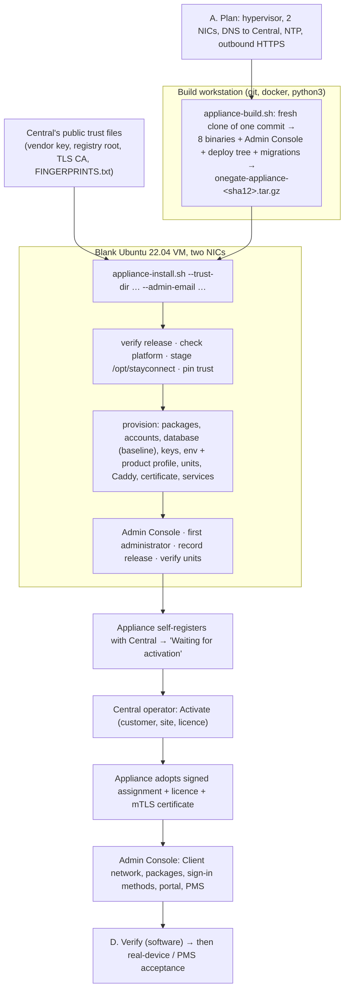

# OneGate Fresh VM Installation & Configuration Manual

| | |
|---|---|
| **Status** | Authoritative procedure for building a **new** OneGate appliance (and a separate OneGate Central) from a blank VM |
| **Validated** | On a dedicated, isolated test pair (a new Central and a new appliance on VMware ESXi, Ubuntu 22.04.5), 2026-10-27: build → install → activation → Client journey → re-run → reboot → backup/restore → upgrade → rollback → clean re-install; then, the same day, every command of Parts B–F re-executed against the final release on the same pair (upgrades, rollback/roll-forward of both hosts, Central outage, reboots of both hosts, consoles in a browser). Evidence: Appendix 3 (A3.7) |
| **Companion documents** | [System Handbook](../architecture/ONEGATE_SYSTEM_HANDBOOK.md) · [Component inventory](../inventory/onegate-components.json) |
| **Audience** | An engineer who can use Linux, systemd, Docker and a hypervisor, and who has the repository, a Central to activate against, and Product-Owner authority for the target |

> ### Read this first
>
> * An appliance is installed from **one release artefact** (`onegate-appliance-<sha12>.tar.gz`, built by
>   `deploy/scripts/appliance-build.sh`) with **one command** (`deploy/scripts/appliance-install.sh`). The same command
>   re-runs safely, resumes an interrupted install, and upgrades (`--upgrade`).
> * Steps carry a verification label (legend below). **[VM]** means the step was executed exactly as written on a fresh VM
>   during the validation in Appendix 3.
> * Nothing here authorises Go-Live, live PMS posting, LIVE card payments, a Root-CA change or any action on a real production
>   environment. A **new** appliance built with this manual is **not** PRE-LIVE `172.21.60.25` and must not be pointed at it.
> * Secrets: every key, password and token is shown as a placeholder (`<…>`). Never paste a real secret into a ticket, a commit
>   or this document.

## Verification legend (each step carries one)

| Label | Meaning |
|---|---|
| **[VM]** | Executed as written on a fresh test VM pair (Appendix 3) |
| **[CODE]** | Behaviour confirmed by reading the script/unit in the repository |
| **[SELFTEST]** | Covered by a self-test in `scripts/ci/` or the script's own `--self-test` |
| **[LIVE-REF]** | The resulting state was observed on the running PRE-LIVE appliance or Central (read-only) |
| **[NOT-EXERCISED]** | Documented from the repository; **not** run on a fresh VM — treat as procedure to be validated on first use |
| **[PO]** | Needs an explicit Product-Owner decision/authorisation |

## Contents

* [Part 0 — The installation at a glance](#part-0--the-installation-at-a-glance)
* [Part A — Planning and prerequisites](#part-a--planning-and-prerequisites)
* [Part B — Fresh appliance installation](#part-b--fresh-appliance-installation)
* [Part C — Initial configuration](#part-c--initial-configuration)
* [Part D — Executable verification checklist](#part-d--executable-verification-checklist)
* [Part E — Recovery, maintenance, upgrade, rollback and restore](#part-e--recovery-maintenance-upgrade-rollback-and-restore)
* [Part F — Installing OneGate Central on a separate server](#part-f--installing-onegate-central-on-a-separate-server)
* [Appendix 1 — Environment files reference](#appendix-1--environment-files-reference)
* [Appendix 2 — Troubleshooting and log map](#appendix-2--troubleshooting-and-log-map)
* [Appendix 3 — Validation performed for this manual](#appendix-3--validation-performed-for-this-manual)

---

## Part 0 — The installation at a glance



Time budget measured on the test pair: release build **≈ 7–9 min** (warm Go caches; the first build downloads the toolchains);
appliance install **≈ 4–5 min** on a blank VM with a current package cache (276 s on 1 vCPU), **plus up to ~15 min** when a stale
image's first-boot unattended upgrade is still running (the installer waits for it); activation **< 2 min** after the Central operator
acts; re-run **≈ 36 s**; upgrade **≈ 25 s** when no migration is pending.

---

## Part A — Planning and prerequisites

### A.1 Hypervisor and VM

| Item | Requirement | Source |
|---|---|---|
| Hypervisor | **VMware ESXi / vSphere** — the platform PRE-LIVE runs on and the platform the validation used. Other hypervisors/bare metal are **not validated — [PO]**. | **[VM]**, PRE-LIVE |
| Guest OS | **Ubuntu Server 22.04 LTS (amd64)** — validated on 22.04.5, kernel 5.15. The installer refuses anything else unless `--allow-unsupported-platform` is given, and the result is then not a supported installation. 24.04 is **not validated** (Kea/Unbound/netplan/polkit versions differ). | **[VM]**, **[CODE]** |
| Minimum | The installer refuses **< 4 GiB memory** (3500 MiB measured) or **< 15 GiB free on `/`**. Documented pilot minimum: **2 vCPU / 4 GB / 40 GB**. | **[CODE]**, `DEPLOYMENT_APPLIANCE.md §8` |
| Validated size | **1 vCPU / 7.8 GiB / 97 GB** (second test appliance, the pristine run) and **4 vCPU / 12 GB / 48 GB** (first test appliance; the install used 7.1 GB of disk). PRE-LIVE runs 1 vCPU / 7.8 GiB / 48 GB. There is **no official sizing statement beyond the pilot figure — [PO]**. Backups (pre-change, pre-restore, scheduled) and the set-aside database after a restore need headroom. | **[VM]**, **[LIVE-REF]** |
| Architecture | amd64 only (the build and Docker apt line are hard-coded; the installer checks) | **[CODE]** |
| Disk layout | The Ubuntu default LVM root works; the product does not require a particular layout. `/var/lib/docker` holds the database volume — it must be on durable storage. | **[VM]** |
| Clock | UTC; **time synchronisation is mandatory** — the licence engine keeps a 48 h clock high-water and refuses large backwards jumps. The installer warns when the clock is not synchronised. | **[CODE]** |

### A.2 Exactly two NICs

OneGate's design rule is **two NICs and no more**. The installer counts physical NICs and refuses any other number.

| NIC | Role | Typical name | Addressing |
|---|---|---|---|
| **NIC 1 — WAN + management** | default route; SSH; Admin Console (HTTPS 443 pinned to its IPv4); the link to Central; the PMS if it is reached through the hotel LAN | `ens160` | Static (or DHCP) address with a default gateway and DNS able to resolve Central |
| **NIC 2 — LAN / Client** | carries Client networks; **no IP address** on the NIC itself — addresses live on bridges netd creates | `ens192` | None |

* Detection: **WAN = interface of the default route**, **LAN = the other physical interface**. `--wan-iface` / `--lan-iface` override it. **[CODE][VM]**
* Management and WAN are the **same** interface. Admin Console, SSH and the Central link share it. **[CODE]**

### A.3 ESXi virtual networking **[NOT-EXERCISED on a physical switch; the settings are from PRE-LIVE experience]**

1. **WAN portgroup (NIC 1):** an ordinary portgroup on the management/uplink network. Default security settings are fine.
2. **LAN portgroup (NIC 2):** carries the Client traffic.
   * **Security → Promiscuous mode: Accept; MAC address changes: Accept; Forged transmits: Accept.** All three are required because the appliance bridges frames whose source MAC is the bridge's or a Client's, not the VM NIC's. *Symptom if missing:* DHCP Offers appear on the wire (`tcpdump`) but no Client ever completes DORA.
3. **VLAN mode of the LAN portgroup — choose one:**
   * **Access / untagged:** portgroup VLAN ID = the Client VLAN (or 0 for an untagged LAN). On the appliance the *prepared* untagged Client network (`10.20.0.0/20`) uses this. One Client network per NIC.
   * **Trunk:** portgroup VLAN ID **4095** (all VLANs) so the VM sees tagged frames; netd then creates `ens192.<vid>` sub-interfaces and a bridge per VLAN. Use this for several Client VLANs. *PRE-LIVE runs VLAN 90 this way (`ens192.90` → `br-g90-a811`).* Tagged-VLAN delivery on the switch/ESXi side is **recorded as unverified** by the project itself.
   * Both can coexist: an untagged network enslaves the parent NIC to its bridge while tagged VLANs ride sub-interfaces of the same parent.
4. Wi-Fi access points / switches: map each SSID to its VLAN, and **turn on AP/switch client isolation** — Clients on the same bridge exchange frames at layer 2 without passing through the appliance's firewall, so isolation *between two Clients on one segment* is the access layer's job (Handbook §10.4; `docs/ARUBA_SSID_VLAN_MAPPING.md`).
5. Do **not** run another DHCP server on a Client VLAN that OneGate serves with Kea (unless you configure the network as *external DHCP*).

### A.4 Addressing, DNS, NTP, firewall

| Need | Detail | Label |
|---|---|---|
| WAN IP/prefix/gateway | Static is recommended: the Admin Console certificate, the nft `443` pin and the Central link follow this address. Changing it later is a staged change with a confirm window (Part C.5). | **[CODE]** |
| DNS on the WAN NIC | Resolvers that **resolve your Central's name** (`sc-central.echofusion.com` for the production Central). The provisioner queries every upstream resolver and **stops if they disagree** about the name (set `ALLOW_SPLIT_DNS=1` only knowingly). | **[CODE][VM]** |
| Central reachability | Outbound **TCP 443** to Central for register/CSR/licence/assignment/hello/portal-TLS, and **TCP 9443** (mutual TLS) once a certificate exists. The name must be a **hostname, not an IP**. Central never connects inbound to the appliance. **If Central sits behind NAT, both 443 and 9443 must be forwarded to the Central host** (the validation found 443 forwarded to the wrong host once — check, do not assume). An appliance outside Central's network needs the name in **public DNS** (an A record to Central's public address); one on Central's own LAN reaches the public address only if the router does hairpin NAT, or by internal DNS. Proven from outside for the test Central (A3.8). | **[CODE][VM]** |
| Package/image sources | Outbound HTTPS to the Ubuntu mirrors, `download.docker.com`, `dl.cloudsmith.io` (Caddy), `deb.nodesource.com`, and Docker Hub (images `timescale/timescaledb:2.16.1-pg16`, `redis:7-alpine`). **No offline install path exists. [PO] if the site is air-gapped.** | **[CODE][VM]** |
| NTP | Outbound UDP 123 to the site's/clock source | — |
| Inbound to the appliance | **22/tcp** (SSH; not address-pinned) and **443/tcp** (Admin Console, pinned to the WAN IP by the rendered firewall). Nothing else on the WAN. Restrict who may reach these at the upstream firewall. | **[CODE][VM]** |
| PMS | Protel FIAS is a **TCP** link from the appliance to the PMS host:port (reached over the WAN NIC unless a route says otherwise). REST PMS kinds need outbound HTTPS to the vendor. | **[CODE]** |
| Portal public name (optional, later) | `<label>.gw.onegate.work` is issued by Central; resolvers must allow answers pointing at private addresses (DNS-rebinding protection) for that zone. | **[DOC]** |

### A.5 What to have in hand before you start

1. **The exact commit** to install (record it). The release build takes a fresh clone of it, so your working tree does not matter, but the commit must be pushed or present locally.
2. A running **OneGate Central** (Part F) whose DNS name you will use, **and its public trust files** from Central's `/opt/stayconnect/central/appliance-trust/`: `vendor-license.pub`, `assignment-registry-root.pub`, `central-tls-ca.crt` and `FINGERPRINTS.txt`. Compare `FINGERPRINTS.txt` **out of band** with the one Central's operator published (the installer then checks every file against it).
3. An operator on Central with `platform_owner`/`platform_admin` (to Activate).
4. The customer, site, licence terms (clients online, validity, grace, modules) you will activate.
5. The initial **site administrator** email and a strong password (**≥ 12 characters**, not the email).
6. For PMS later: host/port of the Protel FIAS interface (and whether TLS with a pinned certificate is used), plus a PMS-side window to commission it. *No real PMS connection is needed to install.*
7. A build workstation (Linux, or Windows with Git Bash + Docker Desktop) with `git`, Docker (Linux containers), `bash`, `python3`, `sha256sum`, and `ssh`/`scp` to the VM. Go and Node run in pinned containers; nothing else is needed locally.

### A.6 Things you must **not** do

* Do not run `scripts/phase1-bootstrap.sh` or `scripts/phase3-bootstrap.sh` (dev-only; seed a dev tenant and default-password admin).
* Do not apply `deploy/nftables/stayconnect.nft`, `deploy/netplan/02-lan-bridge.yaml`, `deploy/kea/kea-dhcp4.conf` or `deploy/unbound/unbound-stayconnect.conf` — they are legacy skeletons that would overwrite what `netd` renders and wipe every Client network.
* Do not copy any file from, or point the new appliance at, the retired development reference appliance or the former Central `150.0.0.252`.
* Do not use PRE-LIVE `172.21.60.25` as a donor of identity, keys, database or configuration.
* Do not hand-edit `/etc/stayconnect/identity`, `assignment` or `license`.
* Do not assemble an appliance by copying binaries and scripts by hand — install a release (Part B).


---

## Part B — Fresh appliance installation

> **Roles.** *WS* = the build workstation. *VM* = the new appliance, as `root`. Replace `<…>` placeholders.

### B.0 What the installer replaced (defects found in the earlier procedure, all fixed)

| ID | Was | Now |
|---|---|---|
| **K1** | The committed factory baseline stopped at 0149 while the tree had migrations to 0158; Gate-P then failed on a blank database. | The baseline is regenerated through **0158** and proven identical to the upgrade path (`factory-clean-baseline-verify.sh`: PASS, 14 058 facts). The build **and** the installer refuse a release whose baseline does not embody the newest migration (`deploy/scripts/lib-baseline.sh`). |
| **K2** | The provisioner re-applied the baseline on every run (`schema "iam_v2" already exists`). | `deploy/scripts/site-db-init.sh` applies the baseline in **one transaction** only to a blank schema; a complete schema is left alone; a half-built one is refused (or, with `--reinitialise-unused-db`, rebuilt only when it provably holds no data). Self-test 10/10. |
| **K3** | The binary build omitted `keybootstrap` and `svc-run`. | Built by default; the release refuses to exist without all eight. |
| **K4** | Copying the tree, the binaries, the trust files and the console; polkit, Kea/Unbound and drop-in overrides; `dnsutils`; the first operator — all by hand. | One release, one command. Trust files are verified against `FINGERPRINTS.txt`; overrides and polkit (`.pkla` on polkit 0.105) are installed by `install-service-units.sh`; the first administrator by `create-first-admin.sh` (no password on a command line). |
| **K5** | A blank box could not be migrated through `edge-migrate.sh` (it needs a verified pre-change backup, impossible before an operator exists). | A blank box is built **at** the release's schema by the baseline (no migration runs); the database records the baseline coverage in `/etc/stayconnect/schema-baseline`. Day-2 migrations go through `edge-migrate.sh` as before (Part E.5). |
| G10 | The enforcement plane and the commerce flags were left off: a Client "signed in" and never got the Internet. | The provisioner writes the supported product profile (B.5) and runs the enforcement-plane coherence check. |
| — | The Admin Console certificate was minted before Caddy could reload; Caddy failed on a vhost written `0640`; a first-run backup-cleanup reported a false failure; a re-run refused the existing admin. | All found on the first real install and fixed (Appendix 3). |
| — | Found only on a **pristine** VM (snapshot reverted three times to reach a clean pass): Ubuntu's first-boot unattended-upgrades held the dpkg lock; the first certificate's health check needed a console that is installed later, sampled the served serial once, raced the renewal timer, and its "renewed" exit code (2) was read as failure; a pasted `email:` prefix became a sign-in name. | The provisioner waits for apt (up to 60 min); the cert manager locks, waits for the served serial and checks the console only once one is installed; exit 2 is success; the admin email must be a plain address. |

### B.1 Build the release (WS) — **[VM]**

```bash
git clone https://github.com/aibrahiiim1/StayConnectEnterprise.git && cd StayConnectEnterprise
git checkout <approved-commit-sha>                     # record this SHA in your install log
bash deploy/scripts/appliance-build.sh                  # → dist/appliance/onegate-appliance-<sha12>.tar.gz (+ .sha256)
```

What it does (**[CODE]**): takes a **fresh clone** of the commit (a dirty working tree is irrelevant and cannot leak in); refuses a baseline older than
the newest migration; builds `scd edged netd portald acctd pmsd keybootstrap svc-run` in `golang:1.25.12` with `CGO_ENABLED=0 -trimpath -tags stayconnect_production`
and reads back each binary's embedded `vcs.revision` (must equal the commit), `vcs.modified=false` and the production tag; packages the Admin Console in
`node:20.18.0-bookworm` (`npm ci` on the committed lockfile, `next build`, capability contract); takes the deploy tree, migrations and installer scripts
with `git archive` (the `deploy/pki` slots are emptied — trust files are never shipped); writes `RELEASE.json` (commit, toolchains, per-binary sha256,
revision and tags, console `build_id`, baseline coverage, supported platform) and `SHA256SUMS` over every file. Nothing is built on the appliance.

Go module and build caches live in the named Docker volumes `onegate-appliance-gocache` / `onegate-appliance-gomodcache`, so a second build is fast.

### B.2 Prepare the operating system (VM) — **[VM]**

1. Install **Ubuntu Server 22.04 LTS amd64**, minimal + OpenSSH. Create the two NICs per Part A.2 / A.3.
2. Give NIC 1 (WAN) its **address, gateway and resolvers** in netplan (the installer never writes the WAN). Leave NIC 2 **unconfigured**.
3. Timezone UTC and time sync: `timedatectl set-timezone Etc/UTC; timedatectl | grep synchronized` → `yes`.
4. Hostname: the product does not use the OS hostname for identity (serial/MACs/DMI are used); set a sensible one.
5. `apt-get update && apt-get -y upgrade` is recommended; the installer installs every package it needs itself.

### B.3 Pre-flight (VM) — **[VM]**

```bash
ip -br link                                   # exactly two physical NICs
ip route show default                         # via the WAN NIC
getent hosts <central-name>                   # resolves to Central (public or internal address, as designed)
curl -sSk https://<central-name>/readyz                    # Central answers (its CA is checked by the installer, B.5)
# 9443 must be Central's mutual-TLS listener, not merely an open port: it asks for a client certificate from the appliance CAs
echo | openssl s_client -connect <central-name>:9443 -servername <central-name> 2>/dev/null \
  | grep -A2 'Acceptable client certificate CA names'      # → "StayConnect Appliance Intermediate CA v1" and "StayConnect Root CA"
```

The installer repeats the platform checks and refuses on failure; the Central checks matter because a blocked 443/9443 or a wrong
port-forward only shows up later, as an appliance that never registers or never converts to mutual TLS. An open-port test cannot tell
Central's listener from another host answering on 9443 (the validation once found 443 forwarded to the wrong host); the client-CA list can.
Before activation the appliance cannot verify the 9443 server certificate itself — Central presents only its leaf, and the Intermediate
arrives with the appliance's own certificate (`/etc/stayconnect/certs/ca.crt`) — so `Verify return code: 21` at this point is expected.
Testing from a Windows workstation with `curl`: add `--ssl-no-revoke` (an internal CA publishes no revocation list). **[VM]** (A3.8)

### B.4 Copy the release and the trust files to the VM (WS) — **[VM]**

Root SSH with a key is assumed (Ubuntu's default `PermitRootLogin prohibit-password` refuses a root password); otherwise copy as your
sudo user and move the files into `/root` on the VM.

```bash
ssh root@<vm> 'install -d -m 0700 /root/central-trust'
scp dist/appliance/onegate-appliance-<sha12>.tar.gz* root@<vm>:/root/
scp vendor-license.pub assignment-registry-root.pub central-tls-ca.crt FINGERPRINTS.txt root@<vm>:/root/central-trust/
ssh root@<vm> 'cd /root && sha256sum -c onegate-appliance-<sha12>.tar.gz.sha256 && tar -xzf onegate-appliance-<sha12>.tar.gz'
```

### B.5 Install (VM) — **[VM]**

```bash
umask 077; printf '%s\n' '<site-admin-password>' > /root/.admin-pw     # or omit --admin-password-file and type it twice
bash /root/onegate-appliance-<sha12>/deploy/scripts/appliance-install.sh \
     --trust-dir /root/central-trust \
     --admin-email <site-admin-email> --admin-password-file /root/.admin-pw
shred -u /root/.admin-pw
```

Options you may need: `--central-base https://<name>` for a Central other than the release's (a lab or second Central; the mutual-TLS endpoint then
defaults to `<name>:9443` and never to the release's) · `--wan-iface/--lan-iface` · `--offline-activation-only` (no Central CA required; the vendor
key is) · `--yes` (no confirmation prompt). A successful install ends with (a unit-status list sits between these two lines, and a
"next:" hint follows):

```text
APPLIANCE_UNITS = PASS
[appliance-install] installed release <commit>
```

What happens, in order, each step printing a heading and stopping at the first failure with the reason (**[CODE][VM]**):

1. **Release** — `SHA256SUMS` verified; every binary embeds the release commit, unmodified and production-tagged.
2. **Platform** — Ubuntu 22.04 amd64, exactly two physical NICs, ≥ 4 GiB memory, ≥ 15 GiB free, a default route; clock sync warned.
3. **Stage** — the release tree goes to `/opt/stayconnect` (a previous tree is kept in `/opt/stayconnect/.previous/<stamp>`); binaries are installed with `install(1)`.
4. **Trust** — the three public files are installed in `deploy/pki/` and each is checked against `FINGERPRINTS.txt` (key id = first 8 bytes of sha256 of the raw key; SHA-256 fingerprint of the CA). A missing registry root or (unless `--offline-activation-only`) Central CA is a hard failure.
5. **Provision** (`deploy/scripts/provision-fresh-appliance.sh`) —
   packages (`nftables conntrack unbound jq python3 dnsutils age openssl`, Docker, Caddy, Kea 2.0.2 — disabled until the first Client network —, Node 20) ·
   accounts and directories · TimescaleDB/Redis containers (random superuser password) ·
   **database**: `site-db-init.sh` — waits for a *stable* server (initdb's temporary server is not), loads roles, the baseline in one transaction, ownership and the Gate-P grants (hash-verified), asserts 2 hypertables and that every `iam_v2` object belongs to `iam_v2_owner`, and writes `/etc/stayconnect/schema-baseline` ·
   credentials (`gatep-set-passwords.sh` → `/etc/stayconnect/.dsn`) and the nine key files (`keybootstrap`) ·
   env files and the **product profile** (below) · units, drop-ins, Kea/Unbound overrides, polkit ·
   Caddy and the dual-SAN Admin Console certificate (`hotel.stayconnect.local` + the WAN IP) ·
   start `scd edged acctd netd portald caddy` and require each `active` and `scd` logged `build=production`.
6. **Admin Console** — `deploy-hotel-admin.sh install` (scratch-port boot, capability contract, atomic switch, smoke, automatic rollback on failure); skipped when that exact build is already live.
7. **First administrator** — `create-first-admin.sh` (12+ characters; the password goes to `edged seed-admin --password-stdin`, never onto a command line). A refusal (password too short or equal to the email, another administrator already exists) **stops the install**; fix it and run the same command again — it resumes. **[VM]**
8. **Record** — `/opt/stayconnect/RELEASE.json`, `SHA256SUMS` and `DEPLOYED_BINARIES.sha256` (service, sha256, embedded revision, tags) are written; `check-appliance-units.sh` must pass.

**The product profile the installer enables** (`ensure_kv`: a key is added only when absent, so an operator's later choice is never overwritten):

| File | Keys | Why |
|---|---|---|
| `scd.env`, `portald.env` | `STAYCONNECT_PHASE2_MASTER=true`, `STAYCONNECT_PHASE2_PORTAL=true` | Client commerce: packages, quote, confirm (the portal cannot list packages without them) |
| `edged.env` | `STAYCONNECT_PHASE2_MASTER=true`, `STAYCONNECT_PHASE2_ADMIN=true` | the Admin Console's packages/plans/vouchers surfaces |
| `netd.env`, `acctd.env` | `STAYCONNECT_PHASE3_MASTER=true`, `NETD_PHASE3_PRODUCER_UID=<uid of acctd's user>` | the **enforcement plane**: without it every session stays `PENDING_ENFORCEMENT` and no Client reaches the Internet |
| `scd.env`, `edged.env` | `STAYCONNECT_PHASE3_MASTER=true`; scd `STAYCONNECT_PHASE3_PMS_AUTH=true`; edged `STAYCONNECT_PHASE3_ADMIN=true` | the **Hotel module is installed**: room sign-in and the *Hotel* section exist, and Central's licence (with the site's switch) decides whether they are used. Inert until a PMS is commissioned (C.10) |
| `scd.env` | `STAYCONNECT_PHASE4_MASTER=true`, `STAYCONNECT_PHASE4_PAYMENT=true`, `STAYCONNECT_PHASE4_POSTING=true` | **card payment and room charge can be configured** (provider accounts, sealed credentials, room-charge preparation); **nothing executes** — C.12 |
| (provisioner defaults) | `STAYCONNECT_IAMV2_MASTER/OTP/SOCIAL=true`, `SCD_DURABLE_THROTTLE`, `SCD_OTP_HMAC` | IAM v2 sign-in, throttling, OTP |

**Not** enabled, and never written by the profile: the PMS connector (`pmsd`, which alone talks to a PMS — commissioned in C.10) and every
financial **execution** switch — `STAYCONNECT_PHASE4_PAYMENT_PROVIDER` (payment-provider calls), `_OUTBOX_WORKER` and `_PMS_TRANSMIT` (PMS posting),
`_FINANCIAL_REVIEW`, `STAYCONNECT_PAYMENT_LIVE_ALLOWED` — C.12, **[PO]**.
The profile is written by `deploy/scripts/apply-product-profile.sh`, which a fresh install **and every `--upgrade`** run, so an appliance installed by
an older release gets what the current one ships. It then runs `check-phase3-enforcement-plane.sh` and `check-phase6-guest-dependency.sh` and stops
if the environment is incoherent.

It deliberately **does not**: write netplan / nftables / Kea / Unbound configuration (netd renders those at the first Client-network apply), set the hostname, create a tenant, site, licence or Client network, enable `pmsd`, or configure any PMS. It refuses to run if `/etc/stayconnect/removed-from-central.json` exists.

### B.6 Re-running, resuming and interrupted installs — **[VM][SELFTEST]**

* **Re-run with the same release**: converges and regenerates nothing that exists — identity, keys, passwords, DSNs, env values, database and certificate are kept (measured: only the licence/assignment refresh timestamps changed). The administrator step reports `already exists — unchanged`.
* **Interrupted install** (power loss, a failed package mirror, Ctrl-C): `/opt/stayconnect/.install-in-progress` marks it; simply run the same command again — it resumes. An interrupted database step is either complete (the baseline is one transaction) or blank.
* **A half-built database from an old procedure** is refused with an explanation. `--reinitialise-unused-db` rebuilds it **only** if it holds no operators, tenants, Clients, sessions or vouchers.
* **A different release on an installed box**: refused — use `--upgrade` (E.5).

### B.7 Check what the install left behind — **[VM]**

```bash
grep -E 'NETD_(WAN|MGMT|LAN)' /etc/stayconnect/netd.env                 # WAN/LAN names correct? NETD_MGMT_ADDR=auto
bash /opt/stayconnect/deploy/scripts/check-appliance-units.sh            # APPLIANCE_UNITS = PASS
cat /opt/stayconnect/DEPLOYED_BINARIES.sha256                            # service, sha256, embedded commit, tags
journalctl -u stayconnect-scd --since -10min | grep -iE 'regist|waiting'  # registered, waiting for activation
```

State at this point: services running, the Admin Console reachable at `https://<WAN-IP>/`, one administrator, **no tenant / site / licence / Client
network**, Kea installed but stopped, `scd` registered and **waiting for activation**. Continue with **Part C**. Keep an install log with: the
release commit and `.tar.gz` sha256, the Central endpoint, the trust fingerprints you compared, the administrator created, and who did what and when.


---

## Part C — Initial configuration

Everything in Part C is done in a browser (two consoles). The validation (Appendix 3) drove C.3, C.6 and C.9 through the **same HTTP APIs the
consoles call** (with the same password step-up), so those steps are **[VM]** for their effect; the screens and routes named are those in the
repository (`hotel-admin/components/nav.tsx`). The appliance is **factory-clean** until Central activates it: no tenant, no site, no licence,
no Client network.

### C.1 Identity: what "factory-clean" means and what must never be typed

* **Tenant, site and appliance identity are never entered on the appliance.** They arrive as a Central-signed assignment verified against the pinned registry root. Do not set `*_TENANT_ID` / `*_SITE_ID` in any env file (the provisioner refuses a file containing them; production builds ignore them).
* The appliance generates its own Ed25519 identity at first `scd` start; `scd` registers token-less (`SCD_AUTO_REGISTER=true`) and then waits. **There are no enrollment tokens** and no setup wizard (`/setup/enrollment` redirects to `/appliance`).
* Do not hand-edit `/etc/stayconnect/{identity,assignment,license}`.

### C.2 First sign-in to the Admin Console

1. Browse to `https://<WAN-IP>/` (or `https://hotel.stayconnect.local/` if you map that name to the WAN IP in your DNS/hosts — the appliance's own Unbound does **not** serve that name to the WAN side). The certificate is signed by **Caddy's local CA**; trust `/var/lib/caddy/.local/share/caddy/pki/authorities/local/root.crt` on the staff PC or accept the warning once. **[UNVERIFIED how staff PCs are expected to receive that root]**
2. Sign in as the administrator created in B.5. (Forgot it, or locked out? `bash /opt/stayconnect/deploy/scripts/create-first-admin.sh --email <same> --reset` sets a new password and clears the lockout — root only, recorded in the journal.)
3. Recommended: enable the optional **two-step sign-in** (TOTP) under *Account*; store the recovery codes (shown once). There is no setting to *require* it for everyone.
4. Session limits default to 30 min idle / 12 h absolute. Keep an eye on *Operators* to add real staff (roles: Site IT manager, Client services operator, Client relations operator, Voucher operator, Payments operator, Viewer) and **disable or change the seeded account** once they exist.

### C.3 Registration and activation (Central side)

**Online (zero-touch):**

1. On the appliance, *System → Appliance & licence* (`/appliance`) shows **Waiting for activation** with the **serial**. (If it instead says it cannot reach Central, fix DNS / the Central CA / outbound 443 — Appendix 2.)
2. In the **Central console** → *Appliances*: the new appliance appears as **Waiting**. A real, unexpected appliance appearing = investigate; do not Activate it.
3. **Activate** (needs a `platform_owner`/`platform_admin` and password step-up): choose or create the **Customer** and **Site** (Site = one physical property; a Customer must be explicit); set **clients online at once** (0 = unlimited), **valid days / until**, **grace days**, and **licensed modules** (`hospitality` for PMS/room sign-in; `paid_access`, `card_payment`, `room_charge`, OTP/social add-ons as sold). Site Type is descriptive only.
4. One transaction produces the **signed assignment**, the **signed licence** (schema 4) and an audit entry. A site that already holds *another customer's* data is refused (`409 holds_other_customer_data`).

**Offline (no route to Central):** *Appliance & licence → Offline activation → Download activation request* → import it in Central (*Appliances → Import activation request*) → Activate → download the **activation package** → upload it on the appliance. Requires `vendor-license.pub` already pinned (B.5, `--offline-activation-only`). **[NOT-EXERCISED]** Licence renewal offline = Central *Offline licence file* → *Upload licence file*.

### C.4 Confirm the appliance converged (software facts)

Within minutes of activation (assignment poll 30 s, licence 1 min until held) — **[VM]**: assignment, licence and the mutual-TLS certificate arrived in under two minutes, and scd then moved to `:9443`:

```bash
ls -l /etc/stayconnect/assignment/ /etc/stayconnect/license/ /etc/stayconnect/certs/     # assignment.json, registry.json; current.json, state.json; client.crt, ca.crt, mtls-client.key
journalctl -u stayconnect-scd --since "10 min ago" --no-pager | grep -iE 'assignment|licen[cs]e|registered|certificate' | tail -20
```

Admin Console *Appliance & licence* should read **Active** (or Grace) with the licence terms, and the Central console shows the appliance **connected** (hello ≤ 5 min). The licence is hardware-bound: moving the disk to different hardware is a hard mismatch; a changed WAN MAC alone is a soft mismatch fixed by Central *Rebind WAN MAC*.

### C.5 WAN / LAN settings

*Network → WAN / LAN settings* (`/network/system`). The WAN is already configured by you in B.3; change it here only through the **validate → apply → confirm** flow:

* **Validate** (no changes) shows the effective merged config and the new management URL. **Apply** needs your password; netd backs up the netplan files, applies, re-asserts the firewall pin, and verifies WAN IP, gateway and **management reachable**.
* You then have **120 s to Confirm from the new management URL**; otherwise netd restores the old files automatically. Changing the WAN IP changes the Admin Console URL and re-issues its certificate; with a literal (non-`auto`) `NETD_MGMT_ADDR` such a change is refused (`management_pin_lockout`).
* The LAN section shows the physical Client NIC; DHCP is **not** edited here (`dhcp_not_edited_here`) — it belongs to each Client network.

### C.6 First Client network

Open *Network → Client networks* (`/network`). A fresh appliance offers one **prepared, not-active** Access network:

| Property | Prepared default |
|---|---|
| Name / type | "Client Wi-Fi" — untagged |
| Subnet / gateway | `10.20.0.0/20` / `10.20.0.1` |
| DHCP pool | `10.20.0.10` – `10.20.15.254`, lease 3600 s (renew 900, rebind 7200) |
| Domain | `guest.local` |
| Captive portal, Internet, NAT, isolation | on |

**Option 1 — activate the prepared network (untagged):** map your AP/SSID to the VLAN that reaches NIC 2 untagged; *Activate* (a staged ENABLE) → **Apply** (password) → verify → **Confirm within 120 s**.

**Option 2 — tagged VLAN(s) on a trunk:** set the LAN NIC's role/port mode to **Client trunk** (*Ports → Trunk*; protected management/WAN ports are refused), create a network with **VLAN id**, gateway/subnet/pool, then Apply → Confirm. Naming is automatic (`ens192.<vid>`, `br-g<vid>…`); topology fields (type, VLAN, parent, bridge) are **immutable** — change them with a staged *Replace*. Two networks cannot overlap subnets or share a VLAN on one parent.

What the apply does (so you know what to verify): creates the bridge (and VLAN sub-interface), assigns the gateway address, converges the nftables table, pushes the Kea config (and **starts Kea for the first time**, writing `/etc/kea/kea-dhcp4.conf`), writes Unbound fragments (and restarts it), creates `ogportal0` with the portal address, and runs health checks (`mgmt_reachable`, `gateway_up`, `kea_running`, `portal_listen`, `portal_address`). **Any failing check rolls the whole change back** and the revision is marked `rolled_back` with the reason — read *Config history* (`/network/revisions`).

Choices per network (see `docs/CLIENT_NETWORKING.md`, `EXTERNAL_DHCP_MODE.md`): **DHCP mode** `local` (Kea) / `external` (the hotel's server — then *you* must hand out option 114 and the gateway) / `relay` (**no data path implemented**) / `disabled`; **DNS mode** appliance or custom; **NAT**; **client isolation**; **captive portal**; internet on/off; lease timers; reservations; per-network portal profile and sign-in methods.

### C.7 Gateway, DHCP, DNS, NAT and captive-portal expectations

After Confirm, on the VM: `ip -br addr` shows the bridge with the gateway address; `ss -ulnp | grep ':67 '` shows Kea on the gateway; `ss -tulnp | grep ':53 '` shows Unbound on the gateway; `nft list table inet stayconnect` shows the sets and chains of Handbook §10.4. A Client should receive an address from the pool, DNS from the gateway, and option 114 pointing at the portal. Real-device behaviour (iOS/Android/Windows auto-pop, VLAN delivery through the physical switch) is **acceptance, not software verification** — Part D.3.

### C.8 Portal address, certificate and branding

* The **portal address** is a private RFC 1918 /32 on `ogportal0` (default series starting `10.255.255.1`, chosen by migration 0116, changeable under *Portal HTTPS*); it must lie outside every Client and host subnet.
* *Portal settings* (`/portal-branding`): brand, welcome text, languages, layout. Images are uploaded to `/opt/stayconnect/portal-assets`.
* **Portal HTTPS** (`/portal-https`): obtains `<label>.gw.onegate.work` through Central (requires Central's Cloudflare token + ACME contact configured by the Product Owner — status on PRE-LIVE was recorded as NOT_CONFIGURED until then). Until HTTPS is active, option 114 carries the HTTP gateway URL and **social login is not offered**. Hotel-owned domains need three DNS records (Handbook §14.3).
* *TLS certificate* (`/network/certificate`): Admin Console certificate status/rotate; auto-renews.

### C.9 Sign-in methods, packages and the Client Portal

1. *Internet packages* (`/internet-packages`) and *Service plans*: create at least one **Free** package (price 0) so a first Client can be tested; paid packages need the `paid_access` module and a currency.
2. *Sign-in methods* (`/sign-in-methods`): switch on the methods you offer — **Voucher**, **Client accounts** (staff-created), **Email accounts** (needs `email_otp` module), **Open selection** (default off), and (licensed) **SMS / WhatsApp codes** and **Social login**. Per-network overrides exist.
3. *Vouchers* (`/vouchers`): generate a batch (code length/mode/prefix configurable); a voucher is always tied to one package revision; reveal/export need the right permission and password.
4. Optional *Delivery* (`/notifications`): SMTP / SendGrid / Twilio / WhatsApp providers — **without one, no OTP or verification email is ever issued**. Optional *Identity providers* (`/social-providers`), *Payment methods* (`/payment-methods`, **TEST mode only** unless the Product Owner authorises LIVE), *Allowed sites* (walled garden).
5. Test with a **voucher on a test device** on the new Client network (Part D.3).

> The enforcement plane and the commerce flags are part of the profile the installer writes (B.5). If a session ever stays
> `PENDING_ENFORCEMENT`, run `bash /opt/stayconnect/deploy/scripts/check-phase3-enforcement-plane.sh /etc/stayconnect` (Appendix 2).

### C.10 PMS Interface onboarding without a live PMS

You can prepare Room sign-in completely and leave it **inert** until a real PMS is available. **[NOT-EXERCISED here; derived from `docs/runbooks/PMS-Interface-Commissioning.md` and the code]**

1. **Licence** must include `hospitality` (Central Activate or *Change licence*). The Hotel module is installed by the product profile (B.5), so
   the *Hotel* section (`/pms-interfaces`, `/room-sign-in`, `/pms-routing`, `/stays`, …) appears as soon as the licence includes it and the site has it
   switched on (*Modules*). Without it, no network asks about room sign-in.
2. **Configure the PMS connector** (`pmsd`, the only process that talks to a PMS; it stays dark until this step):

   ```text
   # /etc/stayconnect/pmsd.env    → STAYCONNECT_PHASE3_MASTER=1 …_PMS_CONNECTOR=1 …_PMS_INGEST=1 …_CHECKOUT_GRACE=1
   #                                PMSD_DB_URL=<svc_pmsd DSN from /etc/stayconnect/.dsn>
   #                                PMSD_EVIDENCE_KEY_HEX=<32-byte hex>  PMSD_EVIDENCE_KEY_VERSION=1
   #                                PMSD_EVENT_IDENTITY_KEY_HEX=<32-byte hex>  PMSD_EVENT_IDENTITY_KEY_VERSION=1
   ```

   Generate the two HMAC keys with `openssl rand -hex 32` and record them in your vault (they live in `pmsd.env`, which the encrypted configuration archive carries; keep a vault copy as well). Do **not** set `PMSD_SECRET_KEY_*` for a `credential_mode=NONE` (Protel FIAS) interface. Enabling PMS authentication does not disable voucher/account sign-in. The enforcement-plane flags are already set by the installer (B.5).
3. **Author without activating.** In *PMS connection* create the interface (display label, kind `protel-fias`, endpoint `host:port`, source timezone, base currency/exponent) → **Publish** the revision. **Leave the lifecycle at `AUTH_DISABLED`** (never `ACTIVE`): `pmsd` dials only `ACTIVE` interfaces, so nothing connects and nothing is posted. Activating against a non-existent host only produces endless reconnect attempts and link-down alerts.
4. **Grace preflight** (once, when you intend to go live): `SELECT iam_v2.bootstrap_emergency_grace('<tenant>','<site>'); SELECT iam_v2.emergency_grace_health('<tenant>','<site>');` (must be `OK`).
5. **Routing**: *PMS routing* → per Client network choose `NONE`, `DEDICATED` (one interface) or `SHARED_STRICT` (2–3), **Preview → Apply**. A network with no decision offers room sign-in to nobody.
6. **Never** enable *Room charge* financial onboarding, set `PHASE4_*` transmit flags or activate an interface for posting during installation: those are real-money/real-PMS actions that require explicit Product-Owner authorisation. **[PO]**
7. When the real PMS window arrives: activate the interface, read the three runtime axes (target `CONNECTED / CONTINUOUS / IN_SYNC`), and run the PMS acceptance in Part D.4.

Mews, Apaleo and OPERA Cloud connectors exist but have **never connected to a live property**; treat any use as a first-light test.

### C.12 Modules: licence, installation and the site's switch

*System → Modules* (`/modules`) shows four facts per module, and a module is **in use** only when all of them hold:

| Column | Decided by | Changed by |
|---|---|---|
| **Available** | the appliance's installation | the release's product profile (B.5); an upgrade adds what a newer release ships |
| **Licensed** | the signed licence from Central | Central → *Licenses* (*Change licence* / *Renew*); the appliance picks it up within minutes, or *Appliance & licence → Check now* |
| **Switched on** | the site | *Modules* (or *Sign-in methods* for the identity add-ons) |
| **Ready** | the module's own prerequisites | e.g. a delivery provider for one-time codes |

What a release installs **[CODE][VM]**: paid access, the identity add-ons (SMS, WhatsApp, email accounts, social sign-in), the **Hotel**
module, and **card payment** and **room charge for configuration**. *Available* means the module can be configured here. It never means the
module can move money or reach a PMS: execution is separate, and it shows as **Ready: No** with the reason.

| Module | Configurable here (installed) | Execution | Shows as |
|---|---|---|---|
| Card payment | provider accounts, sealed credentials, domains, settings | **blocked**: without `STAYCONNECT_PHASE4_PAYMENT_PROVIDER` scd builds no checkout engine, refuses *Test connection* ("Not tested"), opens no provider domain to clients who have not signed in, and never offers card payment | Available Yes · Ready No — "Configurable only: this appliance is not authorised to contact a payment provider" |
| Room charge | room-charge preparation (posting domain) | **blocked**: without `_OUTBOX_WORKER` and `_PMS_TRANSMIT` nothing can reach a PMS; room charge is never offered | Available Yes · Ready No — "Sending charges to the PMS is switched off on this appliance" |
| High availability, White label | — not implemented in this release | — | Available **No** — "Not implemented in this release" (a licence can carry them; nothing implements them) |

Switching execution on is a Product-Owner authorisation **[PO]**, and this manual has no step for it. The product profile never writes an execution
switch. On an appliance where one is already on, the profile reports it and leaves it alone. If it finds one sitting without its master (inert
today), it **refuses** rather than add the master and switch execution on. Likewise it never adds a domain whose execution switches are already on
(the payment domain under an existing provider flag; the posting domain under an existing outbox, transmit or review flag): it reports
"NOT added" and leaves the file as it was. Real payments additionally need `STAYCONNECT_PAYMENT_LIVE_ALLOWED`;
a LIVE-mode account cannot even be saved without it.

### C.11 Hardening you should do before handing over

* Add named operators and disable/replace the seeded one; enable two-step sign-in for administrators.
* Add a **backup key holder** (*Backups → Backup encryption*), take a first **manual backup**, set the schedule, and set the **erasure-ledger secondary copy** destination (mandatory secondary storage). Practise one restore into staging (Part E).
* Set data-retention periods (*Backups → Data retention*) to the customer's policy.
* Confirm only 22 and 443 answer on the WAN IP from an outside network; confirm no other listener is exposed (`ss -ltnup`).
* Record the install in your site file: commit SHA, binary hashes, Admin Console `build_id`, Central activation time, licence terms.


---

## Part D — Executable verification checklist

Run **D.1 → D.3 on the appliance as `root`** (software verification, no people and no hotel hardware needed). D.4 lists what *cannot* be proven
by software and must be witnessed on real devices, real switches or the real PMS — **do not mark an installation accepted on D.1–D.3 alone.**
IDs are stable so a site file can reference them. "Expected" is what a healthy install shows; any other result is a failure to investigate (Appendix 2).

### D.1 Host and operating system (software)

| ID | Check | Command | Expected |
|---|---|---|---|
| D1-01 | OS and kernel | `grep PRETTY_NAME /etc/os-release; uname -r` | Ubuntu 22.04.x LTS |
| D1-02 | Exactly two NICs plus software devices | `ip -br link` | WAN NIC + LAN NIC (+ `lo`, `docker0`, compose bridge, and, **after** C.6, `br-g…`, `ens192.<vid>`, `ifb…`, `ogportal0`); **no third physical NIC** |
| D1-03 | WAN addressed, LAN NIC unaddressed | `ip -br addr` | WAN has the planned IPv4; LAN NIC has none |
| D1-04 | Default route via WAN | `ip route show default` | via the planned gateway on the WAN NIC |
| D1-05 | Clock | `timedatectl` | `System clock synchronized: yes`, UTC |
| D1-06 | Forwarding sysctl | `sysctl net.ipv4.ip_forward net.netfilter.nf_conntrack_max` | `1` and `262144` |
| D1-07 | Disk headroom | `df -h /` | ≥ 40 % free on a new box |
| D1-08 | Only expected inbound listeners | `ss -ltnup`; then **from another host on the WAN network**: `for p in 22 80 443 53 8380 8343 8090 3100 5432; do timeout 3 bash -c "</dev/tcp/<WAN-IP>/$p" 2>/dev/null && echo "$p open"; done` | listeners: `22`; Caddy `*:80`, `*:443` (TCP and UDP); portald `*:8380`, `*:8343`; Kea/Unbound on gateway addresses; everything else `127.0.0.1`. From the WAN only **22 and 443** answer — the rendered nftables input chain closes the rest (Handbook §6.1) |

### D.2 Installed software and services (software)

| ID | Check | Command | Expected |
|---|---|---|---|
| D2-01 | Package versions | `dpkg-query -W docker-ce caddy kea-dhcp4-server unbound nftables nodejs polkitd` | Docker 29.x, Caddy 2.11.x, Kea **2.0.2**, Unbound 1.13.x, nftables 1.0.x, Node 20.x, polkit 0.105 (validated: 29.9.2, 2.11.7, 2.0.2, 1.13.1, 1.0.2, 20.20.2) |
| D2-02 | Containers | `docker ps --format '{{.Names}} {{.Image}} {{.Status}}'` | `stayconnect-pg  timescale/timescaledb:2.16.1-pg16 … healthy` and `stayconnect-redis  redis:7-alpine` (Redis is unused by the appliance) |
| D2-03 | Units active | `for u in scd netd acctd edged portald hotel-admin caddy; do systemctl is-active stayconnect-$u; done` | all `active` |
| D2-04 | Units enabled | `systemctl is-enabled stayconnect-{scd,netd,acctd,edged,portald,hotel-admin,caddy}` | `enabled`; `stayconnect-pmsd` enabled only if you chose to (C.10); stock `caddy.service` **disabled** |
| D2-05 | Timers | `systemctl list-timers 'stayconnect-*'` | `backup-cleanup` and `hotel-admin-cert-renew` scheduled |
| D2-06 | No failed units | `systemctl --failed; bash /opt/stayconnect/deploy/scripts/check-appliance-units.sh` | none failed; script exit 0 |
| D2-07 | Production build profile | `journalctl -u stayconnect-scd -b --no-pager \| grep -m1 'build=production'` | one line (the provisioner requires it) |
| D2-08 | Binary provenance | `cat /opt/stayconnect/DEPLOYED_BINARIES.sha256; sha256sum /opt/stayconnect/bin/*; for b in scd edged netd; do grep -aom1 'vcs.revision=[0-9a-f]*' /proc/$(systemctl show -p MainPID --value stayconnect-$b)/exe; done; jq -r .source_commit /opt/stayconnect/RELEASE.json` | the recorded sha256 match the files; the **running** processes embed the release commit; `RELEASE.json` names the same commit |
| D2-09 | Sockets and modes | `stat -c '%a %U:%G %n' /run/stayconnect/scd.sock /run/stayconnect/netd.sock /run/kea/kea4-ctrl-socket` | scd `660 root:stayconnect-scd`; netd `660 root:stayconnect`; Kea socket exists after C.6 |
| D2-10 | Loopback-only services | `ss -ltn \| grep -E ':(8090\|3100\|9101\|5432\|6379)'` | each bound to `127.0.0.1` |
| D2-11 | Portal listeners | `ss -ltn \| grep -E ':(8380\|8343)'` | both present (`*`) |
| D2-12 | Service accounts | `getent passwd stayconnect stayconnect-portald stayconnect-pmsd stayconnect-hotel-admin; getent group stayconnect-scd` | all present, `nologin` |
| D2-13 | Env files and modes | `stat -c '%a %U:%G %n' /etc/stayconnect/*.env /etc/stayconnect/.dsn` | env `640 root:stayconnect` (scd.env may be `600`); `.dsn` `600 root:root` |
| D2-14 | **No tenant/site in env** | `grep -E 'TENANT_ID\|SITE_ID' /etc/stayconnect/*.env` | no output |
| D2-15 | Secrets present | `ls -l /etc/stayconnect/secrets` | `throttle.key voucher_dek.key otp_hmac_1.key signin_attempts_dek.key payment_dek.key anonymous_access.key notify_dek.key social_dek.key operator_totp_dek.key pg-superuser.env`, all `-rw-------`, dir `drwx------` |
| D2-16 | Trust anchors | `ls -l /etc/stayconnect/vendor-license.pub /etc/stayconnect/assignment-registry-root.pub; ls /usr/local/share/ca-certificates/stayconnect-central-ca.crt` | present (32-byte `.pub` files; CA installed) |
| D2-17 | Caddy config valid | `caddy validate --config /etc/caddy/Caddyfile` | `Valid configuration` |
| D2-18 | Admin Console certificate | `echo \| openssl s_client -connect <WAN-IP>:443 -servername hotel.stayconnect.local 2>/dev/null \| openssl x509 -noout -subject -ext subjectAltName` | SAN = `hotel.stayconnect.local` and the WAN IP |
| D2-19 | Admin Console answers | `curl -ksS -o /dev/null -w '%{http_code}\n' https://<WAN-IP>/` and `curl -ksS https://<WAN-IP>/api/edge/v1/health` | `200`/`307` to `/login`; JSON from edged |
| D2-20 | Admin Console release identity | `cat /opt/stayconnect/hotel-admin/hotel-admin-release.json \| jq '{source_commit,build_id,source_state}'` | your commit, `clean` |
| D2-21 | Logs show no crash loop | `journalctl -p err -b --no-pager \| tail -50` | no repeating errors; `systemctl show -p NRestarts stayconnect-scd stayconnect-netd` small. One `caddy : user NOT in sudoers` line per boot is Caddy declining to add its local root to the OS trust store — harmless. `dhclient … /tmp/<name>.lease` lines come from a namespace test client: remove it (D.3c) |

### D.3 Database and security boundary (software)

`P="docker exec -i stayconnect-pg psql -U stayconnect -d stayconnect_site -tAc"`

| ID | Check | Command | Expected |
|---|---|---|---|
| D3-01 | Server and extensions | `$P "select version()" ; $P "select extname\|\|' '\|\|extversion from pg_extension order by 1"` | PostgreSQL **16.3**; `pgcrypto`, `plpgsql`, `timescaledb 2.16.1`, `uuid-ossp` |
| D3-02 | Table counts | `$P "select table_schema,count(*) from information_schema.tables where table_schema in ('public','iam_v2') and table_type='BASE TABLE' group by 1 order by 1"` | `iam_v2` **169**, `public` **49** at the reviewed SHA (a build at 0149 shows `iam_v2` 161 — see K1) |
| D3-03 | **Hypertables registered** | `$P "select hypertable_name from timescaledb_information.hypertables order by 1"` | `accounting_records`, `audit_log` |
| D3-04 | Post-baseline objects exist (schema at 0158) | `$P "select to_regclass('iam_v2.guest_network_pms_policy') is not null, to_regclass('iam_v2.network_archive') is not null, to_regprocedure('iam_v2.delete_unused_pms_interface(uuid,uuid,uuid)') is not null"` | `t,t,t` — if `f`, the schema is behind the binaries |
| D3-05 | Roles | `$P "select rolname from pg_roles where rolname ~ '^(svc_\|sc_\|iam_v2)' order by 1"` | `svc_scd svc_edged svc_acctd svc_netd svc_pmsd svc_payment svc_payment_outcome svc_posting sc_* iam_v2_owner iam_v2_migrator iam_v2_rollback` |
| D3-06 | Runtime roles are not privileged | `$P "select rolname,rolsuper,rolbypassrls from pg_roles where rolname like 'svc\_%'"` | all `f,f` |
| D3-07 | `iam_v2` owner | `$P "select count(*) from pg_class c join pg_namespace n on n.oid=c.relnamespace join pg_roles r on r.oid=c.relowner where n.nspname='iam_v2' and r.rolname<>'iam_v2_owner' and c.relkind in ('r','v','S')"` | `0` |
| D3-08 | Writer boundary holds | `journalctl -u stayconnect-scd -u stayconnect-netd -u stayconnect-acctd -b \| grep -i writerguard` | no refusal lines |
| D3-09 | Audit table writable | after you sign in once: `$P "select count(*) from audit_log"` | ≥ 1 (proves the hypertable accepts inserts) |
| D3-12 | Schema coverage recorded | `cat /etc/stayconnect/schema-baseline; $P "select coalesce(max(version),'(empty)') from public.schema_migrations"` | the release's newest migration (e.g. `0158`); the ledger empty on a box built from the baseline, or the newest version after an upgrade |
| D3-10 | Database default password gone | Admin Console *Overview* shows no "default database password" warning | no warning |
| D3-11 | Superuser password is not the dev default | `grep -c '^STAYCONNECT_PG_PASSWORD=stayconnect$' /etc/stayconnect/secrets/pg-superuser.env` | `0` |

### D.3b Central link and licence (software, after activation)

| ID | Check | Expected |
|---|---|---|
| D3b-01 | Registered and waiting (before Activate) | *Appliance & licence* shows "Waiting for activation" + serial; Central lists it as Waiting |
| D3b-02 | Assignment adopted | `/etc/stayconnect/assignment/assignment.json` exists; Admin Console shows the Customer/Site names |
| D3b-03 | mTLS certificate | `/etc/stayconnect/certs/client.crt` exists; `openssl x509 -in … -noout -dates -issuer` valid, issued by the appliance Intermediate |
| D3b-04 | Licence | `/etc/stayconnect/license/current.json`; page shows Active with the sold modules and max clients |
| D3b-05 | Hello | Central shows the appliance **connected** within 5 min |
| D3b-06 | Local-first (*only on a test appliance that you may disturb*) | `C=$(getent hosts <central-name> \| awk '{print $1; exit}'); ip route add blackhole $C/32` → wait until *Appliance & licence* shows Central unreachable → `bash /opt/stayconnect/scripts/client-journey-netns-test.sh lf1 <voucher>` → `ip route del blackhole $C/32; bash /opt/stayconnect/scripts/client-journey-netns-test.sh --remove lf1` | while Central is unreachable the licence stays Active and the Client passes the whole journey; after the route is removed Central shows **connected** again **[VM]** |

### D.3c Client network and Client journey (software, with a test client)

Use a laptop or phone on the Client network, **or** the namespace client shipped in the release — **test appliances only** (it plugs a veth into the Client bridge and consumes a voucher):

```bash
bash /opt/stayconnect/scripts/client-journey-netns-test.sh cj1 <voucher-code>     # → "client-journey cj1: 12 passed, 0 failed" (13 with socat)
bash /opt/stayconnect/scripts/client-journey-netns-test.sh --remove cj1            # afterwards: namespace, veth and its dhclient
```

It covers D3c-04…07 (DHCP, DNS, portal interception, HTTPS blocked before sign-in, captive probe, voucher sign-in, entitlement, nft + tc enforcement, Internet, accounting). Use a **test voucher** from a **Free** package.

| ID | Check | Expected |
|---|---|---|
| D3c-01 | Network apply recorded | *Config history* shows a revision `active`; `ls /etc/stayconnect/generated/network/revision-*/` has `stayconnect.nft` etc.; `jq .revision /etc/stayconnect/generated/network/last-confirmed.json` |
| D3c-02 | Rollback proven (optional, once) | Apply a harmless change and **do not confirm**: after ~120 s the revision is `rolled_back` and Clients still work |
| D3c-03 | nft structure: `nft list table inet stayconnect \| grep -E '^\s+(set\|chain) '` | sets `auth_ipv4 phase3_auth_ipv4 walled_garden_* sc_render_fp …`, chains `input forward prerouting_nat postrouting_nat` |
| D3c-04 | DHCP lease | the test client receives an address in the pool; `kea` log shows the lease; option 114 present |
| D3c-05 | Portal reachable pre-auth | from the client: any HTTP URL → portal landing; `curl -sI http://<gateway>:8380/` → `200` |
| D3c-06 | Voucher sign-in end-to-end | voucher accepted → package chosen/redeemed → `/success` |
| D3c-07 | Session **enforced** | `docker exec -i stayconnect-pg psql … -tAc "select state,count(*) from iam_v2.sessions group by 1"` shows `active`, **not** `PENDING_ENFORCEMENT`; `nft list set inet stayconnect phase3_auth_ipv4` lists the client; the client can reach the Internet |
| D3c-08 | Teardown | Disconnect the session in *Active sessions*: the nft element disappears and the Internet stops within seconds (conntrack flushed) |
| D3c-09 | Management plane unreachable from a Client | from the signed-in client: `curl -m5 -k https://<WAN-IP>/`, `timeout 5 bash -c '</dev/tcp/<WAN-IP>/22'`, `timeout 5 bash -c '</dev/tcp/<gateway>/5432'` | all time out / refused (the Admin Console, SSH and the database are not reachable from a Client network) |
| D3c-10 | Survives a reboot | `reboot`; then D2-03, `jq .revision /etc/stayconnect/generated/network/last-confirmed.json` (unchanged), and a new client journey | all units active, the confirmed revision re-asserted, licence still Active, a new client passes |

### D.4 Acceptance that software cannot prove (witness on real equipment)

These stay **open** until a person has observed them; record who, when and on what device. The project itself lists several as not yet performed.

| ID | What to witness | Why software cannot prove it |
|---|---|---|
| D4-01 | **Physical/ESXi port-group**: tagged frames for each Client VLAN actually reach the VM (`tcpdump -nei ens192 vlan`); LAN portgroup security settings = Accept ×3; DHCP DORA completes for an unrelated client | depends on the vSwitch, physical switch trunking and AP |
| D4-02 | **SSID → VLAN mapping** on the real APs; roaming between APs | AP configuration |
| D4-03 | **iOS, Android, Windows (NCSI), macOS, ChromeOS** auto-pop of the portal (option 114 and DNAT fallback); desktop Chrome/Edge login tab | OS captive-portal behaviour varies; Windows NCSI "not verified" in the project's own documents |
| D4-04 | **Client isolation** between two real devices on the same SSID/AP | Clients on one bridge exchange frames at layer 2 without crossing the appliance's firewall (measured on the test appliance: two namespace clients on one bridge could ping each other). Same-segment isolation is the AP/switch's job — witness it on the real access layer. Isolation from the appliance's management plane *is* the appliance's job and was verified (D3c) |
| D4-05 | **Real email**: verification and reset links from a real mailbox; **real SMS/WhatsApp** delivery with the production provider | needs real provider accounts |
| D4-06 | **Real social login round-trip** per provider (callback host in the provider console, HTTPS portal active) | needs real provider applications and public DNS |
| D4-07 | **Card payment in TEST mode** through the hosted page; LIVE mode only with Product-Owner authorisation | provider account and money |
| D4-08 | **PMS first light** (when a PMS window exists): interface `CONNECTED/CONTINUOUS/IN_SYNC`, resync completes, a known in-house room signs in, a known departed room does not, ambiguity is refused | needs the real PMS; **no postings** without authorisation |
| D4-09 | **Reboot drill**: reboot the VM; all units return, nft/Kea/Unbound/bridges reconcile, an authorised Client regains access, `last-confirmed.json` revision unchanged | needs a maintenance window |
| D4-10 | **Backup/restore drill** into staging with a real key-holder private key; erasure-ledger secondary reachable | needs key custody |
| D4-11 | **Central outage drill** from the site's real network | real routing/firewall |
| D4-12 | **Staff PCs trust** (or are told to accept) the Admin Console certificate | PC trust stores |
| D4-13 | Upstream firewall: only 22/443 reach the WAN IP from outside the management network | network devices |

### D.5 Pass criteria

* **Software-accepted** = every D.1, D.2, D.3, D.3b item passes and D.3c-01…08 pass on at least one Client network.
* **Site-accepted** = Software-accepted **and** D.4 items relevant to the site's scope are witnessed and recorded. **Go-Live is a separate Product-Owner decision.**


---

## Part E — Recovery, maintenance, upgrade, rollback and restore

### E.1 When the install fails part-way — **[VM]**

`appliance-install.sh` stops at the first error and prints the failing line and command (`ERR` trap). **Fix the cause and run the
same command again**: it resumes (the `.install-in-progress` marker), and every step converges without regenerating identity,
keys, passwords or the database. During the validation the first install was interrupted nine times by real defects and each
re-run converged.

| Fails at | Typical cause | Recover |
|---|---|---|
| 1. release | damaged copy, edited file, a binary from another commit | copy the `.tar.gz` again; `sha256sum -c` it |
| 2. platform | a third NIC, < 4 GiB, < 15 GiB free, no default route | fix the VM; `--allow-unsupported-platform` exists but the result is unsupported |
| 4. trust | a file missing or not matching `FINGERPRINTS.txt` | get the files from Central again; compare the fingerprints out of band |
| 5. packages | a mirror, Docker Hub, Cloudsmith or NodeSource unreachable | fix DNS/proxy/egress; re-run |
| 5. database | the server is not stable, a baseline older than the release's newest migration, a half-built schema from an old procedure | re-run; build a fresh release; `--reinitialise-unused-db` (data-free only) |
| 5. Central endpoint / DNS | resolvers disagree about the Central name; the release's Central is not the one you activate against | fix DNS; `--central-base` |
| 5. certificate / Caddy | Caddy cannot validate or reload | `journalctl -u stayconnect-caddy`; re-run |
| 5. services | a unit not `active`, or `scd` did not log `build=production` | `journalctl -u stayconnect-<svc> -b`; re-run |
| 6. Admin Console | the candidate failed its smoke test | it rolled back by itself; read the output; re-run |
| 7. administrator | a password shorter than 12 characters or equal to the email | re-run with a valid password |

**Never** `docker compose down -v` and never delete `/etc/stayconnect` on a box that has been activated: that destroys the identity and the
keys (E.3).

### E.2 Reading failures — where the evidence is

See Appendix 2 for the log map. First look at: `systemctl --failed`, `journalctl -b -u stayconnect-<unit>`, Admin Console *Diagnostics* (`/health`), the *Config history* page for network revisions, `/opt/stayconnect/bin/netd recover status`, `docker logs stayconnect-pg`, and Central's console *Appliances* entry (state, last seen).

### E.3 Reinstall and factory-clean

* **Same hardware, wipe and rebuild, new identity** (`docs/DISASTER_RECOVERY_FACTORY_CLEAN_INSTALL.md`): this is the supported path. Reinstall the OS from a **blank disk**, repeat Part B, and Activate again in Central. The appliance registers as a **new** waiting appliance; the old Central record must be **Retired/Replaced** by an operator (Replace hardware has a 72 h window; activating the new box at the same site retires the old). Licences are re-issued; **Client data on the old box is gone unless restored from a backup** (E.4).
* **An appliance Central has removed** (it logs `removed-from-central.json`) can only be recovered by a **blank-disk** reinstall — the provisioner refuses to run over it.
* **Changing customer**: Retire → factory-clean reinstall → register → Activate (Central refuses cross-customer moves of a live record).
* **Break-glass identity reset** (same customer only; root; with an incident reference): stop `scd` and `edged`; shred `/etc/stayconnect/identity/ed25519.key`; remove `identity.json`, `certs/mtls-client.key`, `client.crt`, the assignment files and the licence files; keep the trust anchors; restart. The appliance re-registers as waiting, carrying `holds_customer_id`. (`docs/VENDOR_BREAKGLASS_RUNBOOK.md`)

### E.4 Backup, restore and rebuilding an *existing* appliance

**What to preserve** so a rebuilt machine is the *same* appliance and loses no data — back these up (and test restoring them):

| Preserve | Because |
|---|---|
| Encrypted DB backups **and the backup key holders' private keys** (kept by people, never on the appliance) | Restore needs a holder key; there is no escrow |
| `/etc/stayconnect/secrets/*.key` (the nine key files) | Data-encryption keys — without them voucher codes, provider secrets, MFA secrets and OTP verification are unreadable even with the database |
| `/etc/stayconnect/identity/`, `certs/`, `assignment/`, `license/`, `vendor-license.pub`, `assignment-registry-root.pub` | The appliance's identity, certificate, binding and licence (+ the 48 h clock high-water) |
| `/etc/stayconnect/portal-tls/`, `*.env`, `.dsn`, `backup-retention.conf`, `removed-from-central.json` | Portal keys; service configuration; the "never register again" marker |
| The two `PMSD_*_HMAC` keys and any `PMSD_SECRET_KEY_*` (in `pmsd.env`) | Event identity and PMS credentials |
| The **erasure ledger** primary file and its **secondary copy** | A restore replays it; with no trustworthy copy a restore stops |
| `/etc/stayconnect/financial-restore-generation.json` | Deliberately **not** backed up; must keep counting |

The product's own backup writes an encrypted copy of `/etc/stayconnect` (`etc-<stamp>.tgz.age`) beside every database backup. It is restored by
`deploy/scripts/restore-appliance-config.sh` (Case 2). Keep the files of a backup together, **off the appliance**: `db-<stamp>.sql.gz.age`, its
`.verified` and `.meta.json`, and `etc-<stamp>.tgz.age`.

**Case 1 — restore into the same, healthy appliance (supported; drill-tested by `scripts/ledger-restore-drill.sh`):** Admin Console → *Backups* → choose the backup → *Restore* (password + typed backup name + holder key). The product loads the dump into a **staging** database, replays the erasure ledger there, quiesces edged/pmsd/acctd/portald, swaps databases, reinstates privileges, registers hypertables and enters **financial-recovery mode** (money movement held until an operator reconciles). Command line equivalent: `set -a; . /etc/stayconnect/scd.env; set +a; /opt/stayconnect/bin/scd backup-restore --name <backup> --identity-file <holder-private-key>`. Allow up to ~2 h 15 min. The previous database is kept (`stayconnect_site_before_…`) for 14 days. **[VM]**: a restore on the test appliance brought the voucher count back to the backup's (8 → 6), kept both hypertables, `APPLIANCE_UNITS = PASS`, and a new Client then passed the full journey; the appliance entered financial-recovery mode as designed.

**Case 2 — rebuild the machine but keep the same identity and data** — **[SELFTEST]**, not yet run end to end on a VM (Appendix 3, A3.5); obtain Product-Owner/vendor sign-off before doing it to a production appliance — **[PO]**:

1. Install the same or a newer release on the new machine (Part B). This creates *new* keys and a *new* identity, which the next step replaces. **Do not activate it** in Central.
2. Copy the backup set (`db-…sql.gz.age` + `.verified` + `.meta.json`, `etc-….tgz.age`), the erasure-ledger secondary copy, and a backup holder's **private** key to the machine (`/root`, mode 0600).
3. Restore the configuration — the script stops the services, saves the current `/etc/stayconnect` to `/etc/stayconnect.before-restore-<stamp>`, extracts the archive **under `/etc`** (its paths are `stayconnect/…`), and **keeps this machine's database credentials** (every `*_DB_URL`/`*_DSN` line, `.dsn` and `secrets/pg-superuser.env`), because PostgreSQL on the new machine holds the new passwords and `pg_dump` carries none:
   ```bash
   bash /opt/stayconnect/deploy/scripts/restore-appliance-config.sh --archive /root/etc-<stamp>.tgz.age --identity /root/holder.key --list   # look first
   bash /opt/stayconnect/deploy/scripts/restore-appliance-config.sh --archive /root/etc-<stamp>.tgz.age --identity /root/holder.key --yes
   ```
4. Put the erasure ledger back where the restore expects it (`/var/lib/stayconnect/ledger/erasure-ledger.jsonl`, `0600 root`), from its secondary copy.
5. Start `scd`, put the backup files where scd keeps backups (`/opt/stayconnect/backups/db/`, `root:stayconnect 0640`), and restore the database — the data-encryption keys now match the sealed data:
   ```bash
   systemctl start stayconnect-scd
   set -a; . /etc/stayconnect/scd.env; set +a
   /opt/stayconnect/bin/scd backup-restore --name db-<stamp>.sql.gz.age --identity-file /root/holder.key
   ```
6. Start the rest (`netd acctd portald edged hotel-admin`), run `check-appliance-units.sh` and Part D. The appliance reports to Central as the **old** appliance; the licence must match the hardware (below).
7. Hardware binding: a **different serial/hardware fingerprint** is a hard licence mismatch — Central must **Replace hardware** or **Rebind**; a changed WAN MAC alone is a soft mismatch (Central *Rebind WAN MAC*). Anything that cannot be reconciled → Case 3.
8. Shred the holder private key from the machine.

**Case 3 — lost appliance, accept a new identity (supported):** factory-clean install (E.3) → Activate → configure (Part C) → restore the database content you need from a backup *only if* its sealed secrets are not required, otherwise re-enter provider credentials and re-issue vouchers.

**TimescaleDB rule for any manual restore:** never `pg_restore --clean`; recreate the database, `CREATE EXTENSION timescaledb`, `SELECT timescaledb_pre_restore()` … load … `SELECT timescaledb_post_restore()`, re-apply Gate-P, assert 2 hypertables; same extension version required.

### E.5 Upgrades (appliance) — **[VM]**

Always: take a **manual backup** first (it also proves a backup key holder exists — without one every migration refuses), and schedule a window.
Admin Console → *Backups* → *Back up now*, or as root:

```bash
set -a; . /etc/stayconnect/scd.env; set +a
/opt/stayconnect/bin/scd backup-now --reason "before upgrading to <new-sha12>"   # → "… encrypted and proven restorable"
```

Then build the new release (B.1), copy it to the VM, and:

```bash
bash /root/onegate-appliance-<new-sha12>/deploy/scripts/appliance-install.sh --upgrade
```

In order (**[CODE][VM]**): verify the release → stage the new tree beside the old (`/opt/stayconnect/.previous/<stamp>`) → **apply the pending
migrations** with `deploy/scripts/apply-pending-migrations.sh` — the floor is the ledger's newest version, or, on a box built from the baseline
and never migrated since, `/etc/stayconnect/schema-baseline`; each pending migration goes through `edge-migrate.sh` in `live-site` mode
(mandatory verified pre-change backup, sha256 of the exact file, advisory lock, `iam_v2_owner` executor, one ledger row) → **reconcile Gate-P**
(`gatep-reconcile.sh --expect-commit <release commit>`, hash-guarded against the installed release's `RELEASE.json` + `SHA256SUMS`, one
transaction) → install the binaries with `install(1)`, keeping each old one as `<bin>.bak-<stamp>` → install units → restart in dependency order
(`netd`, `scd`, `acctd`, `portald`, `edged`, and `pmsd` if enabled) → install the Admin Console → record the release → `check-appliance-units.sh`.
**If a migration or the reconcile fails, the binaries are not replaced.** Before step 8 it prints the exact binary-rollback command — copy it into your log.

Measured: an upgrade with no pending migration took ~25 s; a signed-in Client stayed online across it; identity, certificate and `.dsn` were
unchanged. `apply-pending-migrations.sh --list` prints the pending set without changing anything.

**Deploy a backward-compatible API before the UI that depends on it** — the installer does this by restarting edged before the console switch.

**Compatibility gates you must respect:** a `netd` older than the nft converger is refused if the legacy `auth_ipv4` set is non-empty/unreadable (it would de-authorise every online Client); `scd`/`edged` older than migration 0155 are refused while any `SHARED_STRICT` policy exists.

### E.6 Rollback

| What | How |
|---|---|
| Binaries | the command `--upgrade` printed: `bash /opt/stayconnect/scripts/binary-rollback.sh --bin-dir /opt/stayconnect/bin --source-suffix .bak-<stamp> --unit scd=stayconnect-scd --unit edged=stayconnect-edged --unit netd=stayconnect-netd --unit portald=stayconnect-portald --unit acctd=stayconnect-acctd` (add `--dry-run` first). Verifies the sha256 on disk **and** `/proc/<pid>/exe` — "healthy" is not "rolled back". **[VM]**: `BINARY_ROLLBACK = PASS`, the Client stayed online. Roll forward again with `appliance-install.sh --upgrade` from the newer release. A rollback is safe only across releases with the same schema — after a migration, restore the pre-change backup instead |
| Admin Console | `deploy-hotel-admin.sh rollback` (uses the explicit `.previous` pointer) |
| A Client-network change | automatic within 120 s if unconfirmed; after confirmation there is no rollback of an *active* revision — apply a new change, or `/opt/stayconnect/bin/netd recover reassert-confirmed` to re-assert the last confirmed state |
| A WAN/LAN change | automatic within 120 s if unconfirmed |
| A migration | `edge-migrate.sh --down --only <head-version> … --ack-down I_UNDERSTAND_LIVE_SITE_DOWN_MIGRATION --expect-sha256 <sha of .down.sql>` — head of the ledger only, role with ledger `DELETE` (`iam_v2_rollback`); some downs refuse or restore structure only. Prefer **restore from the pre-change backup** |
| Everything | restore the pre-change backup (E.4 Case 1) |

### E.7 Routine maintenance

* **Daily/automatic**: backup-cleanup (03:30), certificate renewal check (every 6 h), licence refresh (6 h), appliance-certificate rotation check (6 h), journal vacuum, retention jobs.
* **Weekly**: Admin Console *Diagnostics* and *Alerts*; `df -h`; `systemctl --failed`; Central shows the appliance connected.
* **Monthly**: verify a backup is `.verified` and restorable (the product re-checks every 6 months by default); review operators; review sign-in protection settings; confirm the erasure-ledger secondary copy is reachable.
* **Quarterly**: restore drill into staging.
* **Before any change**: manual backup; confirm the licence is not near expiry; confirm Central reachability.
* **Licence renewal**: Central *Licenses* (online) or offline licence file.
* **Hardware replacement / move / retire**: Central *Appliances* actions (Replace hardware 72 h; Move same customer only; Retire two-phase; Rebind WAN MAC; Reissue certificate).


---

## Part F — Installing OneGate Central on a separate server

> **Central is never combined with an appliance.** It is its own VM/host with its own IP, DNS name, keys and database. An appliance
> and Central on one machine would also put the vendor's signing keys inside a customer site.
>
> **[PO] Installing a *new* Central creates a *new trust universe*** (new vendor key, assignment key, registry root, appliance Root/Intermediate CA, internal TLS CA). Appliances provisioned against another Central — the current production Central (`central.onegate.getsemantics.com`, `41.128.240.133`), or the retired `172.21.96.196` (`sc-central.echofusion.com`) — will **not** trust it. Do this only for a named, authorised environment (lab, second region, or a rebuild in `restore` mode of the existing one). This manual does not authorise creating any environment.

### F.1 Planning

| Item | Requirement | Label |
|---|---|---|
| Host | Ubuntu **22.04** (validated on 22.04.5) — the installer also lists 24.04 and Debian 12; one NIC; root access. Validated lab Central: 2 vCPU, 5.9 GiB RAM, 18 GB root LV (39 % used after install). Production Central: 1 vCPU, 7.8 GiB, 18 GB | **[VM][LIVE-REF]**; no official sizing — **[PO]** |
| Addressing | One static IPv4; DNS **A record** for the Central name (e.g. `sc-central.echofusion.com`) that every appliance's resolvers can resolve. The name is the only thing appliances pin — if the host moves, change the DNS, not the appliances | **[CODE]** |
| Endpoint config | The Central name is read from the release's `deploy/config/central-endpoint.env` (`CENTRAL_BASE`, `CENTRAL_MTLS_BASE`, `CTRLAPI_APPLIANCE_BASE`); a new environment needs its own value — for a lab, `--endpoint-config <file>` (the validation used one naming the lab Central), and on the appliance side `appliance-install.sh --central-base`. Must be https + FQDN, no IP, no path | **[CODE][VM]** |
| Console name | e.g. `central.onegate.getsemantics.com` (documented as **not configured yet**; needs DNS + certificate + redeploy) — pass with `--admin-name` | **[DOC]** |
| TLS for `:443` | `--tls internal` (default; Central's own CA, which appliances install) or `--tls acme` (public certificate; needs public DNS and `:80/:443`) | **[CODE]** |
| Firewall / NAT | `ufw`: allow **22** (and the real sshd port), **443**, **9443**; default deny. Never expose 5432, 6379, 8080, 3000. Behind NAT, forward **both** 443 and 9443 to the Central host and check each from outside with a temporary listener before you install (the validation found 443 forwarded to the appliance instead) | **[CODE][VM]** |
| Outbound | Docker Hub (`timescale/timescaledb:2.16.1-pg16`, `redis:7-alpine`), apt mirrors; Cloudflare/ACME only if you use portal certificates | **[CODE]** |
| Time | Synchronised (licence validity, JWT lifetime 60 s) | **[CODE]** |
| Backup recipients | Create age public keys **before** you rely on backups; until `/etc/stayconnect/backup-recipients.txt` exists dumps are **unencrypted** (a warning only) | **[CODE]** |
| Off-host storage | Destination for dumps and export bundles — a Product-Owner decision | **[PO]** |

### F.2 Build the release (WS) — **[VM]**

```bash
git checkout <approved-commit-sha>; test -z "$(git status --porcelain)"
make central-build            # or: bash deploy/scripts/central-build.sh
# → dist/central/onegate-central-<sha12>.tar.gz and .sha256 (RELEASE.json, SHA256SUMS, bin/ctrlapi, cloud-admin/, control-plane/migrations, deploy/)
sha256sum -c dist/central/onegate-central-<sha12>.tar.gz.sha256
```

The build is from a **fresh clone of the exact commit** in containers (`golang:1.25.12`, `node:20.18.0-bookworm-slim`), refuses a dirty tree, verifies the commit is embedded in the binary, and never overwrites an existing release directory.

### F.3 Install — **[VM]** (`--mode new` on a blank lab VM; the `restore` mode is **[LIVE-REF]** — the 2026-09-27 move)

```bash
scp dist/central/onegate-central-<sha12>.tar.gz* root@<central>:/root/
ssh root@<central>
sha256sum -c onegate-central-<sha12>.tar.gz.sha256 && tar -xzf onegate-central-<sha12>.tar.gz && cd onegate-central-<sha12>
export CENTRAL_ADMIN_PASSWORD='<>=10 chars, from your vault>'            # or be prompted
bash deploy/scripts/central-install.sh --mode new \
     --admin-email ops@<your-domain> --admin-name central.<your-domain> \
     --tls internal --install-prereqs --dry-run                           # read every change first
bash deploy/scripts/central-install.sh --mode new --admin-email ops@<your-domain> --admin-name central.<your-domain> --tls internal --install-prereqs
```

The installer's 14 steps (idempotent; never regenerates an existing secret/key/CA/certificate; never overwrites different trust material; refuses `--mode new` over a database that already holds appliances or licences):

1. verify the release (`SHA256SUMS`, clean source state, binary embeds the commit, console `BUILD_ID`) · 2. host prerequisites (`--install-prereqs` apt-installs docker, compose v2, caddy, Node 20, age; refuses a host whose `sc-central-pg` was not created from `central-infra.yml`) · 3. user `stayconnect`, directories, **generated `db_password`/`redis_password` files** (`openssl rand -hex 32`, only if absent) · 4. install tooling and `ctrlapi` (previous kept as `.bak-<stamp>`) · 5. `docker compose up` and wait healthy · 6. **identity** — vendor licence key, assignment signing key, registry root key, internal TLS CA; `ctrlapi`'s first start creates the appliance Root + Intermediate CA and moves the Root key to `/etc/stayconnect/pki-offline` · 7. `central-migrate.sh up` + `verify` (56 migrations) · 8. render `/etc/stayconnect/ctrlapi.env` (0600) and `central-endpoint.env` · 9. install units, **mask the stock `caddy.service`**, enable ctrlapi/cloud-admin/caddy/backup timers · 10. console release directory + atomic symlink · 11. start ctrlapi, write `ca-bundle.crt` (intermediate + root) and restart · 12. seed the first platform admin (unless one exists / `--skip-admin`) · 13. console up, internal TLS issuance, render + validate the Caddyfile, restart Caddy, `ufw` enable, timers, **first backup** · 14. publish the **public** trust files to `/opt/stayconnect/central/appliance-trust/`, write `DEPLOYED.json`, run `central-deploy.sh smoke` and `central-preflight.sh` — **the install fails if they fail.**

Lab install (what the validation ran): `--mode new --tls internal --endpoint-config <lab central-endpoint.env> --extra-names <public-ip>,<private-ip> --install-prereqs`; result: smoke 7/7 PASS, preflight READY, 56 migrations, `ufw` 22/443/9443.

Failure modes: wrong `--mode`; a repository checkout instead of a release; checksum mismatch; a database with data in restore mode; TimescaleDB version mismatch; `CHANGE_ME` left in an existing `ctrlapi.env`; `ctrlapi` not ready in 90 s; preflight FAIL.

### F.4 After the install — **key custody is part of the install**

1. **Export** the identity-bearing set: `bash deploy/scripts/central-export.sh --out <encrypted media>` (passphrase ≥ 12 characters; read-back verified). It is the **most sensitive file in the product**: it holds every key a fleet pins. Store the passphrase separately.
2. **Move the appliance Root CA key to cold storage** (`/etc/stayconnect/pki-offline/root-ca.key`) and delete it from the host once the offline copy is confirmed (`docs/CA_CEREMONY_RUNBOOK.md`). Never regenerate the Root.
3. **Publish `FINGERPRINTS.txt` out of band** (vendor key id, assignment key id, registry root key id, Root CA and TLS CA fingerprints). Appliance installers compare against it (B.5).
4. Create `/etc/stayconnect/backup-recipients.txt` (age public keys of the people who may restore) and re-run `bash /opt/stayconnect/central/tooling/deploy/scripts/central-backup.sh --reason first` so backups become encrypted.
5. Give the three public trust files (`vendor-license.pub`, `assignment-registry-root.pub`, `central-tls-ca.crt`) and `FINGERPRINTS.txt` to whoever installs appliances: they are the `--trust-dir` of B.4/B.5.
6. Enable operator **two-step sign-in** for platform accounts (*Account → Security*); create named operators; retire the seeded admin if it is a shared account.
7. Portal certificates (optional): *System → Portal certificates* — Cloudflare API token, ACME contact, staging first, then production and CAA. **[PO]** for the token and zone.
8. Off-host copy of `/opt/stayconnect/backups/db` and the export bundle **[PO]**.

### F.5 Verify Central (software) — **[LIVE-REF] on 172.21.96.196**

| ID | Check | Expected |
|---|---|---|
| F-01 | `systemctl is-active stayconnect-ctrlapi stayconnect-cloud-admin stayconnect-caddy docker` | all `active`; `caddy.service` masked |
| F-02 | `ss -ltnup` | `127.0.0.1:8080` ctrlapi, `*:9443` ctrlapi, `127.0.0.1:3000` console, `*:443` caddy, `127.0.0.1:5432/6379` containers, `:22` |
| F-03 | `docker ps` | `sc-central-pg … timescaledb:2.16.1-pg16 healthy`, `sc-central-redis … redis:7-alpine healthy` |
| F-04 | `T=/opt/stayconnect/central/tooling/deploy/scripts; CENTRAL_ENDPOINT_CONFIG=/etc/stayconnect/central-endpoint.env bash $T/central-preflight.sh --pg-exec "docker exec -i sc-central-pg" --db stayconnect` (the variable matters on a Central installed with `--endpoint-config`: without it the check compares against the release's default name and FAILs) | `READY`, all PASS (keys present and 0600, vendor key 64 bytes, assignment key ≠ vendor key, chain valid, schema complete) |
| F-05 | `bash $T/central-deploy.sh smoke` | `/readyz` sign-in available, `/login` 200, console assets, `/metrics` **not** exposed, `:9443` certificate verifies |
| F-06 | `ufw status` | 22, 443, 9443 only |
| F-07 | `ls -l /etc/stayconnect` | `vendor-license.key`, `assignment-signing.key`, `assignment-registry-root.key`, `operator-mfa.key`, `pki/` — keys `-rw-------`; `pki-offline/` empty after F.4-2 |
| F-08 | `ls /opt/stayconnect/central/appliance-trust/` | `vendor-license.pub`, `assignment-registry-root.pub`, `central-tls-ca.crt`, `appliance-root-ca.crt` + `FINGERPRINTS.txt` |
| F-09 | `systemctl list-timers 'stayconnect-*'` | central-backup (daily ~02:15) and backup-cleanup |
| F-10 | `bash $T/central-migrate.sh --pg-exec "docker exec -i sc-central-pg" --db stayconnect status` | `56 applied, 0 pending, 0 modified` |

### F.6 Upgrade, rollback, move and restore of Central

* **Upgrade**: build a new release (F.2), ship, then `bash <release>/deploy/scripts/central-deploy.sh deploy --release <release>`. **[VM]** It verifies, renders and validates the Caddyfile, takes a pre-deploy dump, stops ctrlapi, migrates, installs, polls `/readyz`, switches the console and smokes. **The database is not rolled back** on failure (migrations are forward-only) — the pre-deploy dump is your way back. A changed `central-infra.yml` is reported, never auto-applied — apply it yourself in a window (it recreates only the containers whose definition changed; Redis keeps nothing, so staff are signed out). **[VM]**
  ```bash
  C=/opt/stayconnect/central/compose/central-infra.yml; diff $C <release>/deploy/compose/central-infra.yml
  cp -a $C $C.bak-$(date -u +%Y%m%dT%H%M%SZ); install -m 0644 <release>/deploy/compose/central-infra.yml $C
  docker compose -p stayconnect-central -f $C up -d redis        # name only the changed service; never `down -v`
  ```
  **Every Central installed before `05481cb5` must apply this once** (finding R1, A3.7): its Redis cannot restart, so the first reboot leaves
  Central down. If that already happened, apply the file first (Redis comes back and ctrlapi recovers by itself), then `deploy`.
* **Rollback of binaries**: `central-deploy.sh rollback` (previous ctrlapi `.bak`, previous console, previous tooling).
* **Move to a new host (same identity; appliances need no change if the DNS name is unchanged)**: on the old host `central-export.sh --final` (stops and **disables** ctrlapi, console, Caddy so it can never issue again) → on the new host `central-install.sh --mode restore --bundle <file>.tar.gz.enc [--extra-names <ip>] --yes` → compare `FINGERPRINTS.txt` → switch DNS → leave the old host stopped. Restore only into an **empty** database; same TimescaleDB version; the marker `central-restored-from.json` makes a re-run safe. The 2026-09-27 move from `150.0.0.252` to `172.21.96.196` followed this path.
* **Database-only restore**: stop ctrlapi and console; recreate the database; `CREATE EXTENSION timescaledb`; `timescaledb_pre_restore()`; `age -d` the dump with a recipient's private key (never kept on Central); `pg_restore`; `timescaledb_post_restore()`; verify hypertables; `central-deploy.sh rollback` for a matching binary. **Never `pg_restore --clean`.**
* **Day-2 hazards**: never `docker compose down -v`; never regenerate keys or CAs to "fix" a trust error; a DB dump alone cannot recreate Central's identity.


---

## Appendix 1 — Environment files reference

Written by the provisioner only if absent (`[ -f ] ||`); never regenerated. The product-profile keys (B.5) are then added to a file only when the key is absent (`ensure_kv`). Modes: `root:stayconnect 0640` (`scd.env` is `0600` on PRE-LIVE). **None may contain `*_TENANT_ID` / `*_SITE_ID`.**

| File | Keys the provisioner writes | Operator-added (when enabling features) |
|---|---|---|
| `scd.env` | `SCD_DB_URL`, `SCD_SOCKET=/run/stayconnect/scd.sock`, `SCD_CTRLAPI_BASE`, `SCD_MTLS_BASE`, `SCD_AUTO_REGISTER=true`, `SCD_METRICS_ADDR=127.0.0.1:9101`, `STAYCONNECT_IAMV2_MASTER/OTP/SOCIAL=true`, `SCD_PAYMENT_DB_URL`, `STAYCONNECT_PHASE4_PAYMENT_OUTCOME_DSN`, `SCD_POSTING_DB_URL`, `SCD_SECRETS_DIR`, `SCD_DURABLE_THROTTLE=true`, `SCD_OTP_HMAC=true`; profile: `STAYCONNECT_PHASE2_MASTER=true`, `STAYCONNECT_PHASE2_PORTAL=true`, `STAYCONNECT_PHASE3_MASTER=true`, `STAYCONNECT_PHASE3_PMS_AUTH=true`, `STAYCONNECT_PHASE4_MASTER=true`, `STAYCONNECT_PHASE4_PAYMENT=true`, `STAYCONNECT_PHASE4_POSTING=true` (configuration only) | execution switches (C.12, **[PO]**): `STAYCONNECT_PHASE4_*` (**[PO]**), `STAYCONNECT_PHASE5_*`, `STAYCONNECT_PHASE6_*`, `STAYCONNECT_PAYMENT_LIVE_ALLOWED` (**[PO]**, never set in a pilot) |
| `edged.env` | `EDGED_DB_URL`, `EDGED_SCD_SOCKET`, `EDGED_COOKIE_SECURE=true`, `STAYCONNECT_IAMV2_MASTER=true`; profile: `STAYCONNECT_PHASE2_MASTER=true`, `STAYCONNECT_PHASE2_ADMIN=true`, `STAYCONNECT_PHASE3_MASTER=true`, `STAYCONNECT_PHASE3_ADMIN=true` | … `PMSD_SECRET_KEY_ID/_HEX` if an `AUTH_KEY` interface is authored |
| `acctd.env` | `ACCTD_DB_URL`, `ACCTD_SCD_SOCKET`; profile: `STAYCONNECT_PHASE3_MASTER=true` (enforcement plane) | `ACCTD_TICK_SECONDS` (1–10) |
| `portald.env` | `PORTALD_SCD_SOCKET`; profile: `STAYCONNECT_PHASE2_MASTER=true`, `STAYCONNECT_PHASE2_PORTAL=true` | `PORTALD_HTTP_ADDR`, `PORTALD_HTTPS_ADDR`, `PORTALD_FQDN` (defaults are right) |
| `netd.env` | `NETD_DB_URL`, `NETD_WAN_IFACE`, `NETD_MGMT_IFACE` (= WAN), `NETD_MGMT_ADDR=auto`, `NETD_LAN_PHYS`; profile: `STAYCONNECT_PHASE3_MASTER=true`, `NETD_PHASE3_PRODUCER_UID=<uid of acctd's user>` (enforcement plane) | `NETD_CONFIRM_SECONDS` (default 120) |
| `pmsd.env` | a copy of `deploy/env/pmsd.env.dark` (no flags — dark) | PMS flags, `PMSD_DB_URL`, `PMSD_EVIDENCE_KEY_*`, `PMSD_EVENT_IDENTITY_KEY_*` (C.10) |
| `hotel-admin.env` | not written (the unit's `EnvironmentFile` is optional) | `EDGE_UPSTREAM` (default `http://127.0.0.1:8090`) |

DSNs are `postgres://<svc_role>:<password>@127.0.0.1:5432/stayconnect_site?sslmode=disable`, copied from `/etc/stayconnect/.dsn`. Flags are strict booleans: **setting any child flag while its master is off is a start-up error**, and the Phase-6 guest/post-stay surfaces are refused unless `PHASE3_PMS_AUTH=true` (`check-phase6-guest-dependency.sh`).

## Appendix 2 — Troubleshooting and log map

### A2.1 Where the evidence is

| Source | Command / path |
|---|---|
| Any service | `journalctl -b -u stayconnect-<scd\|netd\|acctd\|edged\|portald\|pmsd\|hotel-admin\|caddy>` |
| Kea / Unbound | `journalctl -u kea-dhcp4-server -u unbound`; `/var/log/kea/kea-dhcp4.log` |
| Caddy access | `/var/log/caddy/*.log` (query, headers and MACs stripped) |
| Database | `docker logs stayconnect-pg` (terse by design) |
| Network revisions | Admin Console *Config history*; tables `network_config_revisions`, `network_apply_events`, `network_health_checks`; `system_network_audit` |
| Operator actions | Admin Console *Activity* (`audit_log`) |
| Client sign-in refusals | **Not on screen by design** — Admin Console *Guest sign-in attempts* / *Guest sign-in checks*, scd/portald logs |
| Health | Admin Console *Diagnostics*; `check-appliance-units.sh --json` |
| Netd recovery | `/opt/stayconnect/bin/netd recover status` · `… recover reassert-confirmed` (the product binaries are not on `PATH`) |
| Central | Central console *Appliances* (state, last seen), *Activity*, *Backup health*; `journalctl -u stayconnect-ctrlapi` |

### A2.2 Symptom table

| Symptom | Likely cause | Check → fix |
|---|---|---|
| Install or build stops: "the baseline embodies migrations up to … but the release ships up to …" | the release was built from a commit whose baseline is older than its newest migration | regenerate the baseline (`scripts/generate-production-baseline.sh` + `factory-clean-baseline-verify.sh`), commit, rebuild |
| Install stops: "the iam_v2 schema has N tables but this release's baseline defines M" | a half-built schema from an interrupted *old-procedure* install | `--reinitialise-unused-db` (refused if it holds data) |
| Upgrade stops: "… is not listed in the release's SHA256SUMS" / "differs from what release … shipped" | a Gate-P file in `/opt/stayconnect/deploy/gatep` was edited, or the tree is not the installed release | re-run `--upgrade` from an unmodified release |
| Appliance never appears in Central | Central CA not installed, DNS/split-DNS, outbound 443 blocked | `journalctl -u stayconnect-scd \| grep -i regist`; `curl --cacert … https://<central>/readyz`; `ls /usr/local/share/ca-certificates/stayconnect-central-ca.crt` |
| Appears, but never gets a Customer/Site after Activate | `assignment-registry-root.pub` missing (log: "no trusted registry and no root anchor - assignment agent disabled") | B.5; `install-assignment-root-anchor.sh --show`; restart scd |
| Activated, licence Active, but never *connected*; scd logs `client keypair: tls: private key does not match public key` (releases before `d799ff5f`) or `Central issued a certificate for a key this appliance does not hold` | the appliance was reinstalled before activation and Central signed the previous install's CSR (finding F1, fixed in `d799ff5f`: Central no longer signs such a request, and the appliance asks for its own) | upgrade Central and the appliance; on older releases Central → appliance → *Reissue certificate* |
| Activated, no licence | vendor key not pinned (offline) or licence fetch failing | `ls /etc/stayconnect/vendor-license.pub`; scd log; Central *Licenses* |
| "Wrong hardware" licence | disk cloned/moved to other hardware | Central Replace hardware / Rebind WAN MAC |
| Central deleted the appliance | unknown ≥ 3 times over ≥ 10 min | blank-disk reinstall (E.3) |
| Central down after a reboot or a Redis restart: `docker logs sc-central-redis` shows `can't create /tmp/redis-auth.conf: Permission denied`; ctrlapi logs `redis ping failed` | a Central compose file older than `05481cb5` (finding R1) | apply the current `central-infra.yml` (F.6); ctrlapi recovers when Redis is healthy |
| Admin Console 502 | Next server not running / no release | `systemctl status stayconnect-hotel-admin`; `ls -l /opt/stayconnect/hotel-admin`; re-run the installer (step 6) |
| Cannot sign in | no operator / wrong password / locked (5 failures → 15 min) | `create-first-admin.sh --email <same> --reset` sets a new password and clears the lock |
| Network apply "rolled back" | a health check failed — `portal_listen` (portald down), `kea_running` (Kea not bound: bridge not up), `gateway_up`, `mgmt_reachable`, `portal_address` | *Config history* → the revision's events; fix; apply again |
| Apply says busy/blocked | another change in flight, or an incomplete rollback marker | wait / `/opt/stayconnect/bin/netd recover status` → `reassert-confirmed` |
| Confirm says "not applied" | netd restarted inside the window | roll back and apply again |
| Clients get no DHCP | ESXi LAN portgroup security not Accept ×3; wrong VLAN; Kea not listening | D4-01; `ss -ulnp \| grep ':67'`; Kea log |
| Lease but no portal | DNAT/portal not listening; Chrome silent drop of 443 is by design | `nft list chain inet stayconnect prerouting_nat`; `ss -tlnp \| grep 838` |
| Signed in, no Internet, session `PENDING_ENFORCEMENT` | enforcement-plane flags removed by hand, acctd/netd not talking, writerguard refusal | Appendix 1 (profile keys); `journalctl -u stayconnect-netd -u stayconnect-acctd`; `check-phase3-enforcement-plane.sh /etc/stayconnect` |
| "Internet packages are not available right now" | Phase-2 portal flags off, or no eligible/Free package | C.9; scd.env |
| Voucher rejected | wrong network offer, expired, revoked, throttled | scd log; *Guest sign-in attempts* |
| No OTP / verification email | no enabled sender (the stub only writes `/var/log/stayconnect/otp-mail.log`) | *Delivery* |
| Social login not offered | portal HTTPS inactive or hostname not in the provider's callback hosts | *Portal HTTPS*, provider console |
| *Modules*: licensed but **Available: No** | the installation predates the module (Hotel, card payment, room charge: upgrade, E.5), or the module is not implemented in this release (high availability, white label) | the *Modules* card's words; `grep -E 'PHASE3|PHASE4' /etc/stayconnect/scd.env /etc/stayconnect/edged.env` |
| Card payment / room charge **Available: Yes, Ready: No** | by design: configurable, not executable (C.12) | the readiness words; execution is a **[PO]** authorisation |
| Upgrade log: "STAYCONNECT_PHASE4_PAYMENT/POSTING NOT added: … is already on" | an execution switch was set before its domain existed; adding the domain would have switched execution on | by design; remove the switch, or get the authorisation and add the domain by hand |
| Upgrade stops: "sets STAYCONNECT_PHASE4_… with no STAYCONNECT_PHASE4_MASTER" | a financial execution switch left in `scd.env` without its master; adding the master would have switched execution on | remove the switch, or get the authorisation and set the master by hand; re-run `--upgrade` |
| *Client networks* asks to configure room sign-in on a site without the Hotel module | releases before the module fix | upgrade; room sign-in is shown only with the Hotel module in use |
| Room sign-in always "not verified" | by design uniform; check mirror freshness, routing policy (`NONE`/undecided), licence `hospitality`, interface not `ACTIVE`, ambiguity | `/pms-routing/readiness`; `iam_v2.pms_interface_runtime`; scd log |
| `systemctl restart X` hangs | `StartLimitIntervalSec=0` with a *refused* start | `systemctl stop X; systemctl reset-failed X; systemctl start --no-block X` |
| Admin Console certificate warning | Caddy local CA not trusted by the PC; SAN drift after an IP change | trust the local root; `/usr/local/sbin/stayconnect-hotel-admin-cert-manager status\|renew\|rotate` |
| Overview warns "default database password" | an older box kept the dev password | rotate (Gate-P `gatep-set-passwords.sh`) |
| Disk filling | journals (3.9 GB seen), backups, set-aside DB, Docker | `journalctl --disk-usage`; backup-cleanup log; *Backups* |
| Everything dead after `systemctl restart nftables` | rules flushed | netd re-asserts ≤ 10 s; authorised Clients re-appear as the reconcilers repopulate |

## Appendix 3 — Validation performed for this manual

**2026-10-27**, on an **isolated test environment** built for this purpose and never connected to PRE-LIVE `172.21.60.25` or the production
Central `172.21.96.196`: a **new Central** (`central.onegate.getsemantics.com`, its own trust universe, VMware ESXi, Ubuntu 22.04.5, 2 vCPU /
5.9 GiB / 18 GB) and two **new appliances** in turn (VMware ESXi, Ubuntu 22.04.5, two NICs each): appliance 1 (4 vCPU / 12 GB / 48 GB, behind
NAT, reaching Central by its public name) and appliance 2 (1 vCPU / 7.8 GiB / 97 GB, on Central's subnet, reaching it through hairpin NAT). Test
data only (customer "OneGate Test Lab", site "Test Site"); no PMS, no payment provider, no real Client.

**Earlier (2026-10-26, first edition):** the provisioner's database sequence was replayed on disposable TimescaleDB containers and reproduced
K1/K2; that is history now (B.0).

### A3.1 Central

| Step | Result |
|---|---|
| Build `deploy/scripts/central-build.sh` at `721aa6c5` | release `onegate-central-721aa6c5f071` (no Central code changed after it) |
| `central-install.sh --mode new --tls internal --endpoint-config <lab> --extra-names <public>,<private> --install-prereqs` | PASS: smoke 7/7, preflight READY, 56 migrations, `ufw` 22/443/9443, backups encrypted to an age recipient |
| NAT check from outside with a temporary listener | found **443 forwarded to the wrong host** (the appliance); corrected by the network owner; 443 and 9443 then reached Central |

### A3.2 Appliance — the pristine run (final acceptance)

Release **`onegate-appliance-52243660bb6f`** (commit `52243660`), appliance 2 reverted to its blank snapshot, one command:
`appliance-install.sh --trust-dir … --admin-email … --admin-password-file … --central-base https://central.onegate.getsemantics.com --yes`.

| Check | Result |
|---|---|
| Install | **exit 0 in 276 s**, `APPLIANCE_UNITS = PASS`, `installed release 52243660…` |
| Services | `scd netd acctd edged portald hotel-admin caddy` active; no failed unit |
| Database | `iam_v2` 169 tables, `public` 49, 2 hypertables, `schema-baseline` = 0158, empty ledger |
| Provenance | `DEPLOYED_BINARIES.sha256`: 8 binaries, each embedding commit `52243660` |
| Product profile | commerce flags in scd/portald/edged, enforcement plane in netd/acctd (`NETD_PHASE3_PRODUCER_UID=0`: acctd runs as root); `check-phase3-enforcement-plane.sh` OK |
| Admin Console | dual-SAN certificate `hotel.stayconnect.local` + `172.21.96.97`; `https://172.21.96.97/` → 307 to sign-in |
| Registration | self-registered, *waiting*, within seconds of the install |
| Activation | Central *Replace hardware* on appliance 1's record, *Activate* appliance 2 at the same site → signed assignment applied (scd re-exec), licence **Active**, mTLS certificate, licence fetch cut over to `:9443`, Central **connected** — after one *Reissue certificate* (A3.5 finding F1; fixed since, A3.6) |
| Client network | factory network activated → apply (5/5 health checks) → confirm: revision 1 active, `br-g-03bdf735` 10.20.0.1/20, Kea and Unbound active |
| Package + vouchers | plan `LAB-1H` (10/5 Mbit/s, 2 devices), Free package `LAB-FREE-1H`, vouchers issued |
| **Client journey** (`client-journey-netns-test.sh`) | **12/12**: DHCP lease, DNS, HTTP intercepted to the portal, HTTPS blocked before sign-in, captive probe 302, voucher → `/success`, session **active**, entitlement **ACTIVE**, nft `phase3_auth_ipv4`, tc HTB class, **HTTPS 200 to the Internet**, accounting 0.9 MB |
| Isolation from a signed-in Client | Admin Console, SSH, database `:5432`, console backend `:3100` and the WAN-side subnet: all unreachable |
| Reboot | all units active, revision unchanged and re-asserted, licence Active, the pre-reboot Client re-authorised, **two new Clients 12/12** |
| Installer re-run | exit 0 in 36 s, "re-running release …", administrator "unchanged", **0 of 23** identity/key/DSN/env/certificate files changed, a new Client 12/12 |
| Backup before upgrade | backup key holder added and confirmed; `scd backup-now` encrypted and proven restorable (230 tables) |
| Upgrade to the final release `41503f8f` | exit 0 in 28 s; 0 pending migrations; **"every Gate-P file matches the release's SHA256SUMS"**, `GATEP_RECONCILE = OK`; all five daemons running `41503f8f`; a signed-in Client stayed online |
| Binary rollback and roll forward | `BINARY_ROLLBACK = PASS` (running revision back to `52243660`), then `--upgrade` again: `GATEP_RECONCILE = OK`, units PASS, running `41503f8f`; the Client online throughout |

The pristine run took four snapshot reverts. Each earlier attempt stopped on a real defect that only a blank machine shows, fixed in the
commits listed in B.0 (first-boot apt lock, the first certificate's health check and exit code, the renewal-timer race). After the fix that
followed the third attempt, the installer's **resume** path on the same half-installed VM completed every remaining step before the fourth,
clean run.

### A3.3 Appliance 1 — recovery and lifecycle

| Scenario | Result |
|---|---|
| Interrupted installs | nine real interruptions (defects fixed one by one); each re-run resumed and converged without regenerating identity, keys or passwords |
| Backup | holder added and confirmed; `scd backup-now` encrypted and **proven restorable** (230 tables) |
| Restore (Case 1) | `scd backup-restore`: vouchers back to the backup's count (8 → 6), 2 hypertables, units PASS, financial-recovery hold entered, a new Client 12/12 |
| Upgrade `cfc41bb1` → `fef922c5` | 22 s, 0 pending migrations (floor from `schema-baseline`), Gate-P reconciled, binaries replaced with `.bak-<stamp>`, console redeployed, identity/cert/`.dsn` unchanged, a signed-in Client stayed online |
| Binary rollback | `BINARY_ROLLBACK = PASS` (5 binaries, sha256 on disk and `/proc/<pid>/exe`), running revision back to `cfc41bb1`, the Client stayed online |
| Roll forward | **found** `gatep-reconcile.sh` refusing an installed release's `SHA256SUMS` (`*` binary-mode marker) — fixed (`a6954146`); the upgrade refused before replacing any binary, as designed |
| Process kill | `SIGKILL` of scd, Kea, Unbound, portald: each restarted, the Client stayed online |
| Operator disconnect | session ended, nft element removed, Internet stopped |

### A3.4 Self-tests (workstation)

`site-db-init-selftest.sh` 10/10 · `apply-pending-migrations-selftest.sh` 5/5 · `restore-appliance-config-selftest.sh` 10/10 (Ubuntu 22.04 container) ·
`install-service-units-selftest.sh` PASS · `check-phase3-enforcement-plane.sh` self-test PASS · `edged` `TestSeedAdminPasswordSources` PASS ·
`factory-clean-baseline-verify.sh` PASS (14 058 facts).

### A3.5 Findings outside the installer, and what was not exercised

* **F1 — stale CSR after a reinstall before activation (Central/appliance enrollment) — FIXED, A3.6.** Appliance 2's hardware registered three
  times (each snapshot revert generated a new identity and mTLS key under the same hardware serial). Central kept the CSR of the **first**
  attempt pending and signed it on *Activate*; the appliance's current key did not match (`client keypair: tls: private key does not match
  public key`) and, because Central reported its request as pending, it never sent a CSR for its own key. Recovered then with *Reissue
  certificate*; corrected in `d799ff5f` and validated in A3.6.
* **Case 2 (rebuild with the same identity)** — `restore-appliance-config.sh` is self-tested (10/10) but was **not** run end to end on a VM:
  appliance 1's VM was decommissioned before it could be rebuilt, and a different VM is different hardware (a licence mismatch by design).
* Offline activation, PMS, payments, social login, SMS/WhatsApp/email delivery, tagged VLANs on a physical switch, real devices (D.4): not exercised.
* A **fresh install of the final release on a blank VM** was not repeated (A3.7): it needs the test appliance's snapshot reverted, which
  destroys its identity, and that reset was not authorised. The install path changed since the blank run only by F1, R1 and R2, each
  validated on the running pair.
* Client-to-Client isolation on one bridge is **not** an appliance function (A.3 item 4): two namespace Clients on one bridge could reach each other.

### A3.6 F1 correction — reinstall before activation (2026-10-27)

Central upgraded with `central-deploy.sh` to `onegate-central-d799ff5fc737` (migrations unchanged at 56, smoke 9/9, encrypted pre-deploy
dump); appliance 2 upgraded with `appliance-install.sh --upgrade` to `onegate-appliance-d799ff5fc737` (25 s, `APPLIANCE_UNITS = PASS`, five
binaries embedding `d799ff5f`, its own certificate reloaded and mTLS verified). The reinstall was reproduced at the identity level on the
running VM (no snapshot revert was available): `scd` stopped, the record retired on Central, then `identity/`, `certs/`, `assignment/` and
`license/` moved aside (kept) twice, so the same hardware registered as installation A and then as installation B.

| Step | Result |
|---|---|
| Installation A | registered as a new waiting record (`appliance.registered_after_retirement`), filed CSR A → `pending` |
| Reinstall before activation (installation B) | same record adopted the new identity (`appliance.identity_replaced`, `voided_certificate_requests: 1`); CSR A → `rejected`, event `csr_voided`; Central answered `none`, so B filed **its own** CSR |
| *Activate* (same customer and site) | signed **B's** request; A's stays rejected; certificate events `csr_submitted → csr_voided → csr_submitted → issued` |
| Appliance | certificate public key = local `mtls-client.key` (sha256 prefix `a0393b95…` on both); "certificate acquired after waiting", "mTLS transport verified", licence fetch cut over to `:9443`; signed assignment applied (scd re-exec); licence **Active**; Central **connected**; **0** *Reissue certificate* actions |
| Client | after a reboot, a new namespace Client **12/12** (voucher sign-in, session active, nft + tc, HTTPS 200, accounting) |

Two effects of the identity-level shortcut, which a real reinstall (fresh site database and services) does not have: `acctd` and `netd`
kept the previous appliance id until restarted, and `netd`'s activation journal named the previous appliance, so `netd` refused to authorise
Clients (fail-closed) until the journal was moved aside; the site database's appliance mirror row also kept the previous id. Changing an
appliance's identity under a running installation is not a supported path (a retired box is reinstalled), so these are recorded, not changed.

Regression tests (fail on the previous code, pass now): `control-plane/internal/api/stale_csr_integration_test.go`
(reinstall before activation; a request older than the identity against FetchCertificate, *Activate*, *Reissue* and the appliance's own CSR)
and `data-plane/internal/appliancecert/stale_csr_test.go` (foreign certificate refused and replaced; no request flooding; reconcile;
`store` writes nothing for a foreign key).

### A3.7 Installer acceptance on the final release (2026-10-27)

The same isolated pair, identities and data preserved (no reset): Central `central.onegate.getsemantics.com` (public `41.128.240.133` and
`172.21.96.96` are the same host — same SSH host key and machine-id) and appliance `172.21.96.97`. Every command of Parts B–F was run as
written; each one that did not work as written is corrected above (R3). Final releases: `onegate-appliance-28cfc9f4cf2f`,
`onegate-central-05481cb57334` (the appliance code is identical at both commits; `05481cb5` adds only the Central compose fix R1).

| Area | Result |
|---|---|
| Identity of the targets | Central and appliance reachable on 22/443 (and 9443); release provenance read back from `RELEASE.json`, `DEPLOYED.json` and `/proc/<pid>/exe` |
| Part D (appliance) and F.5 (Central) | every check passes with the corrected commands; from the WAN only 22 and 443 answer |
| Admin Consoles in a browser | Admin Console sign-in → *Appliance & licence*: Activated, licence valid, Central **Connected**; *Client networks* Ready. Central console → *Appliances*: the appliance Activated, **Connected** (a throwaway lab operator on each, removed afterwards) |
| Upgrades | appliance `d799ff5f → 701157ed → 28cfc9f4` (27 s, 26 s; 0 pending migrations, `GATEP_RECONCILE = OK`, a pre-upgrade `scd backup-now` encrypted and proven restorable each time; identity, certificate, mTLS key, `.dsn`, data key and licence unchanged); Central `d799ff5f → 28cfc9f4 → 05481cb5` (14 s, smoke 9/9, encrypted pre-deploy dump) |
| Client journey | `client-journey-netns-test.sh` **12/12** after each step below; isolation from a signed-in Client: Admin Console, SSH, `:5432`, `:3100`, `:8090` and Central all unreachable; operator *Disconnect* → nft element gone, Internet stopped within 4 s; `--remove` leaves no namespace, veth or `dhclient` |
| Central outage (D3b-06) | Central blackholed: the appliance reported it unreachable, the licence stayed valid, a new Client **12/12**; route removed → Central **connected** again after 11 s |
| Installer re-run | 46 s, **0 of 27** files under `/etc/stayconnect` changed, administrator unchanged |
| Admin refusal (R2) | a re-run naming a second administrator stopped with exit 1, resume marker kept; the original command then completed and cleared it |
| Rollback | appliance `BINARY_ROLLBACK = PASS` to `701157ed` and `deploy-hotel-admin.sh rollback`, then `--upgrade` forward (28 s) — a signed-in Client online throughout; Central `central-deploy.sh rollback` to `d799ff5f` (smoke PASS) and deploy forward |
| Appliance reboot | all units, Kea and Unbound active; confirmed network revision unchanged; licence valid; Central connected; both pre-reboot sessions re-authorised in nft; a new Client 12/12 |
| Central reboot | **found R1**: Redis restart-looped (`can't create /tmp/redis-auth.conf`), ctrlapi with it, the appliance saw Central unreachable. Fixed (`05481cb5`), applied with the F.6 compose step: two Redis restarts healthy, a second reboot → every service back, smoke PASS, 0 Redis failures, the appliance reconnected |

Not repeated here: a blank-VM install of the final release (A3.5), offline activation, and the D.4 witness items.

### A3.8 External connectivity of the test Central (2026-10-27, read-only)

From a host outside Central's network (public egress `41.33.106.242`, a different address from Central's), with no change to Central, the
appliance, networking or trust:

| Check | Result |
|---|---|
| Public DNS | `central.onegate.getsemantics.com` → A `41.128.240.133` (Cloudflare-hosted zone; same answer from 1.1.1.1, 8.8.8.8 and DoH) |
| 443 | `/readyz` → 200 `ready`, the certificate verified against the published `central-tls-ca.crt` for the name |
| 9443 listener | requests a client certificate from *StayConnect Appliance Intermediate CA v1* / *StayConnect Root CA*; server certificate `CN=stayconnect-mtls` verifies (code 0) for the name against the appliance CA bundle; presents only its leaf, so the Root alone gives code 21 (B.3) |
| 9443 without a client certificate | handshake refused |
| Full mutual TLS over the external path | the activated test appliance's own `curl`, its key never leaving it, tunnelled through the outside host (reverse SOCKS): `GET /v1/appliance/assignment` → **200** with the signed assignment; `/v1/appliance/assignment-registry` → 401 (it also requires the signed request, by design) |
| 443 enrollment endpoint | `GET /v1/appliance/certificate` without a signed request → 401 (reachable and authenticating) |

Not exercised from outside: registering a *new* appliance end to end (it would create a Central record). Registration and the CSR use the
same 443 listener and name verified here, and an appliance on Central's own subnet completed them (A3.2, A3.6).

### A3.9 Module availability on the test appliance (2026-10-28)

Release `onegate-appliance-46459d83158f` installed on `172.21.96.97` with `--upgrade` (after an encrypted, proven-restorable backup). The
profile added `STAYCONNECT_PHASE4_MASTER/_PAYMENT/_POSTING` to `scd.env`; a re-run changed no env file; no execution switch is in any env file.

| Module | Available | Ready | Observed |
|---|---|---|---|
| Hotel, paid access | Yes | Yes | in use |
| Card payment | **Yes** | No — `PROVIDER_CALLS_NOT_AUTHORISED` | *Payment methods* served; a TEST-mode account saved with sealed placeholder credentials; *Test connection* refused (409, "Not tested"); a LIVE save refused; no Stripe/Paymob address in the walled garden; scd: "provider calls are not authorised"; account disabled afterwards |
| Room charge | **Yes** | No — `PMS_POSTING_NOT_AUTHORISED` | the PMS financial-onboarding screen served; posting worker not deployed, transmit off, `pmsd` inactive; no PMS configured |
| SMS, WhatsApp, email accounts, social sign-in | Yes | — | switched off at the site |
| High availability, white label | **No**, Ready — | — | "Not implemented in this release" |

A new Client passed the journey 12/12 on the final release.

