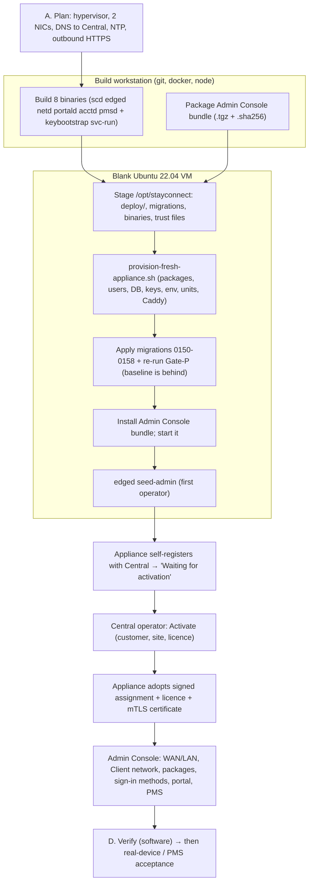

# OneGate Fresh VM Installation & Configuration Manual

| | |
|---|---|
| **Status** | Authoritative procedure for building a **new** OneGate appliance (and a separate OneGate Central) from a blank VM |
| **Reviewed against** | `master` at `7e4686ae56a229ef05460e02675d1d17924f8c9c` (2026-10-26) |
| **Companion documents** | [System Handbook](../architecture/ONEGATE_SYSTEM_HANDBOOK.md) · [Component inventory](../inventory/onegate-components.json) |
| **Audience** | An engineer who can use Linux, systemd, Docker and a hypervisor, and who has the repository, a Central to activate against, and Product-Owner authority for the target |

> ### Read this first — what this manual can and cannot promise
>
> * **No disposable full VM was available while writing it.** Steps are therefore labelled with how far they were verified
>   (legend below). The database portion of the install was **rehearsed on a disposable TimescaleDB container** and **uncovered a
>   defect in the current provisioner** (Part B, *Known defect K1*): on `master` the provisioner's database step fails on a
>   blank VM until the migrations after the baseline are applied first. The manual gives the working order.
> * The repository's installation is a **choreography of scripts plus manual steps**, not a single command. Where a step has no
>   automation, the manual says **MANUAL (gap)** and gives the exact commands.
> * Nothing here authorises Go-Live, live PMS posting, LIVE card payments, a Root-CA change or any action on a real production
>   environment. A **new** appliance built with this manual is **not** PRE-LIVE `172.21.60.25` and must not be pointed at it.
> * Secrets: every key, password and token is shown as a placeholder (`<…>`). Never paste a real secret into a ticket, a commit
>   or this document.

## Verification legend (each step carries one)

| Label | Meaning |
|---|---|
| **[REHEARSED-DB]** | Executed on a disposable TimescaleDB 2.16.1 / PostgreSQL 16 container built from this repository during this mission |
| **[SYNTAX]** | Script syntax checked (`bash -n`) in this mission; behaviour not exercised |
| **[CODE]** | Behaviour confirmed by reading the script/unit in the repository |
| **[LIVE-REF]** | The resulting state was observed on the running PRE-LIVE appliance or Central (read-only) |
| **[NOT-EXERCISED]** | Documented from the repository; **not** run on a fresh VM — treat as procedure to be validated on first use |
| **[PO]** | Needs an explicit Product-Owner decision/authorisation |

## Contents

* [Part 0 — The installation at a glance](#part-0--the-installation-at-a-glance)
* [Part A — Planning and prerequisites](#part-a--planning-and-prerequisites)
* [Part B — Fresh appliance installation](#part-b--fresh-appliance-installation)
* [Part C — Initial configuration](#part-c--initial-configuration)
* [Part D — Executable verification checklist](#part-d--executable-verification-checklist)
* [Part E — Recovery, maintenance, upgrade, rollback and restore](#part-e--recovery-maintenance-upgrade-rollback-and-restore)
* [Part F — Installing OneGate Central on a separate server](#part-f--installing-onegate-central-on-a-separate-server)
* [Appendix 1 — Environment files reference](#appendix-1--environment-files-reference)
* [Appendix 2 — Troubleshooting and log map](#appendix-2--troubleshooting-and-log-map)
* [Appendix 3 — Validation performed for this manual](#appendix-3--validation-performed-for-this-manual)

---

## Part 0 — The installation at a glance



**Order that works on current `master`** (Part B details each): *plan → build → stage → trust files → `dnsutils` → provision* — **but see Known defect K1: apply the post-baseline migrations before Gate-P** — *→ Admin Console bundle → first operator → Central activation → configure*.

Time budget (reference, not a promise): build 10–20 min, provisioning 10–15 min including container image pulls, activation minutes once an operator acts.

---

## Part A — Planning and prerequisites

### A.1 Hypervisor and VM

| Item | Requirement | Source |
|---|---|---|
| Hypervisor | **VMware ESXi / vSphere** is the only platform the project documents and has run on (PRE-LIVE). Other hypervisors/bare metal are **not documented — [PO]/unverified.** | PRE-LIVE; `docs/DEPLOYMENT_APPLIANCE.md` |
| Guest OS | **Ubuntu Server 22.04 LTS (amd64).** Every artefact targets 22.04 (Docker apt repository by `lsb_release -cs`, Kea 2.0.2 from the 22.04 archive). 24.04 is **not verified** — Kea/Unbound/netplan versions differ. | provisioner; **[LIVE-REF]** PRE-LIVE 22.04.5, kernel 5.15 |
| CPU / RAM / disk | Documented pilot-verified minimum: **2 vCPU / 4 GB / 40 GB** (mid-size site, hundreds of devices). Observed on PRE-LIVE: 1 vCPU, 7.8 GiB, 48 GB root LV (54 % used with 4 weeks of data, 3.9 GB journals, 461 MB set-aside DB). Treat 2 vCPU / 8 GB / 60 GB as a comfortable reference; there is **no official sizing statement beyond the pilot figure — [PO]**. Backups (pre-change, pre-restore, scheduled) and the set-aside database need headroom. | `DEPLOYMENT_APPLIANCE.md §8`; **[LIVE-REF]** |
| Architecture | amd64 only (the build and Docker apt line are hard-coded) | **[CODE]** |
| Disk layout | LVM root is what PRE-LIVE uses; the product does not require a particular layout. `/var/lib/docker` holds the database volume — it must be on durable storage. | **[LIVE-REF]** |
| Firmware/clock | UTC; **time synchronisation is mandatory** — the licence engine keeps a 48 h clock high-water and refuses large backwards jumps. `systemd-timesyncd` (PRE-LIVE) or chrony. | **[CODE]**, **[LIVE-REF]** |

### A.2 Exactly two NICs

OneGate's design rule is **two NICs and no more**.

| NIC | Role | Typical name | Addressing |
|---|---|---|---|
| **NIC 1 — WAN + management** | default route; SSH; Admin Console (HTTPS 443 pinned to its IPv4); the link to Central; the PMS if it is reached through the hotel LAN | `ens160` | Static (or DHCP) address with a default gateway and DNS able to resolve Central |
| **NIC 2 — LAN / Client** | carries Client networks; **no IP address** on the NIC itself — addresses live on bridges netd creates | `ens192` | None |

* The provisioner takes **WAN = interface of the default route** and **LAN = the first other interface, alphabetically**, skipping `lo`, `docker*`, `br-*`, `veth*`. If your VM has any other NIC, the heuristic can choose the wrong one. **Do not add a third NIC.** If interface names differ from `ens160`/`ens192`, check `netd.env` after provisioning (Part B.8). **[CODE]**
* Management and WAN are the **same** interface. Admin Console, SSH and the Central link share it. **[CODE]**

### A.3 ESXi virtual networking **[NOT-EXERCISED on a fresh host; the settings are from PRE-LIVE experience — DOC memory/`SYSTEM_OVERVIEW.md`]**

1. **WAN portgroup (NIC 1):** an ordinary portgroup on the management/uplink network. Default security settings are fine.
2. **LAN portgroup (NIC 2):** carries the Client traffic.
   * **Security → Promiscuous mode: Accept; MAC address changes: Accept; Forged transmits: Accept.** All three are required because the appliance bridges frames whose source MAC is the bridge's or a Client's, not the VM NIC's. *Symptom if missing:* DHCP Offers appear on the wire (`tcpdump`) but no Client ever completes DORA.
3. **VLAN mode of the LAN portgroup — choose one:**
   * **Access / untagged:** portgroup VLAN ID = the Client VLAN (or 0 for an untagged LAN). On the appliance the *prepared* untagged Client network (`10.20.0.0/20`) uses this. One Client network per NIC.
   * **Trunk:** portgroup VLAN ID **4095** (all VLANs) so the VM sees tagged frames; netd then creates `ens192.<vid>` sub-interfaces and a bridge per VLAN. Use this for several Client VLANs. *PRE-LIVE runs VLAN 90 this way (`ens192.90` → `br-g90-a811`).* Tagged-VLAN delivery on the switch/ESXi side is **recorded as unverified** by the project itself.
   * Both can coexist: an untagged network enslaves the parent NIC to its bridge while tagged VLANs ride sub-interfaces of the same parent.
4. Wi-Fi access points / switches: map each SSID to its VLAN; AP-level client isolation is *in addition* to the appliance's own isolation (`docs/ARUBA_SSID_VLAN_MAPPING.md`).
5. Do **not** run another DHCP server on a Client VLAN that OneGate serves with Kea (unless you configure the network as *external DHCP*).

### A.4 Addressing, DNS, NTP, firewall

| Need | Detail | Label |
|---|---|---|
| WAN IP/prefix/gateway | Static is recommended: the Admin Console certificate, the nft `443` pin and the Central link follow this address. Changing it later is a staged change with a confirm window (Part E). | **[CODE]** |
| DNS on the WAN NIC | Resolvers that **resolve `sc-central.echofusion.com`** (or your Central's name). The provisioner checks every upstream resolver and **hard-stops if they disagree** about the name (needs `dig`; set `ALLOW_SPLIT_DNS=1` only knowingly). PRE-LIVE is served by the FortiGate gateway DNS (`172.21.60.1`). | **[CODE]** |
| Central reachability | Outbound **TCP 443** to Central for register/CSR/licence/assignment/hello/portal-TLS, and **TCP 9443** (mutual TLS) once a certificate exists. The name must be a **hostname, not an IP**. Central never connects inbound to the appliance. | **[CODE]** |
| Package/image sources | The provisioner needs outbound HTTPS to the Ubuntu mirrors, `download.docker.com`, `dl.cloudsmith.io` (Caddy), `deb.nodesource.com`, and Docker Hub (images `timescale/timescaledb:2.16.1-pg16`, `redis:7-alpine`). **No offline install path exists. [PO] if the site is air-gapped.** | **[CODE]** |
| NTP | Outbound UDP 123 to the site's/clock source | — |
| Inbound to the appliance | **22/tcp** (SSH; not address-pinned) and **443/tcp** (Admin Console, pinned to the WAN IP by the rendered firewall). Nothing else on the WAN. Restrict who may reach these at the upstream firewall. | **[CODE]**, **[LIVE-REF]** |
| PMS | Protel FIAS is a **TCP** link from the appliance to the PMS host:port (reached over the WAN NIC unless a route says otherwise). REST PMS kinds need outbound HTTPS to the vendor. | **[CODE]** |
| Portal public name (optional, later) | `<label>.gw.onegate.work` is issued by Central; resolvers must allow answers pointing at private addresses (DNS-rebinding protection) for that zone. | **[DOC]** |

### A.5 What to have in hand before you start

1. **The exact commit** to install (record it) and a **clean checkout** of it on the build workstation (the build scripts refuse a dirty tree).
2. A running **OneGate Central** (Part F) whose DNS name you will use, **and its three public trust files**: `vendor-license.pub`, `assignment-registry-root.pub`, `central-tls-ca.crt` (from Central's `/opt/stayconnect/central/appliance-trust/`). Verify their fingerprints out of band against Central's `FINGERPRINTS.txt`. **[CODE][DOC deploy/pki/README.md]**
3. An operator on Central with `platform_owner`/`platform_admin` (to Activate).
4. The customer, site, licence terms (clients online, validity, grace, modules) you will activate.
5. The initial **site administrator** email and a strong password (≥ 10 characters).
6. For PMS later: host/port of the Protel FIAS interface (and whether TLS with a pinned certificate is used), plus a PMS-side window to commission it. *No real PMS connection is needed to install.*
7. A build workstation with: `git`, Docker (Linux containers), `bash`, `sha256sum`, Node 20 + npm (for the Admin Console package), `scp`/`ssh` to the VM.

### A.6 Things you must **not** do

* Do not run `scripts/phase1-bootstrap.sh` or `scripts/phase3-bootstrap.sh` (dev-only; seed a dev tenant and default-password admin).
* Do not apply `deploy/nftables/stayconnect.nft`, `deploy/netplan/02-lan-bridge.yaml`, `deploy/kea/kea-dhcp4.conf` or `deploy/unbound/unbound-stayconnect.conf` — they are legacy skeletons that would overwrite what `netd` renders and wipe every Client network.
* Do not copy any file from, or point the new appliance at, the retired development reference appliance or the former Central `150.0.0.252`.
* Do not use PRE-LIVE `172.21.60.25` as a donor of identity, keys or configuration.
* Do not hand-edit `/etc/stayconnect/identity`, `assignment` or `license`.


---

## Part B — Fresh appliance installation

> **Roles.** *WS* = the build workstation. *VM* = the new appliance, as `root`. Replace `<…>` placeholders. Commands that
> contain `<secret>` placeholders must be typed from your vault — never stored in shell history files you keep.

### B.0 Known defects in the current installer (measured — read before you start)

| ID | Defect (on `master 7e4686ae`) | How it was found | Effect | Workaround in this manual |
|---|---|---|---|---|
| **K1** | The factory baseline `data-plane/migrations/baseline/0000_production_baseline.sql` was last generated "through 0149", but the tree has migrations to **0158**. `deploy/gatep/gatep-grants.sql` (applied by the provisioner right after the baseline) references objects created by 0155 (`iam_v2.guest_network_pms_policy`). | **[REHEARSED-DB]**: provisioner database steps replayed on a blank TimescaleDB 2.16.1 container. The baseline loads, then `gatep-grants.sql` fails with `relation "iam_v2.guest_network_pms_policy" does not exist` (`svc-scd-iamv2-guest-auth-grants.sql:87`). | `provision-fresh-appliance.sh` **aborts at "database"** on a blank VM (`ON_ERROR_STOP=1` + `set -e`). | B.7 — stage a baseline regenerated from the same commit |
| **K2** | The provisioner advertises itself as re-runnable but re-applies the baseline unconditionally. A second run fails with `schema "iam_v2" already exists`. | **[REHEARSED-DB]** | After K1 aborts, simply re-running does not recover. | B.7 avoids the first failure; B.7-recovery wipes the half-built DB |
| **K3** | `build-appliance-binaries.sh` does not build `keybootstrap` and `svc-run`, which the provisioner and the Caddy / Admin Console units need. | **[CODE]** | `set -e` abort at "credentials" (missing `keybootstrap`), or `203/EXEC` on units. | B.1 passes `SERVICES=` explicitly |
| **K4** | No installer creates the first operator, copies the tree/binaries to `/opt/stayconnect`, installs the Admin Console bundle, installs trust files (git-ignored), installs polkit/Kea/Unbound overrides, or `dnsutils`. | **[CODE]** | Manual steps below. | B.4–B.5, B.9–B.11 |
| **K5** | Even after the database is correct, `live-site` migrations through `edge-migrate.sh` demand a verified pre-change backup that needs a backup key holder created in the Admin Console — impossible before the first operator exists. | **[CODE]** | Do **not** plan to migrate a blank box through `edge-migrate.sh`; build it at the target schema (B.7). Day-2 migrations are fine (Part E). | B.7 |

> Fixing K1/K2/K3 properly means regenerating and committing the baseline and changing the provisioner/build script. That is a
> **controlled schema/installer change reserved for a Product-Owner decision** (Handbook §24.2) and was deliberately **not**
> made in this documentation-only mission.

### B.1 Build the binaries (WS) — **[CODE][SYNTAX]**

```bash
git clone https://github.com/aibrahiiim1/StayConnectEnterprise.git && cd StayConnectEnterprise
git checkout <approved-commit-sha>                 # record this SHA in your install log
test -z "$(git status --porcelain)" || { echo "dirty tree – the build refuses"; exit 1; }

# Default SERVICES omit keybootstrap and svc-run (defect K3) – name them explicitly:
SERVICES="scd edged pmsd portald netd acctd keybootstrap svc-run" \
  bash scripts/build-appliance-binaries.sh ../sc-appliance-build
# Expected last line:  APPLIANCE_BUILD = PASS
sha256sum ../sc-appliance-build/* > ../sc-appliance-build/SHA256SUMS
```

What it does: `golang:1.25.12` container, `CGO_ENABLED=0 GOOS=linux GOARCH=amd64`, `go build -trimpath -tags stayconnect_production`,
**no `-ldflags`**, then reads `go version -m` and requires `vcs.revision == HEAD`, `vcs.modified=false` and the production tag. A dirty tree is refused (exit 2).
`sitemigrate` is a legacy tool and is **not** needed.

### B.2 Package the Admin Console (WS) — **[CODE][SYNTAX]**

```bash
bash deploy/scripts/deploy-hotel-admin.sh package hotel-admin
# produces hotel-admin/hotel-admin-deploy.tgz and hotel-admin-deploy.tgz.sha256
```

Needs git (provable commit, clean tree), Node 20 + npm (`npm ci` + `npm run build` under `capability-contract.json`). The bundle carries a
machine-readable `hotel-admin-release.json` (source commit, build id). **Nothing is built on the appliance.**

### B.3 Prepare the operating system (VM) — **[NOT-EXERCISED]**

1. Install **Ubuntu Server 22.04 LTS amd64**, minimal + OpenSSH. Create the two NICs per Part A.2 / A.3.
2. Give NIC 1 (WAN) its **static address, gateway and resolvers** (the provisioner never writes netplan for the WAN). Leave NIC 2 **unconfigured** (no address, no netplan entry that configures it).
3. Set the timezone to UTC and confirm time sync:
   ```bash
   timedatectl set-timezone Etc/UTC; timedatectl | grep -E 'synchronized|NTP'    # expect "System clock synchronized: yes"
   ```
4. Hostname: **the product does not use the OS hostname** for identity (serial/MACs/DMI are used). Set a sensible one (`hostnamectl set-hostname <site>-og1`). **[UNVERIFIED how the project intends it]**
5. Update and install the packages the provisioner does *not* install (defect K4):
   ```bash
   apt-get update && apt-get -y upgrade
   apt-get -y install dnsutils openssl iproute2 netplan.io rsync tar age   # dnsutils → the split-DNS check works; age → manual restore of backups
   ```
6. Confirm only **two** NICs and their names: `ip -br link`. If they are not `ens160` / `ens192`, note the names — you will verify `netd.env` in B.8.
7. Reboot once to prove the static address and DNS survive: `ip -br addr; resolvectl status`.

### B.4 Stage the repository files onto the VM (MANUAL — defect G1) — **[NOT-EXERCISED]**

The provisioner expects the tree under `/opt/stayconnect`. Nothing copies it for you.

```bash
# from WS, in the repository checkout at <approved-commit-sha>
ssh root@<vm> 'install -d -m 0755 /opt/stayconnect /opt/stayconnect/bin /opt/stayconnect/data-plane /opt/stayconnect/scripts'
rsync -a --delete --exclude 'pki/' deploy/    root@<vm>:/opt/stayconnect/deploy/   # --exclude keeps trust files from B.5 on a re-sync
rsync -a --delete data-plane/migrations/        root@<vm>:/opt/stayconnect/data-plane/migrations/
rsync -a scripts/edge-migrate.sh scripts/gatep-reconcile.sh scripts/binary-rollback.sh \
      root@<vm>:/opt/stayconnect/scripts/        # needed later for Part E (edge-migrate.sh resolves migrations relative to its parent directory)
scp ../sc-appliance-build/{scd,edged,pmsd,portald,netd,acctd,keybootstrap,svc-run} root@<vm>:/opt/stayconnect/bin/
scp hotel-admin/hotel-admin-deploy.tgz hotel-admin/hotel-admin-deploy.tgz.sha256 root@<vm>:/root/
ssh root@<vm> 'chmod 0755 /opt/stayconnect/bin/* && sha256sum /opt/stayconnect/bin/* | head'
```

Compare the printed hashes with `SHA256SUMS` from B.1. Keep a record of `commit → binary sha256` — the repository does not write `DEPLOYED_BINARIES.sha256`; on PRE-LIVE it is maintained by hand (columns: service, sha256, `vcs.revision`, tags, modified, written).

### B.5 Install the Central trust material into the deploy tree (MANUAL — defect G6) — **[NOT-EXERCISED]**

`deploy/pki/` is git-ignored; a fresh checkout contains only a README. Take the three **public** files from Central (`/opt/stayconnect/central/appliance-trust/`), **verify their fingerprints out of band** against Central's `FINGERPRINTS.txt`, then:

```bash
install -d -m 0755 /opt/stayconnect/deploy/pki
install -m 0644 vendor-license.pub            /opt/stayconnect/deploy/pki/vendor-license.pub          # 32 raw bytes
install -m 0644 assignment-registry-root.pub  /opt/stayconnect/deploy/pki/assignment-registry-root.pub # 32 raw bytes
install -m 0644 central-tls-ca.crt            /opt/stayconnect/deploy/pki/central-ca.crt              # NOTE the slot name differs from Central's file name
sha256sum /opt/stayconnect/deploy/pki/*
```

* The installers refuse a 64-byte file (that would be a private key) and refuse to replace a *different* key without `--force`.
* **If you skip this**, the provisioner only prints a note and continues — and the appliance then **never registers** (no Central CA) or **never adopts its assignment** (no registry root), with no loud error. Offline first-activation additionally needs `vendor-license.pub`.

### B.6 Pre-flight checks (VM) — **[NOT-EXERCISED]**

```bash
getent hosts sc-central.echofusion.com                                   # resolves to Central
for r in $(resolvectl status | awk '/DNS Servers/{for(i=3;i<=NF;i++)print $i}'); do dig +short @"$r" sc-central.echofusion.com; done   # all agree
curl -sS --cacert /opt/stayconnect/deploy/pki/central-ca.crt https://sc-central.echofusion.com/readyz   # Central answers (JSON)
curl -sSI https://download.docker.com | head -1; curl -sSI https://dl.cloudsmith.io | head -1; curl -sSI https://deb.nodesource.com | head -1
ip -br link | grep -v lo       # exactly two NICs (+ none other)
df -h / ; free -h              # headroom
```

Stop if any check fails — each one corresponds to a way the provisioner or the later Central link fails silently.


### B.7 Provision the appliance

`provision-fresh-appliance.sh` is the only installer. As root on the VM:

```bash
bash /opt/stayconnect/deploy/scripts/provision-fresh-appliance.sh      # optional env: CENTRAL_BASE CENTRAL_MTLS_BASE WAN_IFACE LAN_IFACE ALLOW_SPLIT_DNS=1
```

What it does (**[CODE]**; each step prints a heading): (1) apt packages — `ca-certificates curl gnupg lsb-release nftables conntrack unbound jq python3`, Docker (`docker-ce`, `docker-ce-cli`, `containerd.io`, `docker-compose-plugin` from `download.docker.com`), Caddy (from Cloudsmith; the stock `caddy.service` is disabled and masked by the shipped unit), `kea-dhcp4-server` (installed then **disabled and stopped**), Node 20 (NodeSource) · (2) layout and service accounts — `stayconnect`, `stayconnect-portald`, `stayconnect-pmsd`, group `stayconnect-scd`; directories under `/opt/stayconnect`, `/etc/stayconnect` (secrets `0700`), `/var/log/stayconnect`, `/var/lib/kea`, `/var/log/caddy` · (3) infra — random superuser password in `/etc/stayconnect/secrets/pg-superuser.env`, `docker compose -f deploy/compose/infra.yml up -d`, waits ≤ 120 s for `pg_isready` · (4) **database** — creates `stayconnect_site`; runs `gatep-roles.sql`, `gatep-iam-roles.sql`, the baseline, `gatep-iam-roles.sql` again, `gatep-iam-ownership.sql`, `gatep-grants.sql`; asserts ≥ 2 hypertables · (5) credentials and keys — `gatep-set-passwords.sh` writes `/etc/stayconnect/.dsn`; `keybootstrap` creates the nine key files and the OTP generation-1 row; installs the three trust files if present · (6) service environment files (Appendix 1), Central endpoint validation, DNS checks · (7) tmpfiles, sysctl, **`install-service-units.sh`**, Caddy unit + Caddyfile, mints the Admin Console certificate, enables Caddy · (8) enables `scd edged acctd netd portald hotel-admin`, restarts the five Go daemons (`scd` first, then the rest) and **fails** unless each of `scd edged acctd netd portald caddy` is `active` and `scd` logged `build=production`.

It deliberately **does not**: copy files into `/opt/stayconnect`, build anything, write netplan / nftables / Kea / Unbound configuration, set the hostname, create a tenant, site, licence or operator, apply migrations beyond the baseline, install polkit rules, install the Admin Console, enable `pmsd`, or configure any PMS. It also refuses to run if `/etc/stayconnect/removed-from-central.json` exists.

**Because of defects K1/K2, step (4) fails on current `master`.** Choose **one** of the two paths below **before** running the command above.

#### Path A (preferred): provision from a baseline regenerated at the target commit

1. On the WS, in a **throwaway clone** of the exact commit (the generator writes into that checkout's `data-plane/migrations/baseline/`; do not run it in your working tree):
   ```bash
   git clone --local <your-checkout> /tmp/og-baseline && cd /tmp/og-baseline && git checkout <approved-commit-sha>
   bash scripts/generate-production-baseline.sh          # Docker; builds the whole upgrade path 0001→0158 in a cleanroom container and dumps its end state (tens of minutes)
   bash scripts/factory-clean-baseline-verify.sh         # proves the baseline path and the upgrade path agree object for object
   sha256sum data-plane/migrations/baseline/0000_production_baseline.sql
   ```
2. In B.4, stage **that** file as `/opt/stayconnect/data-plane/migrations/baseline/0000_production_baseline.sql` (instead of the committed one) and record its sha256 in the install log.
3. Run the provisioner unmodified. Its database step now finds every object `gatep-grants.sql` needs.
4. **Result in this mission [REHEARSED-DB]:** the generator ran to completion on `7e4686ae` (`EXIT 0`; 3 extensions, 11 migration-created roles, 2 hypertables, 82 `scrub_registry` seed rows; 33,744 lines; its header now reads `0001..0158` instead of `0001..0149`). Replaying the provisioner's database sequence on a blank TimescaleDB 2.16.1 / PostgreSQL 16 container with that file **succeeded end to end**: roles → baseline → ownership → `gatep-grants.sql` all OK; `iam_v2` **169** tables, `public` **49**; **2** hypertables registered; the post-baseline objects present (`guest_network_pms_policy`, `network_archive`, `delete_unused_pms_interface`); **0** `iam_v2` relations or functions owned by anyone but `iam_v2_owner`; an `INSERT` into `audit_log` accepted; ledger empty (as designed). `factory-clean-baseline-verify.sh` (object-for-object comparison of the two paths) was **not** run — run it before trusting a regenerated file.
5. **[PO]** The committed baseline in git is *not* changed by this procedure; the Product Owner should either accept an install from a generated-but-uncommitted baseline or commit the regenerated file first (the proper fix, Handbook §24.2).

#### Path B (fallback; rehearsed on a disposable database): finish the database by hand, then resume the provisioner without its database section

1. Run the provisioner once. It will install packages, create accounts and the compose stack, create `stayconnect_site`, load roles and the baseline, and then **stop** at `gatep-grants.sql` with `relation "iam_v2.guest_network_pms_policy" does not exist`. Everything it did up to that point is kept.
2. Complete the schema **in this order** (rehearsed: baseline → `0150…0158` → ownership → grants succeeds, giving 169 `iam_v2` tables, 2 hypertables, nine ledger rows through `0158`). `edge-migrate.sh` in `live-site` mode would demand a verified pre-change backup that cannot exist yet (**K5**), so on this *never-activated, data-free* database the migrations are applied with the runner's `disposable` mode (the operator creates the harness marker) — **[PO] accept this one-time use on a factory-clean database**:
   ```bash
   export EDGE_PSQL='docker exec -i stayconnect-pg psql -v ON_ERROR_STOP=1 -U stayconnect -d stayconnect_site'
   $EDGE_PSQL -c 'CREATE TABLE IF NOT EXISTS public._scratch_marker(x int)'
   for v in $(ls /opt/stayconnect/data-plane/migrations/*.up.sql | sed 's#.*/##; s#\.up\.sql##' | awk '$0>="0150"'); do
     sha=$(sha256sum /opt/stayconnect/data-plane/migrations/$v.up.sql | cut -d' ' -f1)
     bash /opt/stayconnect/scripts/edge-migrate.sh --only "$v" --expect-db stayconnect_site \
          --target-kind disposable --ack-target I_UNDERSTAND_DISPOSABLE_DATABASE --expect-sha256 "$sha" || { echo "FAILED $v"; break; }
   done
   $EDGE_PSQL -c 'DROP TABLE public._scratch_marker'          # remove the harness marker immediately
   docker cp /opt/stayconnect/deploy/gatep stayconnect-pg:/tmp/gatep
   for f in gatep-iam-ownership.sql gatep-grants.sql; do $EDGE_PSQL -f /tmp/gatep/$f || { echo "FAILED $f"; break; }; done
   ```
   (Each migration takes about a minute; `0155` and `0156` take the longest.) **Re-running ownership after the migrations is required**: in the rehearsal five functions created by 0150–0158 were not owned by `iam_v2_owner` until `gatep-iam-ownership.sql` ran again.
3. Assert: `$EDGE_PSQL -tAc "select count(*) from timescaledb_information.hypertables"` → `2`; `select count(*) from public.schema_migrations` → `9`; D3-04 → `t,t,t`.
4. Resume the rest of the provisioner **without** its database section (the script cannot be re-run whole — **K2**). Generate a resume copy and review it:
   ```bash
   sed -E '/^# -+ 4\. database/,/^# -+ 5\. credentials/{/^# -+ 5\. credentials/!d}' \
       /opt/stayconnect/deploy/scripts/provision-fresh-appliance.sh > /root/provision-resume.sh
   bash -n /root/provision-resume.sh && diff <(sed -n '1,400p' /opt/stayconnect/deploy/scripts/provision-fresh-appliance.sh) /root/provision-resume.sh | head -50
   bash /root/provision-resume.sh
   ```
   (Verified in this mission: the pattern removes exactly the "database" section, the result parses with `bash -n`, and no later step references the removed variables.) The package/layout/infra steps are idempotent and re-run harmlessly.

### B.8 Check what provisioning left behind — **[LIVE-REF] for the resulting state**

```bash
cat /etc/stayconnect/netd.env | grep -E 'NETD_(WAN|MGMT|LAN)'        # WAN/LAN names correct? NETD_MGMT_ADDR=auto
systemctl is-active stayconnect-{scd,edged,acctd,netd,portald,caddy}  # all active
systemctl is-enabled stayconnect-hotel-admin stayconnect-pmsd         # hotel-admin enabled (not yet running); pmsd NOT enabled
docker ps; ss -ltnup | grep -E ':(443|8090|8380|8343|5432|9101)'
```

If `NETD_WAN_IFACE`/`NETD_LAN_PHYS` are wrong (a third interface or different names), fix `netd.env` and restart netd (`systemctl stop stayconnect-netd; systemctl reset-failed stayconnect-netd; systemctl start --no-block stayconnect-netd`) **before** creating any Client network.

State at this point: services running, **no tenant / site / licence / operator / Client network**, Kea installed but stopped, `scd` waiting for registration, the Admin Console certificate minted but the console not yet installed. Kea and Unbound are brought under netd control at the first network apply.

### B.9 Optional OS-level extras (MANUAL — defect G7) — **[NOT-EXERCISED]**

Install only what you need; none is required for a first Client to sign in.

```bash
# Allow the Admin Console "Restart service" action (user stayconnect → systemd manage-units).
# Ubuntu 22.04 ships polkit 0.105, which has NO JavaScript rules.d: use the .pkla (it grants manage-units to the user;
# the per-unit whitelist is enforced inside edged). The 49-...rules file applies only to polkit >= 0.106.
install -D -m 0644 /opt/stayconnect/deploy/polkit/50-stayconnect-health.pkla /etc/polkit-1/localauthority/50-local.d/50-stayconnect-health.pkla
# Restart policies for Kea and Unbound (Restart=on-failure, svc-run back-off)
install -D -m 0644 /opt/stayconnect/deploy/kea/systemd/override.conf     /etc/systemd/system/kea-dhcp4-server.service.d/override.conf
install -D -m 0644 /opt/stayconnect/deploy/unbound/systemd/override.conf /etc/systemd/system/unbound.service.d/override.conf
# Let scd write the Admin Console vhost during certificate operations
install -D -m 0644 /opt/stayconnect/deploy/systemd/stayconnect-scd.service.d/hotel-admin-cert.conf /etc/systemd/system/stayconnect-scd.service.d/hotel-admin-cert.conf
systemctl daemon-reload
```

(`pmsd` is intentionally **not** in the polkit unit list. Which polkit file PRE-LIVE actually uses was not inspected — **[UNVERIFIED]**.)

### B.10 Install the Admin Console bundle (VM) — **[CODE][SYNTAX]**

```bash
sha256sum -c /root/hotel-admin-deploy.tgz.sha256
HOTEL_ADMIN_USER=stayconnect-hotel-admin \
  bash /opt/stayconnect/deploy/scripts/deploy-hotel-admin.sh install /root/hotel-admin-deploy.tgz
```

It verifies the checksum and bundle structure, extracts to `/opt/stayconnect/releases/hotel-admin/<stamp>`, boots the candidate on a scratch port and checks the capability contract, flips the `/opt/stayconnect/hotel-admin` symlink atomically, restarts **only** `stayconnect-hotel-admin`, smoke-tests it, rolls back automatically on failure, then runs the backup-cleanup. It refuses to run from `/root` as the working directory — run it from `/opt/stayconnect/deploy/scripts` or `/`. `HOTEL_ADMIN_USER` is set because the script otherwise chowns the release to `stayconnect` while the unit runs as `stayconnect-hotel-admin` (**G11**).

### B.11 Create the first operator (MANUAL — defect G4) — **[CODE]**

No installer creates an operator, and there is no setup wizard. As root, using the DSN the provisioner wrote:

```bash
set -a; . /etc/stayconnect/edged.env; set +a          # EDGED_DB_URL must be the generated svc_edged DSN, not the old default
/opt/stayconnect/bin/edged seed-admin --email <site-admin-email> --password '<>=10 chars>' --name 'Site Admin'
```

* Creates `operators` + role `site_admin`. A password shorter than 10 characters requires `--allow-weak` and forces a password change at first sign-in. Re-running with the same email **resets the password and clears any lockout**.
* Operators are local to the appliance and independent of Central operators.
* Do not put the password in a script or shell history you retain.

### B.12 Enable the enforcement plane (and Client commerce) — **MANUAL — defect G10 — [CODE]**

Without this a Client "signs in" but is never given the Internet (sessions stay `PENDING_ENFORCEMENT`), and without the Phase-2 portal flag the portal cannot list packages.

```bash
APPLY=0 bash /opt/stayconnect/deploy/scripts/enable-phase3-enforcement-plane.sh     # dry run: shows what it will write
bash /opt/stayconnect/deploy/scripts/enable-phase3-enforcement-plane.sh             # writes netd.env (STAYCONNECT_PHASE3_MASTER, NETD_PHASE3_PRODUCER_UID=<uid of acctd's user>) and acctd.env (STAYCONNECT_PHASE3_MASTER);
                                                                                    # restarts netd then acctd only if they started before their env changed
bash /opt/stayconnect/deploy/scripts/check-phase3-enforcement-plane.sh /etc/stayconnect   # coherence check (also run by install-service-units.sh)
```

The script's own header says it is for "an appliance that already runs a Phase-3 guest surface"; on a fresh box with **only** voucher/account/email sign-in the guest surface flag is `STAYCONNECT_IAMV2_MASTER` and enforcement still needs the plane above. Commerce (packages, quote, confirm) additionally needs, in `scd.env` and `edged.env`: `STAYCONNECT_PHASE2_MASTER=true`, `STAYCONNECT_PHASE2_PORTAL=true` (scd/portal) and `STAYCONNECT_PHASE2_ADMIN=true` (edged), then restart scd, edged and portald. **[UNVERIFIED]** — the repository contains no single document that lists the exact flag set for a minimal fresh appliance; the set above is derived from `deploy/scripts/enable-phase3-enforcement-plane.sh`, `data-plane/internal/iamv2/commerce_config.go` and the portal's behaviour, and must be confirmed on first use. After enabling, run D3c-06/07.

### B.13 Hand over to configuration

The appliance now shows **Waiting for activation** (it registers itself every 30 s → 5 min until Central answers). Continue with **Part C**. Keep an install log with: commit SHA, binary and Admin Console hashes, baseline sha256 (Path A) or migration list (Path B), Central endpoint, operator created, flags enabled, and who did what and when.


---

## Part C — Initial configuration

Everything in Part C is done in a browser (two consoles) and is **[NOT-EXERCISED]** on a fresh VM in this mission; the screens and routes named
are those in the repository (`hotel-admin/components/nav.tsx`). The appliance is **factory-clean** until Central activates it: no tenant, no
site, no licence, no Client network.

### C.1 Identity: what "factory-clean" means and what must never be typed

* **Tenant, site and appliance identity are never entered on the appliance.** They arrive as a Central-signed assignment verified against the pinned registry root. Do not set `*_TENANT_ID` / `*_SITE_ID` in any env file (the provisioner refuses a file containing them; production builds ignore them).
* The appliance generates its own Ed25519 identity at first `scd` start; `scd` registers token-less (`SCD_AUTO_REGISTER=true`) and then waits. **There are no enrollment tokens** and no setup wizard (`/setup/enrollment` redirects to `/appliance`).
* Do not hand-edit `/etc/stayconnect/{identity,assignment,license}`.

### C.2 First sign-in to the Admin Console

1. Browse to `https://<WAN-IP>/` (or `https://hotel.stayconnect.local/` if you map that name to the WAN IP in your DNS/hosts — the appliance's own Unbound does **not** serve that name to the WAN side). The certificate is signed by **Caddy's local CA**; trust `/var/lib/caddy/.local/share/caddy/pki/authorities/local/root.crt` on the staff PC or accept the warning once. **[UNVERIFIED how staff PCs are expected to receive that root]**
2. Sign in as the operator created in B.11. If the password was shorter than 10 characters (`--allow-weak`) you are forced to choose a new one (≥ 10 characters) before anything else.
3. Recommended: enable the optional **two-step sign-in** (TOTP) under *Account*; store the recovery codes (shown once). There is no setting to *require* it for everyone.
4. Session limits default to 30 min idle / 12 h absolute. Keep an eye on *Operators* to add real staff (roles: Site IT manager, Client services operator, Client relations operator, Voucher operator, Payments operator, Viewer) and **disable or change the seeded account** once they exist.

### C.3 Registration and activation (Central side)

**Online (zero-touch):**

1. On the appliance, *System → Appliance & licence* (`/appliance`) shows **Waiting for activation** with the **serial**. (If it instead says it cannot reach Central, fix DNS / the Central CA / outbound 443 — Appendix 2.)
2. In the **Central console** → *Appliances*: the new appliance appears as **Waiting**. A real, unexpected appliance appearing = investigate; do not Activate it.
3. **Activate** (needs a `platform_owner`/`platform_admin` and password step-up): choose or create the **Customer** and **Site** (Site = one physical property; a Customer must be explicit); set **clients online at once** (0 = unlimited), **valid days / until**, **grace days**, and **licensed modules** (`hospitality` for PMS/room sign-in; `paid_access`, `card_payment`, `room_charge`, OTP/social add-ons as sold). Site Type is descriptive only.
4. One transaction produces the **signed assignment**, the **signed licence** (schema 4) and an audit entry. A site that already holds *another customer's* data is refused (`409 holds_other_customer_data`).

**Offline (no route to Central):** *Appliance & licence → Offline activation → Download activation request* → import it in Central (*Appliances → Import activation request*) → Activate → download the **activation package** → upload it on the appliance. Requires `vendor-license.pub` already pinned (B.5). Licence renewal offline = Central *Offline licence file* → *Upload licence file*.

### C.4 Confirm the appliance converged (software facts)

Within minutes of activation (assignment poll 30 s, licence 1 min until held):

```bash
ls -l /etc/stayconnect/assignment/ /etc/stayconnect/license/ /etc/stayconnect/certs/     # assignment.json, registry.json; current.json, state.json; client.crt, ca.crt, mtls-client.key
journalctl -u stayconnect-scd --since "10 min ago" --no-pager | grep -iE 'assignment|licen[cs]e|registered|certificate' | tail -20
```

Admin Console *Appliance & licence* should read **Active** (or Grace) with the licence terms, and the Central console shows the appliance **connected** (hello ≤ 5 min). The licence is hardware-bound: moving the disk to different hardware is a hard mismatch; a changed WAN MAC alone is a soft mismatch fixed by Central *Rebind WAN MAC*.

### C.5 WAN / LAN settings

*Network → WAN / LAN settings* (`/network/system`). The WAN is already configured by you in B.3; change it here only through the **validate → apply → confirm** flow:

* **Validate** (no changes) shows the effective merged config and the new management URL. **Apply** needs your password; netd backs up the netplan files, applies, re-asserts the firewall pin, and verifies WAN IP, gateway and **management reachable**.
* You then have **120 s to Confirm from the new management URL**; otherwise netd restores the old files automatically. Changing the WAN IP changes the Admin Console URL and re-issues its certificate; with a literal (non-`auto`) `NETD_MGMT_ADDR` such a change is refused (`management_pin_lockout`).
* The LAN section shows the physical Client NIC; DHCP is **not** edited here (`dhcp_not_edited_here`) — it belongs to each Client network.

### C.6 First Client network

Open *Network → Client networks* (`/network`). A fresh appliance offers one **prepared, not-active** Access network:

| Property | Prepared default |
|---|---|
| Name / type | "Client Wi-Fi" — untagged |
| Subnet / gateway | `10.20.0.0/20` / `10.20.0.1` |
| DHCP pool | `10.20.0.10` – `10.20.15.254`, lease 3600 s (renew 900, rebind 7200) |
| Domain | `guest.local` |
| Captive portal, Internet, NAT, isolation | on |

**Option 1 — activate the prepared network (untagged):** map your AP/SSID to the VLAN that reaches NIC 2 untagged; *Activate* (a staged ENABLE) → **Apply** (password) → verify → **Confirm within 120 s**.

**Option 2 — tagged VLAN(s) on a trunk:** set the LAN NIC's role/port mode to **Client trunk** (*Ports → Trunk*; protected management/WAN ports are refused), create a network with **VLAN id**, gateway/subnet/pool, then Apply → Confirm. Naming is automatic (`ens192.<vid>`, `br-g<vid>…`); topology fields (type, VLAN, parent, bridge) are **immutable** — change them with a staged *Replace*. Two networks cannot overlap subnets or share a VLAN on one parent.

What the apply does (so you know what to verify): creates the bridge (and VLAN sub-interface), assigns the gateway address, converges the nftables table, pushes the Kea config (and **starts Kea for the first time**, writing `/etc/kea/kea-dhcp4.conf`), writes Unbound fragments (and restarts it), creates `ogportal0` with the portal address, and runs health checks (`mgmt_reachable`, `gateway_up`, `kea_running`, `portal_listen`, `portal_address`). **Any failing check rolls the whole change back** and the revision is marked `rolled_back` with the reason — read *Config history* (`/network/revisions`).

Choices per network (see `docs/CLIENT_NETWORKING.md`, `EXTERNAL_DHCP_MODE.md`): **DHCP mode** `local` (Kea) / `external` (the hotel's server — then *you* must hand out option 114 and the gateway) / `relay` (**no data path implemented**) / `disabled`; **DNS mode** appliance or custom; **NAT**; **client isolation**; **captive portal**; internet on/off; lease timers; reservations; per-network portal profile and sign-in methods.

### C.7 Gateway, DHCP, DNS, NAT and captive-portal expectations

After Confirm, on the VM: `ip -br addr` shows the bridge with the gateway address; `ss -ulnp | grep ':67 '` shows Kea on the gateway; `ss -tulnp | grep ':53 '` shows Unbound on the gateway; `nft list table inet stayconnect` shows the sets and chains of Handbook §10.4. A Client should receive an address from the pool, DNS from the gateway, and option 114 pointing at the portal. Real-device behaviour (iOS/Android/Windows auto-pop, VLAN delivery through the physical switch) is **acceptance, not software verification** — Part D.3.

### C.8 Portal address, certificate and branding

* The **portal address** is a private RFC 1918 /32 on `ogportal0` (default series starting `10.255.255.1`, chosen by migration 0116, changeable under *Portal HTTPS*); it must lie outside every Client and host subnet.
* *Portal settings* (`/portal-branding`): brand, welcome text, languages, layout. Images are uploaded to `/opt/stayconnect/portal-assets`.
* **Portal HTTPS** (`/portal-https`): obtains `<label>.gw.onegate.work` through Central (requires Central's Cloudflare token + ACME contact configured by the Product Owner — status on PRE-LIVE was recorded as NOT_CONFIGURED until then). Until HTTPS is active, option 114 carries the HTTP gateway URL and **social login is not offered**. Hotel-owned domains need three DNS records (Handbook §14.3).
* *TLS certificate* (`/network/certificate`): Admin Console certificate status/rotate; auto-renews.

### C.9 Sign-in methods, packages and the Client Portal

1. *Internet packages* (`/internet-packages`) and *Service plans*: create at least one **Free** package (price 0) so a first Client can be tested; paid packages need the `paid_access` module and a currency.
2. *Sign-in methods* (`/sign-in-methods`): switch on the methods you offer — **Voucher**, **Client accounts** (staff-created), **Email accounts** (needs `email_otp` module), **Open selection** (default off), and (licensed) **SMS / WhatsApp codes** and **Social login**. Per-network overrides exist.
3. *Vouchers* (`/vouchers`): generate a batch (code length/mode/prefix configurable); a voucher is always tied to one package revision; reveal/export need the right permission and password.
4. Optional *Delivery* (`/notifications`): SMTP / SendGrid / Twilio / WhatsApp providers — **without one, no OTP or verification email is ever issued**. Optional *Identity providers* (`/social-providers`), *Payment methods* (`/payment-methods`, **TEST mode only** unless the Product Owner authorises LIVE), *Allowed sites* (walled garden).
5. Test with a **voucher on a test device** on the new Client network (Part D.3).

> **Do not skip:** on a freshly provisioned appliance the *enforcement plane* is **not** enabled by the provisioner. Until it is (B.12) a successful sign-in produces a session that stays `PENDING_ENFORCEMENT` and the device never gets Internet.

### C.10 PMS Interface onboarding without a live PMS

You can prepare Room sign-in completely and leave it **inert** until a real PMS is available. **[NOT-EXERCISED here; derived from `docs/runbooks/PMS-Interface-Commissioning.md` and the code]**

1. **Licence** must include `hospitality` (Central Activate). The *Hotel* pages (`/pms-interfaces`, `/room-sign-in`, `/pms-routing`, `/stays`, …) appear only then and only when the Phase-3 admin surface is enabled (below).
2. **Enable the PMS surface flags** (otherwise the PMS admin routes are not mounted at all):

   ```text
   # /etc/stayconnect/edged.env   → STAYCONNECT_PHASE3_MASTER=1   STAYCONNECT_PHASE3_ADMIN=1
   # /etc/stayconnect/scd.env     → STAYCONNECT_PHASE3_MASTER=1   STAYCONNECT_PHASE3_PMS_AUTH=1
   # /etc/stayconnect/pmsd.env    → STAYCONNECT_PHASE3_MASTER=1 …_PMS_CONNECTOR=1 …_PMS_INGEST=1 …_CHECKOUT_GRACE=1
   #                                PMSD_DB_URL=<svc_pmsd DSN from /etc/stayconnect/.dsn>
   #                                PMSD_EVIDENCE_KEY_HEX=<32-byte hex>  PMSD_EVIDENCE_KEY_VERSION=1
   #                                PMSD_EVENT_IDENTITY_KEY_HEX=<32-byte hex>  PMSD_EVENT_IDENTITY_KEY_VERSION=1
   ```

   Generate the two HMAC keys with `openssl rand -hex 32` and record them in your vault (they are **not** in any backup the product writes by itself). Do **not** set `PMSD_SECRET_KEY_*` for a `credential_mode=NONE` (Protel FIAS) interface. Enabling PMS authentication does not disable voucher/account sign-in. Remember the enforcement-plane flags (B.12).
3. **Author without activating.** In *PMS connection* create the interface (display label, kind `protel-fias`, endpoint `host:port`, source timezone, base currency/exponent) → **Publish** the revision. **Leave the lifecycle at `AUTH_DISABLED`** (never `ACTIVE`): `pmsd` dials only `ACTIVE` interfaces, so nothing connects and nothing is posted. Activating against a non-existent host only produces endless reconnect attempts and link-down alerts.
4. **Grace preflight** (once, when you intend to go live): `SELECT iam_v2.bootstrap_emergency_grace('<tenant>','<site>'); SELECT iam_v2.emergency_grace_health('<tenant>','<site>');` (must be `OK`).
5. **Routing**: *PMS routing* → per Client network choose `NONE`, `DEDICATED` (one interface) or `SHARED_STRICT` (2–3), **Preview → Apply**. A network with no decision offers room sign-in to nobody.
6. **Never** enable *Room charge* financial onboarding, set `PHASE4_*` transmit flags or activate an interface for posting during installation: those are real-money/real-PMS actions that require explicit Product-Owner authorisation. **[PO]**
7. When the real PMS window arrives: activate the interface, read the three runtime axes (target `CONNECTED / CONTINUOUS / IN_SYNC`), and run the PMS acceptance in Part D.4.

Mews, Apaleo and OPERA Cloud connectors exist but have **never connected to a live property**; treat any use as a first-light test.

### C.11 Hardening you should do before handing over

* Add named operators and disable/replace the seeded one; enable two-step sign-in for administrators.
* Add a **backup key holder** (*Backups → Backup encryption*), take a first **manual backup**, set the schedule, and set the **erasure-ledger secondary copy** destination (mandatory secondary storage). Practise one restore into staging (Part E).
* Set data-retention periods (*Backups → Data retention*) to the customer's policy.
* Confirm only 22 and 443 answer on the WAN IP from an outside network; confirm no other listener is exposed (`ss -ltnup`).
* Record the install in your site file: commit SHA, binary hashes, Admin Console `build_id`, Central activation time, licence terms.


---

## Part D — Executable verification checklist

Run **D.1 → D.3 on the appliance as `root`** (software verification, no people and no hotel hardware needed). D.4 lists what *cannot* be proven
by software and must be witnessed on real devices, real switches or the real PMS — **do not mark an installation accepted on D.1–D.3 alone.**
IDs are stable so a site file can reference them. "Expected" is what a healthy install shows; any other result is a failure to investigate (Appendix 2).

### D.1 Host and operating system (software)

| ID | Check | Command | Expected |
|---|---|---|---|
| D1-01 | OS and kernel | `grep PRETTY_NAME /etc/os-release; uname -r` | Ubuntu 22.04.x LTS |
| D1-02 | Exactly two NICs plus software devices | `ip -br link` | WAN NIC + LAN NIC (+ `lo`, `docker0`, compose bridge, and, **after** C.6, `br-g…`, `ens192.<vid>`, `ifb…`, `ogportal0`); **no third physical NIC** |
| D1-03 | WAN addressed, LAN NIC unaddressed | `ip -br addr` | WAN has the planned IPv4; LAN NIC has none |
| D1-04 | Default route via WAN | `ip route show default` | via the planned gateway on the WAN NIC |
| D1-05 | Clock | `timedatectl` | `System clock synchronized: yes`, UTC |
| D1-06 | Forwarding sysctl | `sysctl net.ipv4.ip_forward net.netfilter.nf_conntrack_max` | `1` and `262144` |
| D1-07 | Disk headroom | `df -h /` | ≥ 40 % free on a new box |
| D1-08 | Only expected inbound listeners | `ss -ltnup` | on the WAN address: `22` and `443`; everything else loopback or bound to a gateway address (Handbook §6.1) |

### D.2 Installed software and services (software)

| ID | Check | Command | Expected |
|---|---|---|---|
| D2-01 | Package versions | `dpkg-query -W docker-ce caddy kea-dhcp4-server unbound nftables nodejs` | Docker 29.x, Caddy 2.11.x, Kea **2.0.2**, Unbound 1.13.x, nftables 1.0.x, Node 20.x |
| D2-02 | Containers | `docker ps --format '{{.Names}} {{.Image}} {{.Status}}'` | `stayconnect-pg  timescale/timescaledb:2.16.1-pg16 … healthy` and `stayconnect-redis  redis:7-alpine` (Redis is unused by the appliance) |
| D2-03 | Units active | `for u in scd netd acctd edged portald hotel-admin caddy; do systemctl is-active stayconnect-$u; done` | all `active` (`hotel-admin` only after B.10) |
| D2-04 | Units enabled | `systemctl is-enabled stayconnect-{scd,netd,acctd,edged,portald,hotel-admin,caddy}` | `enabled`; `stayconnect-pmsd` enabled only if you chose to (C.10); stock `caddy.service` **disabled** |
| D2-05 | Timers | `systemctl list-timers 'stayconnect-*'` | `backup-cleanup` and `hotel-admin-cert-renew` scheduled |
| D2-06 | No failed units | `systemctl --failed; bash /opt/stayconnect/deploy/scripts/check-appliance-units.sh` | none failed; script exit 0 |
| D2-07 | Production build profile | `journalctl -u stayconnect-scd -b --no-pager \| grep -m1 'build=production'` | one line (the provisioner requires it) |
| D2-08 | Binary provenance | on the WS: `go version -m ./scd` for each binary copied back (or compare `sha256sum` with B.1) | `vcs.revision` = your commit, `vcs.modified=false`, `-tags=stayconnect_production` |
| D2-09 | Sockets and modes | `stat -c '%a %U:%G %n' /run/stayconnect/scd.sock /run/stayconnect/netd.sock /run/kea/kea4-ctrl-socket` | scd `660 root:stayconnect-scd`; netd `660 root:stayconnect`; Kea socket exists after C.6 |
| D2-10 | Loopback-only services | `ss -ltn \| grep -E ':(8090\|3100\|9101\|5432\|6379)'` | each bound to `127.0.0.1` |
| D2-11 | Portal listeners | `ss -ltn \| grep -E ':(8380\|8343)'` | both present (`*`) |
| D2-12 | Service accounts | `getent passwd stayconnect stayconnect-portald stayconnect-pmsd stayconnect-hotel-admin; getent group stayconnect-scd` | all present, `nologin` |
| D2-13 | Env files and modes | `stat -c '%a %U:%G %n' /etc/stayconnect/*.env /etc/stayconnect/.dsn` | env `640 root:stayconnect` (scd.env may be `600`); `.dsn` `600 root:root` |
| D2-14 | **No tenant/site in env** | `grep -E 'TENANT_ID\|SITE_ID' /etc/stayconnect/*.env` | no output |
| D2-15 | Secrets present | `ls -l /etc/stayconnect/secrets` | `throttle.key voucher_dek.key otp_hmac_1.key signin_attempts_dek.key payment_dek.key anonymous_access.key notify_dek.key social_dek.key operator_totp_dek.key pg-superuser.env`, all `-rw-------`, dir `drwx------` |
| D2-16 | Trust anchors | `ls -l /etc/stayconnect/vendor-license.pub /etc/stayconnect/assignment-registry-root.pub; ls /usr/local/share/ca-certificates/stayconnect-central-ca.crt` | present (32-byte `.pub` files; CA installed) |
| D2-17 | Caddy config valid | `caddy validate --config /etc/caddy/Caddyfile` | `Valid configuration` |
| D2-18 | Admin Console certificate | `echo \| openssl s_client -connect <WAN-IP>:443 -servername hotel.stayconnect.local 2>/dev/null \| openssl x509 -noout -subject -ext subjectAltName` | SAN = `hotel.stayconnect.local` and the WAN IP |
| D2-19 | Admin Console answers | `curl -ksS -o /dev/null -w '%{http_code}\n' https://<WAN-IP>/` and `curl -ksS https://<WAN-IP>/api/edge/v1/health` | `200`/`307` to `/login`; JSON from edged |
| D2-20 | Admin Console release identity | `cat /opt/stayconnect/hotel-admin/hotel-admin-release.json \| jq '{source_commit,build_id,source_state}'` | your commit, `clean` |
| D2-21 | Logs show no crash loop | `journalctl -p err -b --no-pager \| tail -50` | no repeating errors; `systemctl show -p NRestarts stayconnect-scd stayconnect-netd` small |

### D.3 Database and security boundary (software)

`P="docker exec -i stayconnect-pg psql -U stayconnect -d stayconnect_site -tAc"`

| ID | Check | Command | Expected |
|---|---|---|---|
| D3-01 | Server and extensions | `$P "select version()" ; $P "select extname\|\|' '\|\|extversion from pg_extension order by 1"` | PostgreSQL **16.3**; `pgcrypto`, `plpgsql`, `timescaledb 2.16.1`, `uuid-ossp` |
| D3-02 | Table counts | `$P "select table_schema,count(*) from information_schema.tables where table_schema in ('public','iam_v2') and table_type='BASE TABLE' group by 1 order by 1"` | `iam_v2` **169**, `public` **49** at the reviewed SHA (a build at 0149 shows `iam_v2` 161 — see K1) |
| D3-03 | **Hypertables registered** | `$P "select hypertable_name from timescaledb_information.hypertables order by 1"` | `accounting_records`, `audit_log` |
| D3-04 | Post-baseline objects exist (schema at 0158) | `$P "select to_regclass('iam_v2.guest_network_pms_policy') is not null, to_regclass('iam_v2.network_archive') is not null, to_regprocedure('iam_v2.delete_unused_pms_interface(uuid,uuid,uuid)') is not null"` | `t,t,t` — if `f`, the schema is behind the binaries |
| D3-05 | Roles | `$P "select rolname from pg_roles where rolname ~ '^(svc_\|sc_\|iam_v2)' order by 1"` | `svc_scd svc_edged svc_acctd svc_netd svc_pmsd svc_payment svc_payment_outcome svc_posting sc_* iam_v2_owner iam_v2_migrator iam_v2_rollback` |
| D3-06 | Runtime roles are not privileged | `$P "select rolname,rolsuper,rolbypassrls from pg_roles where rolname like 'svc\_%'"` | all `f,f` |
| D3-07 | `iam_v2` owner | `$P "select count(*) from pg_class c join pg_namespace n on n.oid=c.relnamespace join pg_roles r on r.oid=c.relowner where n.nspname='iam_v2' and r.rolname<>'iam_v2_owner' and c.relkind in ('r','v','S')"` | `0` |
| D3-08 | Writer boundary holds | `journalctl -u stayconnect-scd -u stayconnect-netd -u stayconnect-acctd -b \| grep -i writerguard` | no refusal lines |
| D3-09 | Audit table writable | after you sign in once: `$P "select count(*) from audit_log"` | ≥ 1 (proves the hypertable accepts inserts) |
| D3-10 | Database default password gone | Admin Console *Overview* shows no "default database password" warning | no warning |
| D3-11 | Superuser password is not the dev default | `grep -c '^STAYCONNECT_PG_PASSWORD=stayconnect$' /etc/stayconnect/secrets/pg-superuser.env` | `0` |

### D.3b Central link and licence (software, after activation)

| ID | Check | Expected |
|---|---|---|
| D3b-01 | Registered and waiting (before Activate) | *Appliance & licence* shows "Waiting for activation" + serial; Central lists it as Waiting |
| D3b-02 | Assignment adopted | `/etc/stayconnect/assignment/assignment.json` exists; Admin Console shows the Customer/Site names |
| D3b-03 | mTLS certificate | `/etc/stayconnect/certs/client.crt` exists; `openssl x509 -in … -noout -dates -issuer` valid, issued by the appliance Intermediate |
| D3b-04 | Licence | `/etc/stayconnect/license/current.json`; page shows Active with the sold modules and max clients |
| D3b-05 | Hello | Central shows the appliance **connected** within 5 min |
| D3b-06 | Local-first | `bash scripts/central-outage-local-first-test.sh` (run as root; **blackholes Central, signs a voucher in and asserts a real session row**) — *only on a test appliance that you may disturb* |

### D.3c Client network and Client journey (software, with a test client)

Use a laptop or phone on the Client network, **or** the repository's namespace client (`scripts/phase1-test-client.sh`) — and a **test voucher** from a **Free** package.

| ID | Check | Expected |
|---|---|---|
| D3c-01 | Network apply recorded | *Config history* shows a revision `active`; `ls /etc/stayconnect/generated/network/revision-*/` has `stayconnect.nft` etc.; `jq .revision /etc/stayconnect/generated/network/last-confirmed.json` |
| D3c-02 | Rollback proven (optional, once) | Apply a harmless change and **do not confirm**: after ~120 s the revision is `rolled_back` and Clients still work |
| D3c-03 | nft structure: `nft list table inet stayconnect \| grep -E '^\s+(set\|chain) '` | sets `auth_ipv4 phase3_auth_ipv4 walled_garden_* sc_render_fp …`, chains `input forward prerouting_nat postrouting_nat` |
| D3c-04 | DHCP lease | the test client receives an address in the pool; `kea` log shows the lease; option 114 present |
| D3c-05 | Portal reachable pre-auth | from the client: any HTTP URL → portal landing; `curl -sI http://<gateway>:8380/` → `200` |
| D3c-06 | Voucher sign-in end-to-end | voucher accepted → package chosen/redeemed → `/success` |
| D3c-07 | Session **enforced** | `docker exec -i stayconnect-pg psql … -tAc "select state,count(*) from iam_v2.sessions group by 1"` shows `active`, **not** `PENDING_ENFORCEMENT`; `nft list set inet stayconnect phase3_auth_ipv4` lists the client; the client can reach the Internet |
| D3c-08 | Teardown | Disconnect the session in *Active sessions*: the nft element disappears and the Internet stops within seconds (conntrack flushed) |

### D.4 Acceptance that software cannot prove (witness on real equipment)

These stay **open** until a person has observed them; record who, when and on what device. The project itself lists several as not yet performed.

| ID | What to witness | Why software cannot prove it |
|---|---|---|
| D4-01 | **Physical/ESXi port-group**: tagged frames for each Client VLAN actually reach the VM (`tcpdump -nei ens192 vlan`); LAN portgroup security settings = Accept ×3; DHCP DORA completes for an unrelated client | depends on the vSwitch, physical switch trunking and AP |
| D4-02 | **SSID → VLAN mapping** on the real APs; roaming between APs | AP configuration |
| D4-03 | **iOS, Android, Windows (NCSI), macOS, ChromeOS** auto-pop of the portal (option 114 and DNAT fallback); desktop Chrome/Edge login tab | OS captive-portal behaviour varies; Windows NCSI "not verified" in the project's own documents |
| D4-04 | **Client isolation** between two real devices on the same SSID/AP | AP-level isolation is separate from the appliance rule |
| D4-05 | **Real email**: verification and reset links from a real mailbox; **real SMS/WhatsApp** delivery with the production provider | needs real provider accounts |
| D4-06 | **Real social login round-trip** per provider (callback host in the provider console, HTTPS portal active) | needs real provider applications and public DNS |
| D4-07 | **Card payment in TEST mode** through the hosted page; LIVE mode only with Product-Owner authorisation | provider account and money |
| D4-08 | **PMS first light** (when a PMS window exists): interface `CONNECTED/CONTINUOUS/IN_SYNC`, resync completes, a known in-house room signs in, a known departed room does not, ambiguity is refused | needs the real PMS; **no postings** without authorisation |
| D4-09 | **Reboot drill**: reboot the VM; all units return, nft/Kea/Unbound/bridges reconcile, an authorised Client regains access, `last-confirmed.json` revision unchanged | needs a maintenance window |
| D4-10 | **Backup/restore drill** into staging with a real key-holder private key; erasure-ledger secondary reachable | needs key custody |
| D4-11 | **Central outage drill** from the site's real network | real routing/firewall |
| D4-12 | **Staff PCs trust** (or are told to accept) the Admin Console certificate | PC trust stores |
| D4-13 | Upstream firewall: only 22/443 reach the WAN IP from outside the management network | network devices |

### D.5 Pass criteria

* **Software-accepted** = every D.1, D.2, D.3, D.3b item passes and D.3c-01…08 pass on at least one Client network.
* **Site-accepted** = Software-accepted **and** D.4 items relevant to the site's scope are witnessed and recorded. **Go-Live is a separate Product-Owner decision.**


---

## Part E — Recovery, maintenance, upgrade, rollback and restore

### E.1 When the install fails part-way

The provisioner stops at the first error (`set -e`, `ON_ERROR_STOP=1`) and prints the failing step. State left behind and how to continue:

| Fails at | What already exists | Recover |
|---|---|---|
| Packages (docker/caddy/nodesource unreachable) | partial apt state | Fix connectivity/DNS/proxy; re-run the provisioner (package steps are idempotent). **[CODE]** |
| Layout/users | directories and accounts | Re-run (idempotent) |
| Infra (compose / `pg_isready` > 120 s) | volume `stayconnect-infra_pgdata`, possibly a generated `pg-superuser.env` | `docker logs stayconnect-pg`; fix disk/memory; re-run. A pre-existing volume **keeps its old password** — never delete `pgdata` casually: **never `docker compose down -v`** on a box that holds data |
| **Database (K1/K2)** | `stayconnect_site`, roles, baseline, maybe part of Gate-P | See B.7-recovery. Plain re-run fails with `schema "iam_v2" already exists` |
| Credentials: `keybootstrap` not found | database ready | Copy the binary (`K3`), re-run **only if** the database step is skipped/idempotent in your workflow (K2) — otherwise run the remaining steps by hand from the script text |
| Env/units/Caddy | env files, units | Re-run is safe for these steps (existing env files are never overwritten) |
| Service start (a unit not `active`, or no `build=production`) | everything installed | `journalctl -u stayconnect-<svc> -b`; fix; `systemctl stop … ; reset-failed … ; start --no-block …` |
| Hotel Admin install | previous release (if any) | `deploy-hotel-admin.sh` auto-rolls back; re-run `install` with a corrected tarball |

A repeated, identical failure is **never** solved by deleting `/etc/stayconnect` on a box that has been activated: that destroys the identity and keys (E.3).

### E.2 Reading failures — where the evidence is

See Appendix 2 for the log map. First look at: `systemctl --failed`, `journalctl -b -u stayconnect-<unit>`, Admin Console *Diagnostics* (`/health`), the *Config history* page for network revisions, `netd recover status`, `docker logs stayconnect-pg`, and Central's console *Appliances* entry (state, last seen).

### E.3 Reinstall and factory-clean

* **Same hardware, wipe and rebuild, new identity** (`docs/DISASTER_RECOVERY_FACTORY_CLEAN_INSTALL.md`): this is the supported path. Reinstall the OS from a **blank disk**, repeat Part B, and Activate again in Central. The appliance registers as a **new** waiting appliance; the old Central record must be **Retired/Replaced** by an operator (Replace hardware has a 72 h window; activating the new box at the same site retires the old). Licences are re-issued; **Client data on the old box is gone unless restored from a backup** (E.4).
* **An appliance Central has removed** (it logs `removed-from-central.json`) can only be recovered by a **blank-disk** reinstall — the provisioner refuses to run over it.
* **Changing customer**: Retire → factory-clean reinstall → register → Activate (Central refuses cross-customer moves of a live record).
* **Break-glass identity reset** (same customer only; root; with an incident reference): stop `scd` and `edged`; shred `/etc/stayconnect/identity/ed25519.key`; remove `identity.json`, `certs/mtls-client.key`, `client.crt`, the assignment files and the licence files; keep the trust anchors; restart. The appliance re-registers as waiting, carrying `holds_customer_id`. (`docs/VENDOR_BREAKGLASS_RUNBOOK.md`)

### E.4 Backup, restore and rebuilding an *existing* appliance

**What to preserve** so a rebuilt machine is the *same* appliance and loses no data — back these up (and test restoring them):

| Preserve | Because |
|---|---|
| Encrypted DB backups **and the backup key holders' private keys** (kept by people, never on the appliance) | Restore needs a holder key; there is no escrow |
| `/etc/stayconnect/secrets/*.key` (the nine key files) | Data-encryption keys — without them voucher codes, provider secrets, MFA secrets and OTP verification are unreadable even with the database |
| `/etc/stayconnect/identity/`, `certs/`, `assignment/`, `license/`, `vendor-license.pub`, `assignment-registry-root.pub` | The appliance's identity, certificate, binding and licence (+ the 48 h clock high-water) |
| `/etc/stayconnect/portal-tls/`, `*.env`, `.dsn`, `backup-retention.conf`, `removed-from-central.json` | Portal keys; service configuration; the "never register again" marker |
| The two `PMSD_*_HMAC` keys and any `PMSD_SECRET_KEY_*` (in `pmsd.env`) | Event identity and PMS credentials |
| The **erasure ledger** primary file and its **secondary copy** | A restore replays it; with no trustworthy copy a restore stops |
| `/etc/stayconnect/financial-restore-generation.json` | Deliberately **not** backed up; must keep counting |

The product's own backup writes an encrypted copy of `/etc/stayconnect` (`etc-<stamp>.tgz.age`) beside every database backup, **but no code extracts it** — restoring configuration from that archive is a **manual** step (G14).

**Case 1 — restore into the same, healthy appliance (supported; drill-tested by `scripts/ledger-restore-drill.sh`):** Admin Console → *Backups* → choose the backup → *Restore* (password + typed backup name + holder key). The product loads the dump into a **staging** database, replays the erasure ledger there, quiesces edged/pmsd/acctd/portald, swaps databases, reinstates privileges, registers hypertables and enters **financial-recovery mode** (money movement held until an operator reconciles). Command line equivalent: `scd backup-restore --name <backup> --identity-file <holder-private-key>`. Allow up to ~2 h 15 min. The previous database is kept (`stayconnect_site_before_…`) for 14 days.

**Case 2 — rebuild the machine but keep the same identity and data (manual; not exercised; obtain Product-Owner/vendor sign-off first — [PO]):**

1. Build a fresh VM per Part B up to and including provisioning (this creates *new* keys and a new identity).
2. **Do not activate.** Stop the services: `systemctl stop stayconnect-{hotel-admin,edged,portald,acctd,netd,scd,pmsd}`.
3. Decrypt and restore the configuration archive from the latest backup (holder private key required): `age -d -i <holder-key> etc-<stamp>.tgz.age | tar -xz -C / ` (inspect the listing first: `… | tar -tz`). This replaces the new keys/identity/certs/assignment/licence with the old ones.
4. Start `scd`, then restore the database with `scd backup-restore …` (the DEKs now match the sealed data). Re-apply Gate-P (`E.5`), start the rest, run Part D.
5. Hardware binding: if the new VM has a **different serial/hardware fingerprint** the licence is a hard mismatch — Central must **Replace hardware** or **Rebind**; a changed WAN MAC alone is a soft mismatch (Central *Rebind WAN MAC*).
6. Anything that cannot be reconciled → fall back to Case 3.

**Case 3 — lost appliance, accept a new identity (supported):** factory-clean install (E.3) → Activate → configure (Part C) → restore the database content you need from a backup *only if* its sealed secrets are not required, otherwise re-enter provider credentials and re-issue vouchers.

**TimescaleDB rule for any manual restore:** never `pg_restore --clean`; recreate the database, `CREATE EXTENSION timescaledb`, `SELECT timescaledb_pre_restore()` … load … `SELECT timescaledb_post_restore()`, re-apply Gate-P, assert 2 hypertables; same extension version required.

### E.5 Upgrades (appliance)

Always: record the current provenance first (`sha256sum /opt/stayconnect/bin/*`), take a **manual backup**, and schedule a window. **Deploy a backward-compatible API before the UI that depends on it** (deploying the Admin Console without its edged half exposed a 404 once).

1. **Build** the new commit on the WS (B.1/B.2). **Stage** to a new directory on the VM (`/root/stage-<sha>/`).
2. **Database migrations first, forward-only, one at a time**, on the VM from the staged repository layout:
   ```bash
   export EDGE_PSQL='docker exec -i stayconnect-pg psql -v ON_ERROR_STOP=1 -U stayconnect -d stayconnect_site'
   v=<NNNN_migration_name>; sha=$(sha256sum /opt/stayconnect/data-plane/migrations/$v.up.sql | cut -d' ' -f1)
   bash /opt/stayconnect/scripts/edge-migrate.sh --only "$v" --expect-db stayconnect_site \
        --target-kind live-site --ack-target I_UNDERSTAND_LIVE_DARK_SITE_MIGRATION \
        --apply-role iam_v2_owner --expect-sha256 "$sha"
   ```
   The runner takes a **mandatory verified pre-change backup first** (exit 4 and no change if it cannot — add a backup key holder first), refuses a superuser executor, locks, applies and writes one ledger row. `public`-schema migrations are applied by hand as superuser. Then re-apply the privileges: `bash /opt/stayconnect/scripts/gatep-reconcile.sh --container stayconnect-pg --db stayconnect_site --user stayconnect --expect-commit <sha>` (hash-guarded, one transaction, `--dry-run` first).
3. **Binaries**: for each service `install -m 0755 <new> /opt/stayconnect/bin/<svc>` after saving the old as `<svc>.bak-<tag>` (**never `cp`**: a running executable cannot be overwritten). Restart order: `netd`, `scd`, `acctd`, `portald`, `edged` (and `pmsd`): `systemctl stop X; systemctl reset-failed X; systemctl start --no-block X`. Wait for the units to settle.
4. **Admin Console**: `bash /opt/stayconnect/deploy/scripts/deploy-hotel-admin.sh install /root/hotel-admin-deploy.tgz` (auto-rollback on failed smoke).
5. **Verify**: Part D.2/D.3 (at minimum D2-03, D2-07, D2-08, D3-02, D3-04) and refresh `DEPLOYED_BINARIES.sha256` by hand with the new hashes, commits and tags.

**Compatibility gates you must respect:** a `netd` older than the nft converger is refused if the legacy `auth_ipv4` set is non-empty/unreadable (it would de-authorise every online Client); `scd`/`edged` older than migration 0155 are refused while any `SHARED_STRICT` policy exists.

### E.6 Rollback

| What | How |
|---|---|
| Binaries | `bash /opt/stayconnect/scripts/binary-rollback.sh --bin-dir /opt/stayconnect/bin --source-suffix .bak-<tag> --unit scd=stayconnect-scd --unit netd=stayconnect-netd …` (add `--dry-run` first). Verifies the sha256 on disk **and** `/proc/<pid>/exe` — "healthy" is not "rolled back" |
| Admin Console | `deploy-hotel-admin.sh rollback` (uses the explicit `.previous` pointer) |
| A Client-network change | automatic within 120 s if unconfirmed; after confirmation there is no rollback of an *active* revision — apply a new change, or `netd recover reassert-confirmed` to re-assert the last confirmed state |
| A WAN/LAN change | automatic within 120 s if unconfirmed |
| A migration | `edge-migrate.sh --down --only <head-version> … --ack-down I_UNDERSTAND_LIVE_SITE_DOWN_MIGRATION --expect-sha256 <sha of .down.sql>` — head of the ledger only, role with ledger `DELETE` (`iam_v2_rollback`); some downs refuse or restore structure only. Prefer **restore from the pre-change backup** |
| Everything | restore the pre-change backup (E.4 Case 1) |

### E.7 Routine maintenance

* **Daily/automatic**: backup-cleanup (03:30), certificate renewal check (every 6 h), licence refresh (6 h), appliance-certificate rotation check (6 h), journal vacuum, retention jobs.
* **Weekly**: Admin Console *Diagnostics* and *Alerts*; `df -h`; `systemctl --failed`; Central shows the appliance connected.
* **Monthly**: verify a backup is `.verified` and restorable (the product re-checks every 6 months by default); review operators; review sign-in protection settings; confirm the erasure-ledger secondary copy is reachable.
* **Quarterly**: restore drill into staging.
* **Before any change**: manual backup; confirm the licence is not near expiry; confirm Central reachability.
* **Licence renewal**: Central *Licenses* (online) or offline licence file.
* **Hardware replacement / move / retire**: Central *Appliances* actions (Replace hardware 72 h; Move same customer only; Retire two-phase; Rebind WAN MAC; Reissue certificate).


---

## Part F — Installing OneGate Central on a separate server

> **Central is never combined with an appliance.** It is its own VM/host with its own IP, DNS name, keys and database. An appliance
> and Central on one machine would also put the vendor's signing keys inside a customer site.
>
> **[PO] Installing a *new* Central creates a *new trust universe*** (new vendor key, assignment key, registry root, appliance Root/Intermediate CA, internal TLS CA). Appliances provisioned against the existing production Central (`sc-central.echofusion.com`, `172.21.96.196`) will **not** trust it. Do this only for a named, authorised environment (lab, second region, or a rebuild in `restore` mode of the existing one). This manual does not authorise creating any environment.

### F.1 Planning

| Item | Requirement | Label |
|---|---|---|
| Host | Ubuntu **22.04** (live) — the installer also lists 24.04 and Debian 12; one NIC; root access. Observed Central: 1 vCPU, 7.8 GiB RAM, 18 GB root LV (41 % used after ~4 weeks) | **[LIVE-REF][CODE]**; no official sizing — **[PO]** |
| Addressing | One static IPv4; DNS **A record** for the Central name (e.g. `sc-central.echofusion.com`) that every appliance's resolvers can resolve. The name is the only thing appliances pin — if the host moves, change the DNS, not the appliances | **[CODE]** |
| Endpoint config | The Central name is read from the release's `deploy/config/central-endpoint.env` (`CENTRAL_BASE`, `CENTRAL_MTLS_BASE`, `CTRLAPI_APPLIANCE_BASE`); a new environment needs its own value (`--endpoint-config` is for labs only). Must be https + FQDN, no IP, no path | **[CODE]** |
| Console name | e.g. `central.onegate.getsemantics.com` (documented as **not configured yet**; needs DNS + certificate + redeploy) — pass with `--admin-name` | **[DOC]** |
| TLS for `:443` | `--tls internal` (default; Central's own CA, which appliances install) or `--tls acme` (public certificate; needs public DNS and `:80/:443`) | **[CODE]** |
| Firewall | `ufw`: allow **22** (and the real sshd port), **443**, **9443**; default deny. Never expose 5432, 6379, 8080, 3000 | **[CODE][LIVE-REF]** |
| Outbound | Docker Hub (`timescale/timescaledb:2.16.1-pg16`, `redis:7-alpine`), apt mirrors; Cloudflare/ACME only if you use portal certificates | **[CODE]** |
| Time | Synchronised (licence validity, JWT lifetime 60 s) | **[CODE]** |
| Backup recipients | Create age public keys **before** you rely on backups; until `/etc/stayconnect/backup-recipients.txt` exists dumps are **unencrypted** (a warning only) | **[CODE]** |
| Off-host storage | Destination for dumps and export bundles — a Product-Owner decision | **[PO]** |

### F.2 Build the release (WS) — **[CODE][SYNTAX]**

```bash
git checkout <approved-commit-sha>; test -z "$(git status --porcelain)"
make central-build            # or: bash deploy/scripts/central-build.sh
# → dist/central/onegate-central-<sha12>.tar.gz and .sha256 (RELEASE.json, SHA256SUMS, bin/ctrlapi, cloud-admin/, control-plane/migrations, deploy/)
sha256sum -c dist/central/onegate-central-<sha12>.tar.gz.sha256
```

The build is from a **fresh clone of the exact commit** in containers (`golang:1.25.12`, `node:20.18.0-bookworm-slim`), refuses a dirty tree, verifies the commit is embedded in the binary, and never overwrites an existing release directory.

### F.3 Install — **[NOT-EXERCISED on a fresh host in this mission; the pipeline is [CODE][SYNTAX]; the running result is [LIVE-REF] on `172.21.96.196`]**

```bash
scp dist/central/onegate-central-<sha12>.tar.gz* root@<central>:/root/
ssh root@<central>
sha256sum -c onegate-central-<sha12>.tar.gz.sha256 && tar -xzf onegate-central-<sha12>.tar.gz && cd onegate-central-<sha12>
export CENTRAL_ADMIN_PASSWORD='<>=10 chars, from your vault>'            # or be prompted
bash deploy/scripts/central-install.sh --mode new \
     --admin-email ops@<your-domain> --admin-name central.<your-domain> \
     --tls internal --install-prereqs --dry-run                           # read every change first
bash deploy/scripts/central-install.sh --mode new --admin-email ops@<your-domain> --admin-name central.<your-domain> --tls internal --install-prereqs
```

The installer's 14 steps (idempotent; never regenerates an existing secret/key/CA/certificate; never overwrites different trust material; refuses `--mode new` over a database that already holds appliances or licences):

1. verify the release (`SHA256SUMS`, clean source state, binary embeds the commit, console `BUILD_ID`) · 2. host prerequisites (`--install-prereqs` apt-installs docker, compose v2, caddy, Node 20, age; refuses a host whose `sc-central-pg` was not created from `central-infra.yml`) · 3. user `stayconnect`, directories, **generated `db_password`/`redis_password` files** (`openssl rand -hex 32`, only if absent) · 4. install tooling and `ctrlapi` (previous kept as `.bak-<stamp>`) · 5. `docker compose up` and wait healthy · 6. **identity** — vendor licence key, assignment signing key, registry root key, internal TLS CA; `ctrlapi`'s first start creates the appliance Root + Intermediate CA and moves the Root key to `/etc/stayconnect/pki-offline` · 7. `central-migrate.sh up` + `verify` (56 migrations) · 8. render `/etc/stayconnect/ctrlapi.env` (0600) and `central-endpoint.env` · 9. install units, **mask the stock `caddy.service`**, enable ctrlapi/cloud-admin/caddy/backup timers · 10. console release directory + atomic symlink · 11. start ctrlapi, write `ca-bundle.crt` (intermediate + root) and restart · 12. seed the first platform admin (unless one exists / `--skip-admin`) · 13. console up, internal TLS issuance, render + validate the Caddyfile, restart Caddy, `ufw` enable, timers, **first backup** · 14. publish the **public** trust files to `/opt/stayconnect/central/appliance-trust/`, write `DEPLOYED.json`, run `central-deploy.sh smoke` and `central-preflight.sh` — **the install fails if they fail.**

Failure modes: wrong `--mode`; a repository checkout instead of a release; checksum mismatch; a database with data in restore mode; TimescaleDB version mismatch; `CHANGE_ME` left in an existing `ctrlapi.env`; `ctrlapi` not ready in 90 s; preflight FAIL.

### F.4 After the install — **key custody is part of the install**

1. **Export** the identity-bearing set: `bash deploy/scripts/central-export.sh --out <encrypted media>` (passphrase ≥ 12 characters; read-back verified). It is the **most sensitive file in the product**: it holds every key a fleet pins. Store the passphrase separately.
2. **Move the appliance Root CA key to cold storage** (`/etc/stayconnect/pki-offline/root-ca.key`) and delete it from the host once the offline copy is confirmed (`docs/CA_CEREMONY_RUNBOOK.md`). Never regenerate the Root.
3. **Publish `FINGERPRINTS.txt` out of band** (vendor key id, assignment key id, registry root key id, Root CA and TLS CA fingerprints). Appliance installers compare against it (B.5).
4. Create `/etc/stayconnect/backup-recipients.txt` (age public keys of the people who may restore) and re-run `bash /opt/stayconnect/central/tooling/central-backup.sh --reason first` (path per your install) so backups become encrypted.
5. Copy the three public trust files (`vendor-license.pub`, `assignment-registry-root.pub`, `central-tls-ca.crt`) into the **appliance** deploy trees you will provision (B.5).
6. Enable operator **two-step sign-in** for platform accounts (*Account → Security*); create named operators; retire the seeded admin if it is a shared account.
7. Portal certificates (optional): *System → Portal certificates* — Cloudflare API token, ACME contact, staging first, then production and CAA. **[PO]** for the token and zone.
8. Off-host copy of `/opt/stayconnect/backups/db` and the export bundle **[PO]**.

### F.5 Verify Central (software) — **[LIVE-REF] on 172.21.96.196**

| ID | Check | Expected |
|---|---|---|
| F-01 | `systemctl is-active stayconnect-ctrlapi stayconnect-cloud-admin stayconnect-caddy docker` | all `active`; `caddy.service` masked |
| F-02 | `ss -ltnup` | `127.0.0.1:8080` ctrlapi, `*:9443` ctrlapi, `127.0.0.1:3000` console, `*:443` caddy, `127.0.0.1:5432/6379` containers, `:22` |
| F-03 | `docker ps` | `sc-central-pg … timescaledb:2.16.1-pg16 healthy`, `sc-central-redis … redis:7-alpine healthy` |
| F-04 | `bash deploy/scripts/central-preflight.sh` | all PASS (keys present and 0600, vendor key 64 bytes, assignment key ≠ vendor key, chain valid, schema complete) |
| F-05 | `bash /opt/stayconnect/central/tooling/central-deploy.sh smoke` | `/readyz` sign-in available, `/login` 200, console assets, `/metrics` **not** exposed, `:9443` certificate verifies |
| F-06 | `ufw status` | 22, 443, 9443 only |
| F-07 | `ls -l /etc/stayconnect` | `vendor-license.key`, `assignment-signing.key`, `assignment-registry-root.key`, `operator-mfa.key`, `pki/` — keys `-rw-------`; `pki-offline/` empty after F.4-2 |
| F-08 | `ls /opt/stayconnect/central/appliance-trust/` | the three public files + `FINGERPRINTS.txt` |
| F-09 | `systemctl list-timers 'stayconnect-*'` | central-backup (daily ~02:15) and backup-cleanup |
| F-10 | `central-migrate.sh status` | 56 applied, no checksum mismatch |

### F.6 Upgrade, rollback, move and restore of Central

* **Upgrade**: build a new release (F.2), ship, then `bash <release>/deploy/scripts/central-deploy.sh deploy --release <release>`. It verifies, renders and validates the Caddyfile, takes a pre-deploy dump, stops ctrlapi, migrates, installs, polls `/readyz`, switches the console and smokes. **The database is not rolled back** on failure (migrations are forward-only) — the pre-deploy dump is your way back. A changed `central-infra.yml` is reported, never auto-applied.
* **Rollback of binaries**: `central-deploy.sh rollback` (previous ctrlapi `.bak`, previous console, previous tooling).
* **Move to a new host (same identity; appliances need no change if the DNS name is unchanged)**: on the old host `central-export.sh --final` (stops and **disables** ctrlapi, console, Caddy so it can never issue again) → on the new host `central-install.sh --mode restore --bundle <file>.tar.gz.enc [--extra-names <ip>] --yes` → compare `FINGERPRINTS.txt` → switch DNS → leave the old host stopped. Restore only into an **empty** database; same TimescaleDB version; the marker `central-restored-from.json` makes a re-run safe. The 2026-09-27 move from `150.0.0.252` to `172.21.96.196` followed this path.
* **Database-only restore**: stop ctrlapi and console; recreate the database; `CREATE EXTENSION timescaledb`; `timescaledb_pre_restore()`; `age -d` the dump with a recipient's private key (never kept on Central); `pg_restore`; `timescaledb_post_restore()`; verify hypertables; `central-deploy.sh rollback` for a matching binary. **Never `pg_restore --clean`.**
* **Day-2 hazards**: never `docker compose down -v`; never regenerate keys or CAs to "fix" a trust error; a DB dump alone cannot recreate Central's identity.


---

## Appendix 1 — Environment files reference

Written by the provisioner only if absent (`[ -f ] ||`); never regenerated. Modes: `root:stayconnect 0640` (`scd.env` is `0600` on PRE-LIVE). **None may contain `*_TENANT_ID` / `*_SITE_ID`.**

| File | Keys the provisioner writes | Operator-added (when enabling features) |
|---|---|---|
| `scd.env` | `SCD_DB_URL`, `SCD_SOCKET=/run/stayconnect/scd.sock`, `SCD_CTRLAPI_BASE`, `SCD_MTLS_BASE`, `SCD_AUTO_REGISTER=true`, `SCD_METRICS_ADDR=127.0.0.1:9101`, `STAYCONNECT_IAMV2_MASTER/OTP/SOCIAL=true`, `SCD_PAYMENT_DB_URL`, `STAYCONNECT_PHASE4_PAYMENT_OUTCOME_DSN`, `SCD_POSTING_DB_URL`, `SCD_SECRETS_DIR`, `SCD_DURABLE_THROTTLE=true`, `SCD_OTP_HMAC=true` | `STAYCONNECT_PHASE2_MASTER/PORTAL/ADMIN` (commerce portal), `STAYCONNECT_PHASE3_MASTER/PMS_AUTH`, `STAYCONNECT_PHASE4_*` (**[PO]**), `STAYCONNECT_PHASE5_*`, `STAYCONNECT_PHASE6_*`, `STAYCONNECT_PAYMENT_LIVE_ALLOWED` (**[PO]**, never set in a pilot) |
| `edged.env` | `EDGED_DB_URL`, `EDGED_SCD_SOCKET`, `EDGED_COOKIE_SECURE=true`, `STAYCONNECT_IAMV2_MASTER=true` | `STAYCONNECT_PHASE2_MASTER/ADMIN`, `STAYCONNECT_PHASE3_MASTER/ADMIN`, … `PMSD_SECRET_KEY_ID/_HEX` if an `AUTH_KEY` interface is authored |
| `acctd.env` | `ACCTD_DB_URL`, `ACCTD_SCD_SOCKET` | `STAYCONNECT_PHASE3_MASTER=true` (enforcement plane — B.12), `ACCTD_TICK_SECONDS` (1–10) |
| `portald.env` | `PORTALD_SCD_SOCKET` | `PORTALD_HTTP_ADDR`, `PORTALD_HTTPS_ADDR`, `PORTALD_FQDN` (defaults are right) |
| `netd.env` | `NETD_DB_URL`, `NETD_WAN_IFACE`, `NETD_MGMT_IFACE` (= WAN), `NETD_MGMT_ADDR=auto`, `NETD_LAN_PHYS` | `STAYCONNECT_PHASE3_MASTER=true`, `NETD_PHASE3_PRODUCER_UID=<uid of acctd's user>` (enforcement plane), `NETD_CONFIRM_SECONDS` (default 120) |
| `pmsd.env` | a copy of `deploy/env/pmsd.env.dark` (no flags — dark) | PMS flags, `PMSD_DB_URL`, `PMSD_EVIDENCE_KEY_*`, `PMSD_EVENT_IDENTITY_KEY_*` (C.10) |
| `hotel-admin.env` | not written (the unit's `EnvironmentFile` is optional) | `EDGE_UPSTREAM` (default `http://127.0.0.1:8090`) |

DSNs are `postgres://<svc_role>:<password>@127.0.0.1:5432/stayconnect_site?sslmode=disable`, copied from `/etc/stayconnect/.dsn`. Flags are strict booleans: **setting any child flag while its master is off is a start-up error**, and the Phase-6 guest/post-stay surfaces are refused unless `PHASE3_PMS_AUTH=true` (`check-phase6-guest-dependency.sh`).

## Appendix 2 — Troubleshooting and log map

### A2.1 Where the evidence is

| Source | Command / path |
|---|---|
| Any service | `journalctl -b -u stayconnect-<scd\|netd\|acctd\|edged\|portald\|pmsd\|hotel-admin\|caddy>` |
| Kea / Unbound | `journalctl -u kea-dhcp4-server -u unbound`; `/var/log/kea/kea-dhcp4.log` |
| Caddy access | `/var/log/caddy/*.log` (query, headers and MACs stripped) |
| Database | `docker logs stayconnect-pg` (terse by design) |
| Network revisions | Admin Console *Config history*; tables `network_config_revisions`, `network_apply_events`, `network_health_checks`; `system_network_audit` |
| Operator actions | Admin Console *Activity* (`audit_log`) |
| Client sign-in refusals | **Not on screen by design** — Admin Console *Guest sign-in attempts* / *Guest sign-in checks*, scd/portald logs |
| Health | Admin Console *Diagnostics*; `check-appliance-units.sh --json` |
| Netd recovery | `netd recover status` · `netd recover reassert-confirmed` |
| Central | Central console *Appliances* (state, last seen), *Activity*, *Backup health*; `journalctl -u stayconnect-ctrlapi` |

### A2.2 Symptom table

| Symptom | Likely cause | Check → fix |
|---|---|---|
| Provisioner aborts at "database" with `relation "iam_v2.guest_network_pms_policy" does not exist` | **K1** (stale baseline) | B.7 |
| Re-run fails `schema "iam_v2" already exists` | **K2** | B.7-recovery |
| `keybootstrap: not found` / `203/EXEC` on Caddy or Admin Console | **K3** (`keybootstrap`, `svc-run` not built) | B.1 with `SERVICES=` |
| Appliance never appears in Central | Central CA not installed, DNS/split-DNS, outbound 443 blocked | `journalctl -u stayconnect-scd \| grep -i regist`; `curl --cacert … https://<central>/readyz`; `ls /usr/local/share/ca-certificates/stayconnect-central-ca.crt` |
| Appears, but never gets a Customer/Site after Activate | `assignment-registry-root.pub` missing (log: "no trusted registry and no root anchor - assignment agent disabled") | B.5; `install-assignment-root-anchor.sh --show`; restart scd |
| Activated, no licence | vendor key not pinned (offline) or licence fetch failing | `ls /etc/stayconnect/vendor-license.pub`; scd log; Central *Licenses* |
| "Wrong hardware" licence | disk cloned/moved to other hardware | Central Replace hardware / Rebind WAN MAC |
| Central deleted the appliance | unknown ≥ 3 times over ≥ 10 min | blank-disk reinstall (E.3) |
| Admin Console 502 | Next server not running / no release | `systemctl status stayconnect-hotel-admin`; `ls -l /opt/stayconnect/hotel-admin`; B.10 |
| Cannot sign in | no operator / wrong password / locked (5 failures → 15 min) | B.11; re-running `edged seed-admin` resets the password and clears the lock |
| Network apply "rolled back" | a health check failed — `portal_listen` (portald down), `kea_running` (Kea not bound: bridge not up), `gateway_up`, `mgmt_reachable`, `portal_address` | *Config history* → the revision's events; fix; apply again |
| Apply says busy/blocked | another change in flight, or an incomplete rollback marker | wait / `netd recover status` → `reassert-confirmed` |
| Confirm says "not applied" | netd restarted inside the window | roll back and apply again |
| Clients get no DHCP | ESXi LAN portgroup security not Accept ×3; wrong VLAN; Kea not listening | D4-01; `ss -ulnp \| grep ':67'`; Kea log |
| Lease but no portal | DNAT/portal not listening; Chrome silent drop of 443 is by design | `nft list chain inet stayconnect prerouting_nat`; `ss -tlnp \| grep 838` |
| Signed in, no Internet, session `PENDING_ENFORCEMENT` | **enforcement plane flags missing** (G10), acctd/netd not talking, writerguard refusal | B.12; `journalctl -u stayconnect-netd -u stayconnect-acctd`; `check-phase3-enforcement-plane.sh /etc/stayconnect` |
| "Internet packages are not available right now" | Phase-2 portal flags off, or no eligible/Free package | C.9; scd.env |
| Voucher rejected | wrong network offer, expired, revoked, throttled | scd log; *Guest sign-in attempts* |
| No OTP / verification email | no enabled sender (the stub only writes `/var/log/stayconnect/otp-mail.log`) | *Delivery* |
| Social login not offered | portal HTTPS inactive or hostname not in the provider's callback hosts | *Portal HTTPS*, provider console |
| Room sign-in always "not verified" | by design uniform; check mirror freshness, routing policy (`NONE`/undecided), licence `hospitality`, interface not `ACTIVE`, ambiguity | `/pms-routing/readiness`; `iam_v2.pms_interface_runtime`; scd log |
| `systemctl restart X` hangs | `StartLimitIntervalSec=0` with a *refused* start | `systemctl stop X; systemctl reset-failed X; systemctl start --no-block X` |
| Admin Console certificate warning | Caddy local CA not trusted by the PC; SAN drift after an IP change | trust the local root; `/usr/local/sbin/stayconnect-hotel-admin-cert-manager status\|renew\|rotate` |
| Overview warns "default database password" | an older box kept the dev password | rotate (Gate-P `gatep-set-passwords.sh`) |
| Disk filling | journals (3.9 GB seen), backups, set-aside DB, Docker | `journalctl --disk-usage`; backup-cleanup log; *Backups* |
| Everything dead after `systemctl restart nftables` | rules flushed | netd re-asserts ≤ 10 s; authorised Clients re-appear as the reconcilers repopulate |

## Appendix 3 — Validation performed for this manual

Performed on **2026-10-26** against `master 7e4686ae56a229ef05460e02675d1d17924f8c9c`. No change was made to PRE-LIVE or Central; no migration was executed on a real environment; no software was deployed.

| What | How | Result |
|---|---|---|
| Live inventory of PRE-LIVE `172.21.60.25` and Central `172.21.96.196` | read-only shell inspection (versions, units, listeners, file names/modes — no secret value read or recorded) | Handbook §3.4, §6, §14; unit files and Caddyfile compared with the repository |
| Syntax of installer scripts | `bash -n` on `provision-fresh-appliance.sh`, `install-service-units.sh`, `build-appliance-binaries.sh`, `deploy-hotel-admin.sh`, `hotel-admin-cert-manager.sh`, `edge-migrate.sh`, `install-pmsd-dark.sh`, `appliance-central-cutover.sh`, `appliance-dns-align.sh`, `gatep-set-passwords.sh`, and `central-*.sh` | all pass |
| **Provisioner database sequence on a blank disposable TimescaleDB 2.16.1/PG 16 container** | replay of `gatep-roles` → `gatep-iam-roles` → baseline → `gatep-iam-roles` → `gatep-iam-ownership` → `gatep-grants` | **K1 reproduced**: baseline OK (`iam_v2` 161 tables, `public` 49, 2 hypertables, 0 ledger rows); `gatep-grants.sql` FAILS on `iam_v2.guest_network_pms_policy`; **K2 reproduced**: second baseline load fails `schema "iam_v2" already exists` |
| Post-baseline migrations on that container | `edge-migrate.sh --target-kind disposable` one migration at a time, 0150 → 0158 (about a minute each; 0155/0156 longest) | **all nine applied**; then `gatep-ownership` + `gatep-grants` succeed; `iam_v2` 169 / `public` 49 (+ the harness marker table, dropped); 9 ledger rows; 5 functions were owned by the superuser until ownership was re-run |
| Regenerated baseline (Path A) | `scripts/generate-production-baseline.sh` in a throwaway clone of the same commit, then the provisioner's database sequence on a second blank container | **success**, results in B.7 Path A item 4; K2 reproduced again (second load fails) |
| Fresh VM, Central activation, Client journey, PMS | **not performed** — no disposable VM, no authorisation to touch PRE-LIVE/Central | all such steps carry **[NOT-EXERCISED]** |

